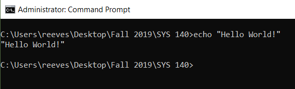
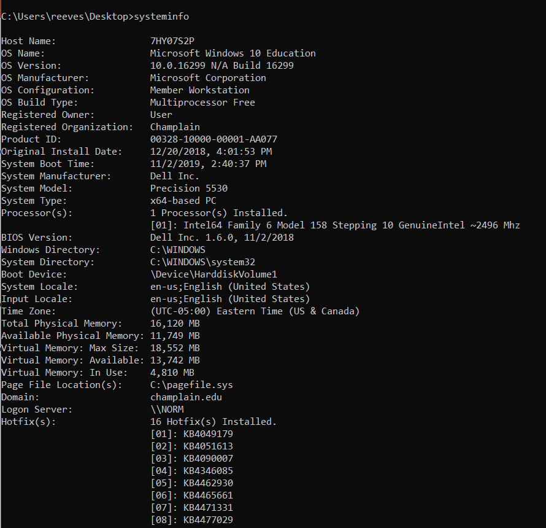
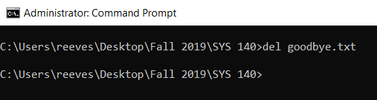
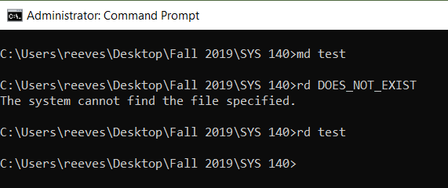
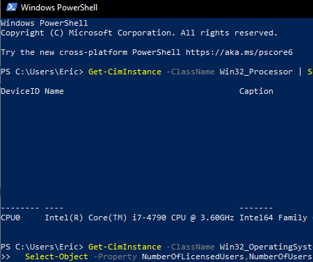
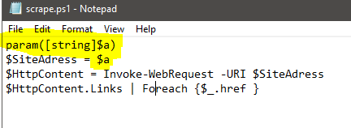

Week 10 introduces **scripting**: using the command line to automate tasks. It covers why CMD batch files are limited (and sometimes dangerous), what other scripting languages exist, and how to get started with **PowerShell**, including the Scripting Lab's web-scraping script.

*Source: the "Scripting #1" slides and Scripting Lab #1. This builds on [Week 7: Small, Specialized Command-Line Tools](Week-7-‐-System-Utilities-&-IO#small-specialized-command-line-tools).*

## Contents

1. [The Command-Line Interface (CLI)](#1-the-command-line-interface-cli)
2. [CMD and Batch Scripts](#2-cmd-and-batch-scripts)
3. [Why Not Use CMD for Everything?](#3-why-not-use-cmd-for-everything)
4. [Other Scripting Languages](#4-other-scripting-languages)
5. [Windows PowerShell](#5-windows-powershell)
6. [CMD vs. PowerShell Cheat Sheet](#6-cmd-vs-powershell-cheat-sheet)
7. [Lab: Scripting Lab #1](#7-lab-scripting-lab-1)

---

# 1. The Command-Line Interface (CLI)

A **command-line interface** is a way to interact with your computer by **typing text commands** instead of clicking.

- We've used **CMD** (Command Prompt) in this class.
- **PowerShell is different** from CMD, even though both are command lines.
- **Scripting is not the same as programming.** A script is usually a short list of commands that automates a task, while programming builds full applications. Scripting is how you combine tools with automation.

---

# 2. CMD and Batch Scripts

- CMD can be used to make **very simple scripts**.
- **`.bat` files** (batch files) are plain text files that run in CMD, one command per line.



**Example:** a one-line batch file

```bat
@echo off
echo "Hello World!"
```

CMD also has built-in tools that report on the system, like `systeminfo`:



---

# 3. Why Not Use CMD for Everything?

**CMD has limitations.**

### It handles errors poorly, or not at all

A script keeps going after something fails, which can cause bigger problems further down.

### You can easily do terrible things by accident

**`del`** deletes a file, with no confirmation and **no Recycle Bin**.



### Manipulating entire directories in one command is sketchy

| Command | Does |
|---|---|
| **`md`** | Creates a directory |
| **`rd`** | Deletes a directory... **yikes!** |



> **Watch out:** plain `rd` only removes an **empty** folder, but `rd /s /q` deletes a folder **and everything inside it** without asking. One typo in a path can wipe out the wrong folder.

### CMD is being replaced, but lingers

CMD is still in Windows for compatibility, but **Windows has many more features than CMD can reach**. That's where PowerShell comes in.

---

# 4. Other Scripting Languages

| General-purpose | Specific |
|---|---|
| **PowerShell** | **Hardware:** network hardware, industrial machinery |
| **Bash** (Linux/macOS) | **Software:** Excel (macros) |
| **Python** | **Web pages** (JavaScript) |
| **PHP** | |
| **Ruby** | |
| **Perl** | |

---

# 5. Windows PowerShell



- PowerShell is a **Microsoft scripting language** with **two parts**: a **command-line shell** and a **scripting language**.
- Commands in PowerShell are called **cmdlets** (pronounced "command-lets"). They follow a **Verb-Noun** pattern: `Get-Process`, `Set-ExecutionPolicy`, `Invoke-WebRequest`.
- It has **administrative commands that aren't in CMD**, like **security** and **networking**.
- **There are no CMD commands left that PowerShell can't do.** Many CMD commands even work in PowerShell as aliases (`dir`, `cd`, `del`).
- **PowerShell now has Mac and Linux versions** (PowerShell 7, cross-platform).

**Example:** asking Windows about the CPU (compare with [Week 3](Week-3-‐-The-CPU-&-Fast-Storage#1-the-central-processing-unit-cpu)):

```powershell
Get-CimInstance -ClassName Win32_Processor | Select-Object DeviceID, Name, Caption
```

### Key PowerShell ideas

| Concept | Example | Meaning |
|---|---|---|
| **Variable** | `$name = "Austin"` | Variables start with `$` |
| **Pipeline** | `Get-Process \| Sort-Object CPU` | `\|` passes one cmdlet's **objects** to the next. CMD only passes text. |
| **`$_`** | `ForEach-Object { $_.Name }` | "The current item" in the pipeline |
| **Comment** | `# This is a comment` | Ignored by PowerShell. It explains the code. |
| **Script file** | `scrape.ps1` | PowerShell scripts use the **`.ps1`** extension |
| **Help** | `Get-Help Get-Process` | Built-in documentation for any cmdlet |

---

# 6. CMD vs. PowerShell Cheat Sheet

| Task | CMD | PowerShell cmdlet (alias) |
|---|---|---|
| List files | `dir` | `Get-ChildItem` (`dir`, `ls`) |
| Change folder | `cd` | `Set-Location` (`cd`) |
| Make a folder | `md` | `New-Item -ItemType Directory` (`md`, `mkdir`) |
| Delete a file | `del` | `Remove-Item` (`del`, `rm`) |
| Show text | `echo` | `Write-Output` / `Write-Host` (`echo`) |
| Read a file | `type` | `Get-Content` (`cat`, `type`) |
| Running processes | `tasklist` | `Get-Process` (`ps`) |
| Network info | `ipconfig` | `Get-NetIPConfiguration` |
| System info | `systeminfo` | `Get-ComputerInfo` |
| Clear the screen | `cls` | `Clear-Host` (`cls`, `clear`) |

> **Safety tip:** many PowerShell cmdlets that change things support **`-WhatIf`**, which shows what *would* happen without doing it. For example, `Remove-Item .\test -Recurse -WhatIf`. CMD has nothing like this.

---

# 7. Lab: Scripting Lab #1

**Objective:** gain experience **using and modifying PowerShell scripts**. Even if you don't know how to write scripts, being able to make basic edits can be extremely useful.

**Submission:** only the answers, labeled with numbers.

### Setup

1. Use a **Windows virtual machine**, such as **viewportal.champlain.edu** ("New Student VDI (Win 11)") or your local VMware VM.
2. Find PowerShell from the Windows button by typing **powershell**.
3. **Right-click → Run as Administrator.**
4. Check your version:

```powershell
$PSVersionTable
```

### Allowing scripts to run

Running scripts can **expose a system to risk**. An unknown script might do "bad things," so Windows blocks scripts by default (`Restricted`). For this lab, we need to run our own scripts:

```powershell
Get-ExecutionPolicy          # shows: Restricted
Set-ExecutionPolicy Unrestricted
# Answer the prompt with A (Yes to All)
Get-ExecutionPolicy          # shows: Unrestricted
```

> **Security note:** only do this in a **lab VM**, not on your personal computer. `Unrestricted` lets *any* script run. On your own machine, the safer choices are `RemoteSigned` (your own scripts run, downloaded ones need a signature), or allowing scripts for just the current window with `Set-ExecutionPolicy -Scope Process Bypass`.

### The web-scraping script

This script downloads a web page and lists every link on it:

```powershell
$SiteAdress = "http://google.com"
$HttpContent = Invoke-WebRequest -URI $SiteAdress
$HttpContent.Links | Foreach {$_.href }
```

| Line | What it does |
|---|---|
| `$SiteAdress = "http://google.com"` | Stores the website address in a variable |
| `$HttpContent = Invoke-WebRequest -URI $SiteAdress` | Downloads the page (an HTTP request, the [Application layer](Week-9-‐-Network-Communications#7-application-layer) from Week 9) |
| `$HttpContent.Links \| Foreach {$_.href }` | Takes every link on the page and prints each one's address (`href`) |

> The variable is spelled `$SiteAdress` (one "d") in the lab. It still works, because the same spelling is used everywhere.

### Taking input with parameters



Adding a **`param`** line lets you pass the site address in when you run the script, instead of editing the file:

```powershell
param([string]$a)
$SiteAdress = $a
$HttpContent = Invoke-WebRequest -URI $SiteAdress
$HttpContent.Links | Foreach {$_.href }
```

Run it like this: `.\scrape.ps1 http://google.com`

### Asking the user for input

This example script asks for a name and prints it back. **Comments** (`#`) explain each line:

```powershell
# Ask for user's name
$name = Read-Host "What is your name?"
# Output that name
Write-Host $name
```

**Lab task:** change the web-scraping script so it **prompts the user** for the site to scrape, like this:

```
PS C:\users\eshore\desktop\test> .\scrape.ps1
What is the site address?: google.com
https://www.google.com/webhp?tab=ww
https://www.google.com/imghp?hl=en&tab=wi
http://maps.google.com/maps?hl=en&tab=wl
...
```

*(Hint: combine `Read-Host` from the name example with the scraping script.)*
