Week 11 introduces **Linux**: why it matters, how it grew out of the history of UNIX, what "Linux" actually means (kernel vs. distribution), the main kinds of software licenses, and a lab where you **build the Vim text editor from source** on Ubuntu.

*Source: the "Introduction to Linux" slides.*

## Contents

1. [Why Is Linux Important?](#1-why-is-linux-important)
2. [History: From Multics to Linux](#2-history-from-multics-to-linux)
3. [What "Linux" Actually Means](#3-what-linux-actually-means)
4. [Software Licensing](#4-software-licensing)
5. [Lab: Building Vim from Source](#5-lab-building-vim-from-source)
6. [Linux Command Cheat Sheet](#6-linux-command-cheat-sheet)

---

# 1. Why Is Linux Important?

- **All of the world's top 500 supercomputers** run Linux.
- Out of the **25 top websites** in the world, only **two** aren't powered by Linux.
- **Performance:** Linux is used in more than **90% of Hollywood visual effects**.
- **Security:** lots of people can see the code ("exposure"), so **bugs get squashed fast**.
- It's **free**, and it works on **all kinds of hardware**.

---

# 2. History: From Multics to Linux

### Timeline

| When | What happened |
|---|---|
| **1960s** | **Multics** (Multiplexed Information and Computing Service) is developed by **MIT, General Electric, and Bell Labs** (then part of the phone company). It lets many people use a mainframe at the same time. Bell Labs is **dissatisfied and withdraws**. |
| **1969–1970** | A small group at Bell Labs (including **Ken Thompson** and **Dennis Ritchie**) creates a simpler OS called **UNICS** (Uniplexed Information and Computing Service), a play on "Multics." It's first named in 1970, and "no one can remember" who came up with the final spelling, **UNIX**. |
| **Early 1970s** | UNIX first ran on DEC's **PDP-7**, a machine that would cost about **$600,000** in 2022 dollars. |
| **1970s** | Bell Labs shares UNIX's **source code** with universities and researchers. |
| **1982** | The **Department of Justice** declares the phone company **"Ma Bell"** a monopoly and **breaks it up** (completed in 1984). |
| **After the breakup** | **AT&T gets UNIX** and starts **selling it for profit**. This was good for consumers (the phone monopoly ended) but it **broke UNIX**. |
| **1980s** | Competing **proprietary** UNIX versions splinter, **incompatible** with each other: **IBM AIX**, **Sun Solaris**, **HP-UX**. |
| **1991** | College student **Linus Torvalds** can't afford UNIX (about **$5,000**, roughly **$11,000** in 2023 dollars). He writes his own **kernel** as a project: **Linux**. |
| **September 1991** | Linus releases the Linux kernel **for free**. Once the kernel is free, people start building things for it. The **GNU project** ("Free Software Movement") supplies most of the non-kernel tools. |

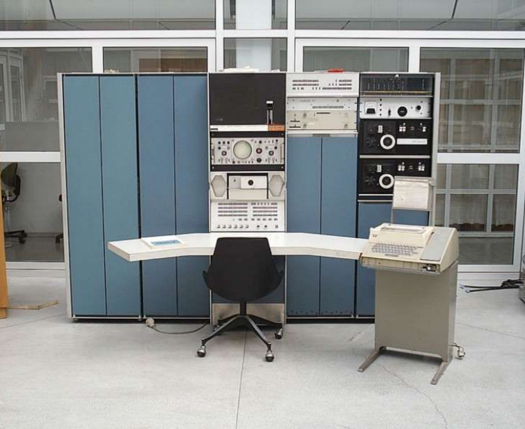

*DEC's PDP-7: UNICS originally ran only on this machine.*

> **Clarification:** The slides say UNIX was published as "open-source." Early UNIX wasn't open source in today's sense. AT&T was **legally barred from selling computer products** while it was a regulated phone monopoly, so it **licensed the source code cheaply** to universities. That's why UNIX spread so widely, and why AT&T started charging for it once the 1982 breakup removed that restriction. Also, Linux 0.01 (September 1991) was free to download, and in 1992 Linus put it under the **GPL**, the open-source license it still uses.

---

# 3. What "Linux" Actually Means

| Term | Meaning |
|---|---|
| **Linux** | Strictly speaking, just the **kernel** (the core of the OS, see [The Kernel](Week-1-‐-Introduction-&-Computer-Architecture#the-kernel) in Week 1) |
| **GNU/Linux** | A more accurate name for the **operating system**: the Linux kernel **plus GNU utilities and libraries** |
| **Distribution ("distro")** | GNU/Linux **bundled with other applications**, ready to install |

### Linux distributions

In class we've used **Ubuntu** and, more recently, **Kali**. There are **many** more:

| Family | Examples |
|---|---|
| **Debian-based** | Debian, **Ubuntu** (Kubuntu, Xubuntu), Linux Mint, **Kali** |
| **Red Hat-based** | Red Hat Enterprise Linux, Fedora, CentOS |
| **Others** | Arch Linux, openSUSE, Slackware, Gentoo, Puppy Linux |

---

# 4. Software Licensing

A **software license** defines:
- **How many times** the software can be downloaded, installed, or transferred
- **How** the software may be used
- **What** the software will cost
- **What access** users have to the **source code**

### Types of licenses

| Type | Source code available? | Can you modify and share it? | Cost | Examples |
|---|:-:|:-:|---|---|
| **Open source** | ✅ Yes | ✅ Yes. The license permits modifying and redistributing it, modified or unmodified. | Usually free | Linux, Firefox |
| **Proprietary (closed source)** | ❌ No | ❌ No. Users can't freely alter it, and licenses usually **forbid reverse engineering** to get the code. | Usually paid | iOS, Microsoft Windows, Adobe, Activision games |
| **Public domain** | Not always | ✅ Yes. No copyright, so anyone can use it. | Free | SQLite |
| **Free software** | ✅ Yes | ✅ Yes. Run it for **any purpose**, and **study, change, and distribute** it and any adapted versions. | Usually free | GNU tools, Linux kernel |

- **Public domain:** it doesn't cost money, but there's **no copyright** at all. The slides say it's "not flexible" and often comes **without source code**.
- **"Free" software is about freedom, not price.** The Free Software Foundation (FSF) puts it as *"free as in free speech, not free beer."*

> **Clarification:** The slide's public-domain example, **SQLite**, actually **does** publish its source code. Public domain software may or may not include source. What makes it public domain is that **no one holds the copyright**.

---

# 5. Lab: Building Vim from Source

This lab requires an **Ubuntu VM**. You'll download the source code of **Vim** (a text editor), change its welcome message, then compile and install your own version.

> **Network not working?** If the VM was suspended or not shut down normally, its network connection may be broken. **The easiest fix is to reboot the VM.**

### Step 1: Update Ubuntu from the terminal

```bash
sudo apt update      # refresh the list of available packages
sudo apt upgrade     # install the updates
```

`sudo` runs a command as an administrator ("superuser do"). `apt` is Ubuntu's package manager.

### Step 2: Install Git

```bash
sudo apt install git
```

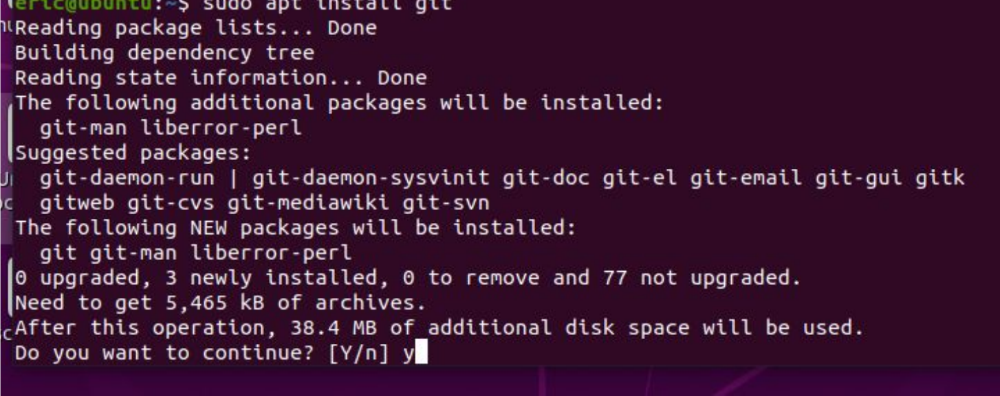

### Step 3: Copy the source files with clone

```bash
git clone https://github.com/vim/vim
```

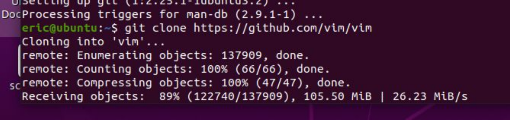

### Step 4: Change into the vim directory

```bash
cd vim
ls
```

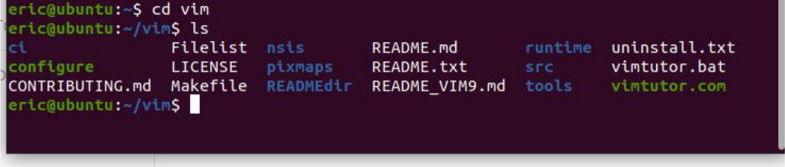

### Step 5: Edit the source

Open `src/version.c` in a text editor and find the intro message lines. Change `"VIM - Vi IMproved"` to add your own text:

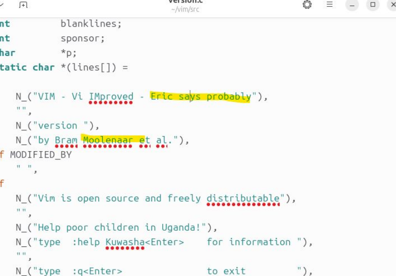

```c
N_("VIM - Vi IMproved - Eric says probably"),
```

### Step 6: Install the build tools

```bash
sudo apt install build-essential
```

`build-essential` includes the **C compiler** (`gcc`) and **`make`**, which are needed to turn source code into a program.

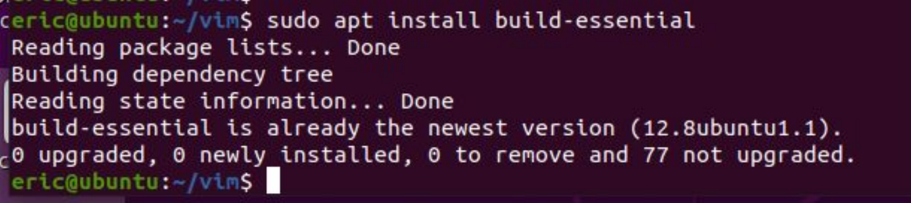

### Troubleshooting: it may not work the first time...

> **Read the output... Errors are normal... Welcome to Linux!**

Read the error messages and follow the suggested steps. Those steps may suggest, and your instructor suggests, running:

```bash
sudo apt update
sudo apt upgrade
sudo apt --fix-broken install
```

Then try installing build-essential again:

```bash
sudo apt install build-essential
```

### Step 7: Run the configure script

```bash
./configure
```

`configure` checks that your system has everything Vim needs. **It may fail**:

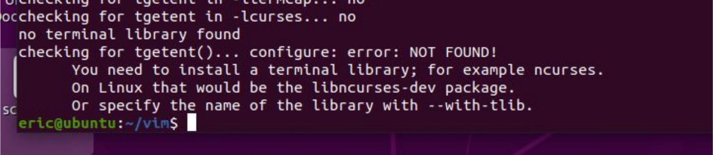

*"No terminal library found... You need to install a terminal library; for example ncurses."*

### Step 8: Install the missing piece

```bash
sudo apt-get install libncurses-dev
```

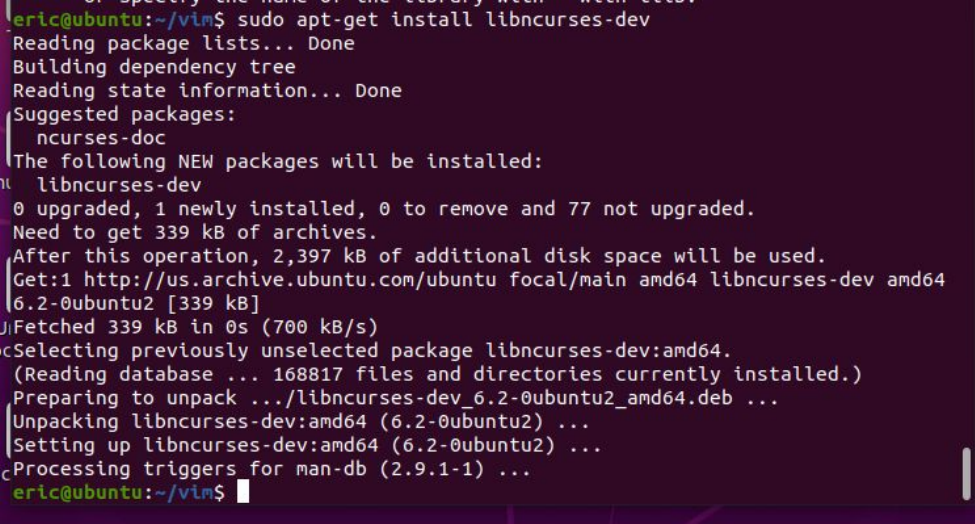

Then run `./configure` again. It should succeed this time.

### Step 9: Run make from the source directory

```bash
make
```

`make` **compiles** the source code into a program, following the instructions in the `Makefile`.

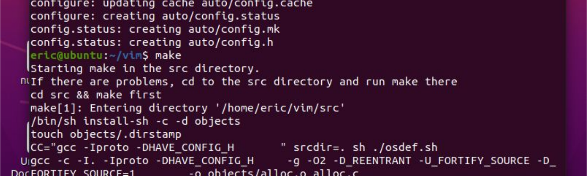

### Step 10: Install it

```bash
sudo make install
```

This copies your compiled Vim into `/usr/local/bin`.

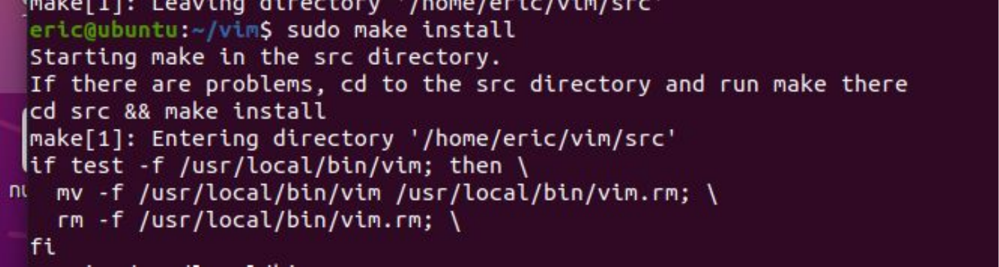

### Step 11: Run Vim

```bash
vim
```

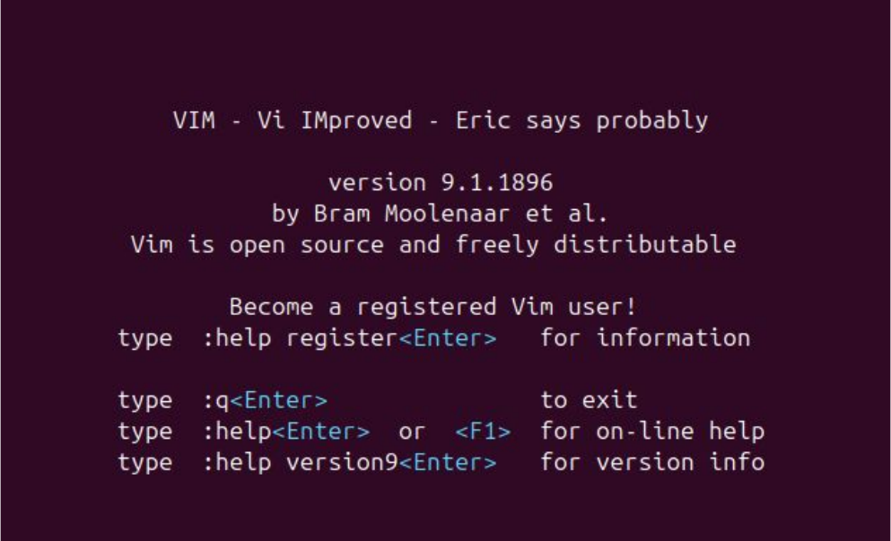

Your custom message appears on the welcome screen. To quit Vim, type **`:q`** and press **Enter**.

### The whole process at a glance

| Step | Command | Why |
|:-:|---|---|
| 1 | `sudo apt update && sudo apt upgrade` | Get the system up to date |
| 2 | `sudo apt install git` | Install Git, to download source code |
| 3 | `git clone https://github.com/vim/vim` | Download Vim's source |
| 4 | `cd vim` | Go into the source folder |
| 5 | Edit `src/version.c` | Make your change |
| 6 | `sudo apt install build-essential` | Install the compiler and build tools |
| 7 | `./configure` | Check for everything needed |
| 8 | `sudo apt-get install libncurses-dev` | Fix the missing terminal library |
| 9 | `make` | Compile |
| 10 | `sudo make install` | Install |
| 11 | `vim` | Run your version! |

This is the open-source freedom from [section 4](#4-software-licensing) in action: you **studied, changed, and rebuilt** someone else's software.

---

# 6. Linux Command Cheat Sheet

Commands used in this lab, plus a few basics (compare with [Week 10: CMD vs. PowerShell](Week-10-‐-Scripting#6-cmd-vs-powershell-cheat-sheet)):

| Linux (Bash) | What it does | Windows equivalent |
|---|---|---|
| `ls` | List files | `dir` |
| `cd folder` | Change directory | `cd` |
| `pwd` | Show the current directory | `cd` (no arguments) |
| `mkdir name` | Make a directory | `md` |
| `rm file` | Delete a file | `del` |
| `cat file` | Show a file's contents | `type` |
| `sudo command` | Run as an administrator | Run as Administrator |
| `apt install pkg` | Install software (Ubuntu/Debian) | `winget install` |
| `man command` | Show the manual for a command | `Get-Help` |
| `./script` | Run a program or script in this folder | `.\script` |
