Week 2 covers how computers represent data (binary, hexadecimal, data types, and character encoding) and four pieces of computer hardware: the pipeline, the GPU, CPU cooling, and chipsets.

*Sources: the "Introduction to Data Types and Representation" slides and my notes on The Pipeline, Graphics Processing Units, CPU Cooling, and Chipsets.*

## Contents

0. [This Week's Work](#this-weeks-work)
1. [Data Types and Representation](#1-data-types-and-representation)
   - [Why Data Representation Matters](#why-data-representation-matters)
   - [Bits, Nibbles, and Bytes](#bits-nibbles-and-bytes)
   - [Binary (Base-2)](#binary-base-2)
   - [Hexadecimal (Base-16)](#hexadecimal-base-16)
   - [Telling Number Systems Apart](#telling-number-systems-apart)
   - [Common Data Types](#common-data-types)
   - [Characters: ASCII, Unicode, and UTF-8](#characters-ascii-unicode-and-utf-8)
   - [Lab: Tools and Examples](#lab-tools-and-examples)
2. [The Pipeline](#2-the-pipeline)
3. [Graphics Processing Unit (GPU)](#3-graphics-processing-unit-gpu)
4. [CPU Cooling](#4-cpu-cooling)
5. [Chipsets](#5-chipsets)
6. [Image Credits & References](#6-image-credits--references)

---

## This Week's Work

| What | Due |
|---|---|
| **Lecture:** Data types and data representation | — |
| **Work:** Data types and conversions & journal | Next Monday |
| **Lab (Thursday):** Data types and representation | Thursday next week |
| **Homework:** Questions and definitions | Monday |
| **Reading & journal:** Computer processors | Monday |

---

# 1. Data Types and Representation

**Goals of this module:**
- Recognize the various data types and representation systems.
- Understand how conversions might be useful.
- You aren't expected to do conversions quickly. The point is to know **why** you'd need one and **how** you might do it.
- This is the most math the course gets into.

## Why Data Representation Matters

- To process data properly, a computer needs it in a format it can understand: `10101010101110101011101010101010101010101`
- The most basic component of a computer's circuitry is a **switch**.
- Computer hardware contains an exceptionally large number of very fast, interconnected switches.

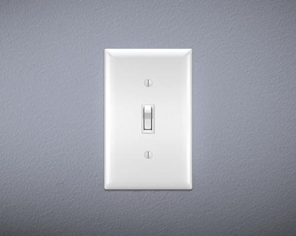

- With two states, a switch can represent two values. This is called a **bit**.
  - **On = 1**
  - **Off = 0**
- Any data we want a computer to process must be converted into something that can be represented by switches being on and off.

### Computer memory involves huge numbers

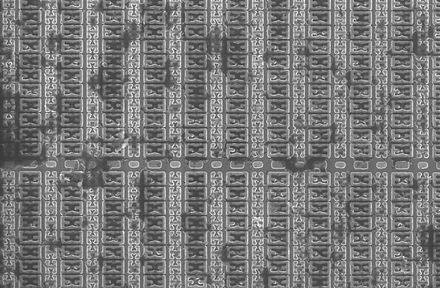 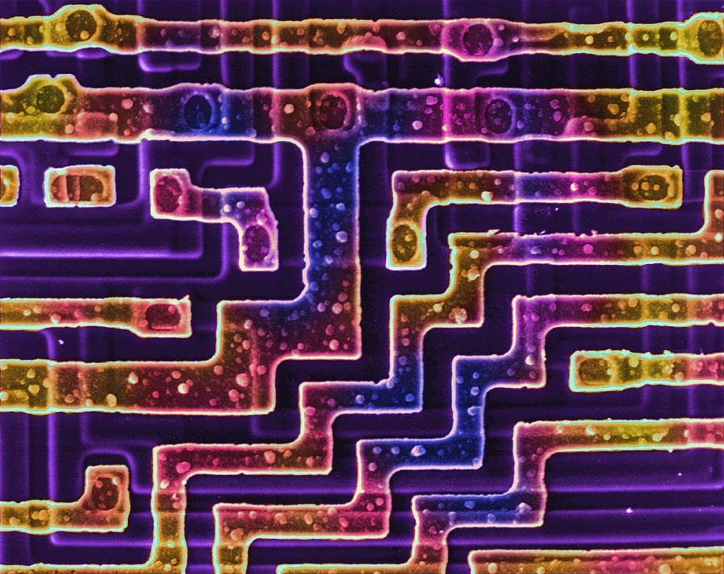

- A modern processor has **100,000,000,000 transistors or more**.
- Transistors act as switches (see [How Does a Transistor Work?](Week-1-‐-Introduction-&-Computer-Architecture#4-how-does-a-transistor-work) in Week 1).
- Memory adds even more.

## Bits, Nibbles, and Bytes

Like decimal numbers, binary numbers can have more than one digit. A **binary number** is a single- or multi-digit number in which each digit is either 0 or 1.

| Name | Binary digits | Example |
|---|---|---|
| **Bit** | 1 | `0` |
| **Nibble** | 4 | `0110` |
| **Byte** | 8 | `0110 1010` |

> **Truth:** binary is for machines. Using binary "by hand" would be absurd, but it's the simplest form data takes.

## Binary (Base-2)

### Start with base-10, which we already know

Each place in a decimal number is a power of 10: the ones place, the tens place, the hundreds place, and so on.

**45** = 4 × 101 + 5 × 100 = 40 + 5 = **45**

### Binary has places too

In binary, each place is a **power of 2**: the ones place, the twos place, the fours place, the eights place, the sixteens place, and so on.

| Power of 2 | Value | Power of 2 | Value |
|---|---|---|---|
| 20 | 1 | 26 | 64 |
| 21 | 2 | 27 | 128 |
| 22 | 4 | 28 | 256 |
| 23 | 8 | 29 | 512 |
| 24 | 16 | 210 | 1024 |
| 25 | 32 | 211 | 2048 |

> **Why does anything to the zero power equal 1?** Each step down in power divides by the base: 22 = 4, 21 = 2, so 20 = 2 ÷ 2 = 1. The same works for any base.

### Converting binary 101101 to decimal

Add up the place values wherever there's a 1:

| Place value | 32 | 16 | 8 | 4 | 2 | 1 |
|---|---|---|---|---|---|---|
| Binary digit | 1 | 0 | 1 | 1 | 0 | 1 |

1 × 32 + 0 × 16 + 1 × 8 + 1 × 4 + 0 × 2 + 1 × 1 = 32 + 8 + 4 + 1 = **45**

So binary **101101** and decimal **45** represent the same quantity.

## Hexadecimal (Base-16)

### Why we need it

- A **memory address** is special computer data that points to other data.
  - Example: there are about **68.7 billion** memory addresses in 64 GB of RAM.
  - Memory is treated as a sequence of locations starting from zero.
  - Addresses are usually stored as **unsigned integers** (no sign bit).
  - Writing memory locations gets ridiculous because the numbers are gigantic.
- We need a more compact number system to point to these locations.

### Hexadecimal digits

**Hexadecimal (base-16)** represents values more compactly than binary. It's often used for **addresses in computer memory**. Hex uses the digits **0–9** and **A–F**:

| Hex | 0 | 1 | 2 | 3 | 4 | 5 | 6 | 7 | 8 | 9 | A | B | C | D | E | F |
|---|---|---|---|---|---|---|---|---|---|---|---|---|---|---|---|---|
| **Decimal** | 0 | 1 | 2 | 3 | 4 | 5 | 6 | 7 | 8 | 9 | 10 | 11 | 12 | 13 | 14 | 15 |

Each place is a power of 16:

| Place | 6 | 5 | 4 | 3 | 2 | 1 |
|---|---|---|---|---|---|---|
| **Value** | 1,048,576 (165) | 65,536 (164) | 4,096 (163) | 256 (162) | 16 (161) | 1 (160) |

### Converting hex to decimal

**Example: 2D**
- 2 in the sixteens place: 2 × 16 = 32
- D (13) in the ones place: 13 × 1 = 13
- 32 + 13 = **45**. So hex **2D** = binary **101101** = decimal **45**.

**Example: 64**
- (6 × 16) + (4 × 1) = **100** decimal

**Example: AAA**
- A = 10, so 10 × 256 + 10 × 16 + 10 × 1 = 2560 + 160 + 10 = **2730**

> **Correction:** The lab handout's worked example gives 2721 for AAA, but 2560 + 160 + 10 = **2730**.

Hex is what you see in a **hex dump**, where each byte of a file or memory is shown as two hex digits:

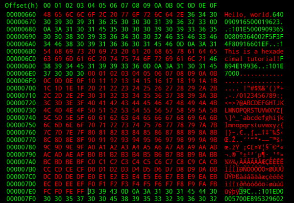

## Telling Number Systems Apart

How do we tell which number system a number is written in? For example, **110** could mean:
- 110 in decimal
- 6 (if it's binary)
- 272 (if it's hexadecimal)

Common notations:

| Notation | Meaning |
|---|---|
| `0x2D` | **Hexadecimal** (the `0x` prefix) |
| `100101` binary | Format stated explicitly |
| `100101b` or `100101B` | Binary suffix (Intel convention) |
| `bin 100101` | Binary prefix |
| `100101`2 | Subscript indicating base-2 |
| `%100101` | Binary prefix (Motorola convention) |
| `0b100101` | Binary prefix, common in programming languages |
| `6b100101` | Prefix giving the number of bits |
| `#b100101` | Binary prefix used in Lisp languages |

Yes, it's confusing.

## Common Data Types

Software uses different systems as needed. Commonly used data types:
- **Boolean** values (true/false)
- **Integer** numbers
- **Floating-point** numbers
- **Memory addresses**
- **Characters**

Not all numbers are whole numbers. Computers also need to represent fractions and "real" numbers:

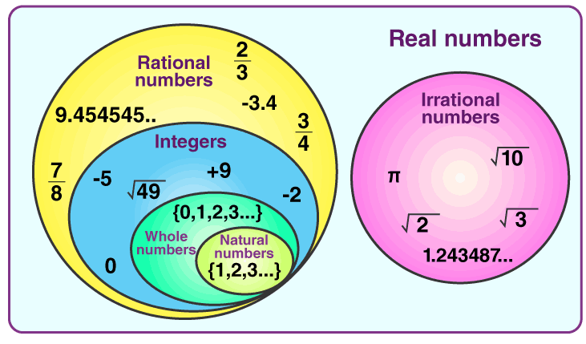

### Boolean values

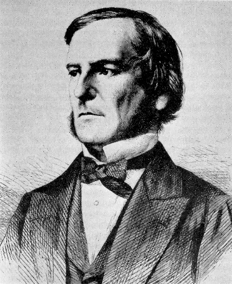

- The simplest form of data: **yes or no**, **on or off**, **true or false**. Used for comparisons.
- Named after **George Boole**, who was all about true-or-false questions.
- Computers take this approach:
  - A binary number containing **all zeros = False**
  - **Anything else = True**
  - This lets each binary digit act like an on/off switch.
- **Boolean logic:** AND, OR, NOT, NOR, XOR...
  - `If X AND Y THEN Z`
  - `If X OR Y THEN Z`

 

### Integers vs. floating-point numbers

| Integers | Floating-point numbers |
|---|---|
| Whole numbers, no fractions or decimal points | Numbers with decimal points |
| Examples: 3, -6, 0 | Examples: 2.5, 0.6, 3.14159 |
| Directly represented as a binary number (`101101` = 45) | Stored in a special format (below) |

**Why are they treated differently?**
- Decimal numbers can't accurately represent a number like ⅓. It has to round to something like 0.33.
- But 0.33 + 0.33 + 0.33 doesn't add up to 1.
- Computers use binary because that's all they have to work with, so they **cannot perfectly represent the real world**.

### Floating point

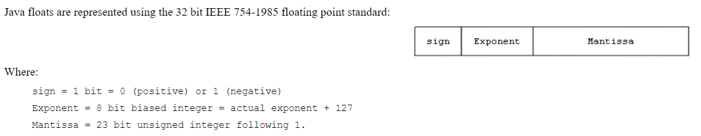

A 32-bit float (IEEE 754 standard) is split into three parts:
- **Sign:** 1 bit. 0 is positive, 1 is negative.
- **Exponent:** 8 bits, a biased integer (actual exponent + 127)
- **Mantissa (fraction):** 23 bits, the digits that follow the leading 1

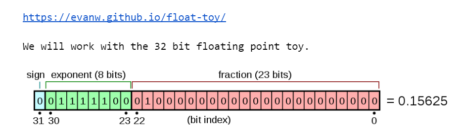

🔗 Try it: [Float Toy](https://evanw.github.io/float-toy/) lets you flip the bits of a float and watch its value change.

### Signed vs. unsigned numbers

- **Signed numbers** use one bit to show whether a number is positive or negative.
- **Unsigned numbers** can hold larger positive values, but no negative ones.
- Which one should you use? It depends on the task.

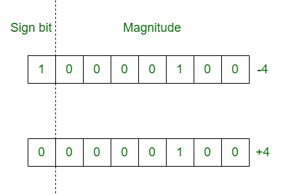

## Characters: ASCII, Unicode, and UTF-8

We've converted binary into different number systems, but people need more than numbers: `ABCDEFGHIJKLMNOPQRSTUVWXYZ<>?:"{}` and `abcdefghijklmnopqrstuvwxyz,./;'[]`

### ASCII

- **American Standard Code for Information Interchange (ASCII)**, 1963. Bob Bemer is known as the "father of ASCII."
- A **7-bit** format
- Represents letters, digits, some punctuation, and control characters
- **Is this enough?**
  - Only 95 printable characters
  - Only one language
- Reference: [ASCII table (RapidTables)](https://www.rapidtables.com/code/text/ascii-table.html)

 

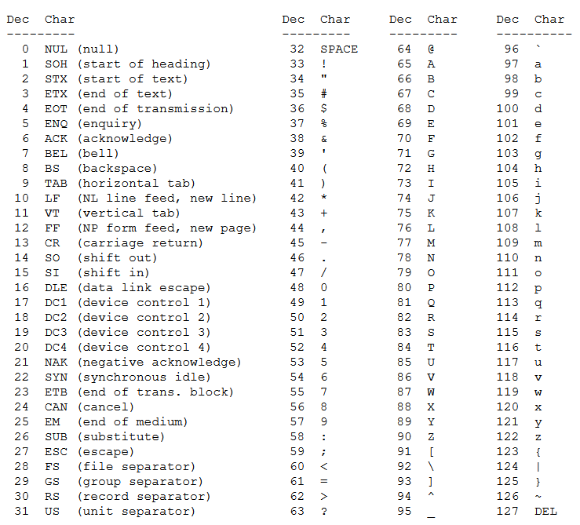

### Unicode: a better way

- **[Unicode](https://unicode.org/charts/)**, 1991
- Aims to represent **every written language**
- Covers over 100,000 characters (now about 150,000)
- Uses up to a 32-bit code

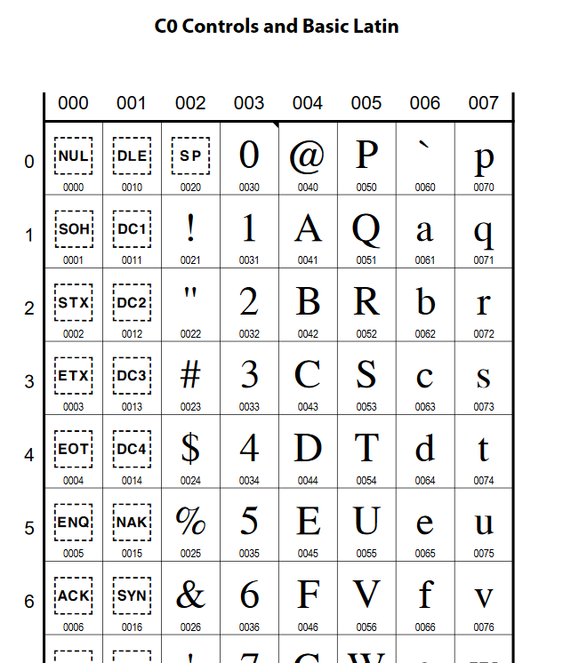

Unicode also has extras, like **emoji**:

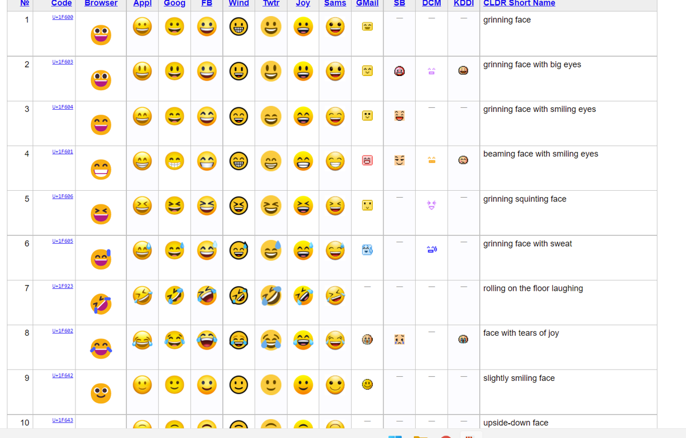

### UTF-8

- **Unicode** is the standard that assigns a unique number (a **code point**) to every character.
- **UTF-8** is a way of encoding those Unicode code points as bytes.
- UTF-8 is the standard for web pages, programming languages, databases, and operating systems.

## Lab: Tools and Examples

These tools come from the Data Types and Representation lab:

- **[Online Hex Tools](https://onlinehextools.com/):** converts between data types and representations, such as UTF-8 to hex.

  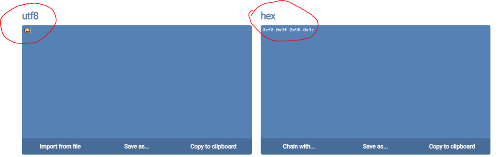

- **Windows Calculator in Programmer mode:** shows a number in HEX, DEC, OCT, and BIN at the same time.

  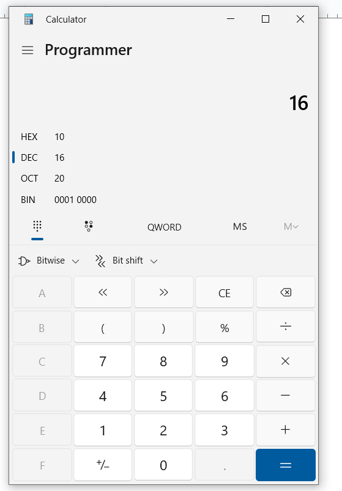

- **[Float Toy](https://evanw.github.io/float-toy/):** explores the 32-bit floating-point format.

**Practice from the lab:**
1. In binary, count up to the decimal equivalent of 10 (0, 1, 10, ...).
2. In hexadecimal, count up to the decimal equivalent of 20 (0, 1, 2, ...).
3. Convert these hex numbers to decimal, showing your work: **1000**, **ff**, **10f**, **eee**.

---

# 2. The Pipeline

A **pipeline** is a design technique that breaks a task into sequential, ordered stages so that multiple operations can be processed at the same time, like an **assembly line**. Data or tasks move through the steps in order, and the output of one step becomes the input of the next.

## Types of pipelines

**Instruction pipelines** are used inside a CPU to overlap the execution of multiple instructions. A standard **5-stage pipeline** handles:

| Stage | Name | What it does |
|---|---|---|
| **IF** | Fetch | Gets the instruction from memory |
| **ID** | Decode | Interprets the instruction |
| **EX** | Execute | Performs the math or logic |
| **MEM** | Memory | Reads or writes data |
| **WB** | Writeback | Saves the final result |

While one instruction is executing, the next one can already be decoding and the one after that can be fetching.

**Graphics pipelines** are found in GPUs. They manage rendering stages like projection, lighting, and coloring in parallel.

**Software/data pipelines** chain independent programs or data processes together, so one tool's output streams directly into the next tool's input.

## Why pipelines matter

- **Higher throughput:** processes more instructions or data in less total time
- **Better resource use:** keeps hardware busy instead of leaving it idle
- **Challenges (hazards):** a pipeline can slow down or stall if an instruction depends on the unfinished result of a previous step

---

# 3. Graphics Processing Unit (GPU)

A **graphics processing unit (GPU)** is a specialized electronic circuit designed to rapidly process and render images, videos, and 3D animations.

| CPU | GPU |
|---|---|
| Handles general tasks one after another | Uses **parallel processing** |
| A few powerful cores | **Thousands of smaller cores** that run many math operations at the same time |

## Types of GPUs

| Type | Description |
|---|---|
| **Integrated GPU** | Built directly into the motherboard or main processor. Shares system memory, uses less power, and works well for everyday tasks and light gaming. |
| **Discrete (dedicated) GPU** | A separate hardware unit on a dedicated graphics card. Has its own memory (**VRAM**) and cooling system, offering maximum power for heavy workloads. |

## Common uses

- **Gaming and VR:** renders complex 3D worlds, high frame rates, and realistic lighting in real time
- **Content creation:** speeds up video editing, 3D modeling, and rendering visual effects
- **Artificial intelligence (AI):** powers modern machine learning, large language models, and data training

---

# 4. CPU Cooling

**CPU cooling** removes waste heat from a computer's central processing unit to keep it within safe operating temperatures.

## How it works

1. **Heat transfer:** heat moves from the processor surface into a metal baseplate through **thermal paste**.
2. **Redistribution:** the heat travels away from the chip through metal **heat pipes** or circulating **liquid coolant**.
3. **Dissipation:** **fans** blow the heat out into the surrounding air through metal fins or a **radiator**.

## Main types of CPU coolers

| Type | How it works | Example |
|---|---|---|
| **Air cooler** | Metal heatsinks and fans absorb heat and blow it away | Noctua NH-D15 |
| **Liquid cooler** | A pump, water block, liquid coolant, and radiator move heat away more efficiently | ARCTIC Liquid Freezer III Pro |

## Thermal paste

**Thermal paste** is a gooey, thermally conductive compound applied between the processor and its cooler to help transfer heat away from the chip.

- **Fills gaps:** processor and cooler surfaces look smooth, but they have tiny, microscopic imperfections and rough spots.
- **Blocks air:** when the two surfaces are pressed together, those flaws trap air pockets.
- **Improves flow:** air is a terrible conductor of heat. Thermal paste replaces the trapped air with a conductive material, so heat moves smoothly and quickly from the chip to the cooler.

---

# 5. Chipsets

A **chipset** is a group of microchips on the motherboard that acts as a **traffic controller**, managing how data flows between the CPU, memory, storage, and external devices.

> Think of the **CPU as the brain** that does the thinking, and the **chipset as the highway system** that moves information between the brain and the rest of the computer.

## How a chipset works

- **Data flow control:** it directs signals so parts like the graphics card, hard drive, and USB ports can talk to the processor without crashes.
- **Northbridge and Southbridge:** older computers split these tasks into two chips.
  - The **Northbridge** handled fast parts like RAM and video cards.
  - The **Southbridge** handled slower parts like keyboards and USB ports.
  - Modern systems combine these into a single controller.
- **System limits:** the chipset decides which features your computer can use, such as how many USB ports you get, how fast your RAM can run, and whether you can overclock the processor.

---

# 6. Image Credits & References

- Slides: *Introduction to Data Types and Representation*, System Fundamentals, Eric Shore.
- [The Floating-Point Guide (UConn)](https://www.phys.uconn.edu/~rozman/Courses/P2200_15F/downloads/floating-point-guide-2015-10-15.pdf)

<b>Image credits (from the course slides)</b>

- Light switch: [Menards](https://hw.menardc.com/main/items/media/POWER001/ProductLarge/660Wwall.jpg)
- Floating-point diagram: Figure 3.5, *Systems Architecture*, Seventh Edition. ©2016 Cengage Learning.
- ASCII table: [Carnegie Mellon](https://www.cs.cmu.edu/~pattis/15-1XX/common/handouts/ascii.html)
- Unicode table piece: [unicode.org](https://unicode.org/charts/PDF/U0000.pdf)
- Other images: from the course slides and lab handout.

