Week 3 covers how a CPU actually works (clocks, transistors, and logic), the kinds of fast memory a CPU uses, and the units used to measure storage, including why your hard drive looks smaller than the size printed on the box.

*Sources: the "Central Processing Unit (CPU) and Fast Storage" slides, the "Megabytes and Mebibytes" reading, and Crucial's article on types of memory (linked under Further Reading).*

## Contents

1. [The Central Processing Unit (CPU)](#1-the-central-processing-unit-cpu)
   - [What Does a CPU Process?](#what-does-a-cpu-process)
   - [How Does a CPU Work?](#how-does-a-cpu-work)
   - [Computer Clocks and Hertz](#computer-clocks-and-hertz)
   - [Transistors: The Switches](#transistors-the-switches)
   - [Connecting Transistors Creates Logic](#connecting-transistors-creates-logic)
   - [Why Not Make the Clock Faster?](#why-not-make-the-clock-faster)
   - [Inside the CPU: Logical Design](#inside-the-cpu-logical-design)
2. [Fast Storage: Memory](#2-fast-storage-memory)
3. [Units of Measurement: Megabytes and Mebibytes](#3-units-of-measurement-megabytes-and-mebibytes)
   - [Bits, Bytes, and Words](#bits-bytes-and-words)
   - [Kilobytes to Petabytes](#kilobytes-to-petabytes)
   - [Kibibytes and Mebibytes](#kibibytes-and-mebibytes)
   - [Why Your Drive Looks Smaller Than Advertised](#why-your-drive-looks-smaller-than-advertised)
4. [Lab: How CPUs Work](#4-lab-how-cpus-work)
5. [Further Reading & Credits](#5-further-reading--credits)

---

# 1. The Central Processing Unit (CPU)

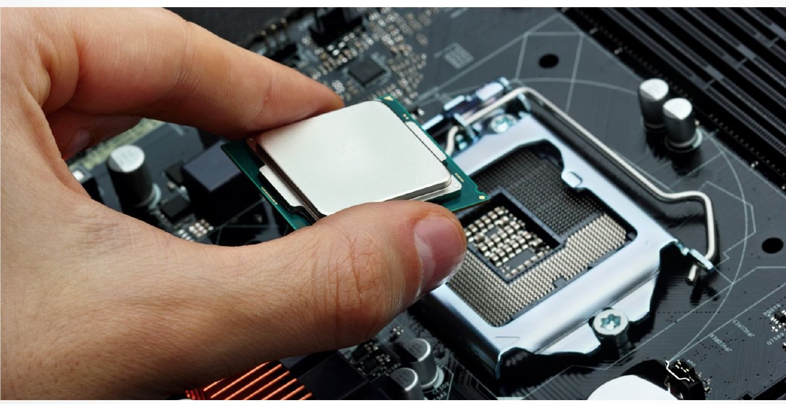

## What Does a CPU Process?

A CPU processes **instructions** and **data**. Instructions tell it to:

- **Store** data
- **Move** data
- **Compare** data: `<` `>` `AND` `OR` `NOT` `NOR`
- **Perform arithmetic:** `+` `-` `/` `*`
- Do other basic operations on data, depending on the processor

## How Does a CPU Work?

- The CPU operates with **very small pulses of electricity**.
- These pulses make the CPU's components execute commands and change values.
- The pulses are generated by **the clock**.

## Computer Clocks and Hertz

### What is a computer clock?

- Not an alarm clock. Each **pulse of electricity** makes the processor perform an operation.
- The **clock** generates these pulses.
- Clocks originally used a **quartz crystal** to create regular electrical pulses. Other methods are now used too.

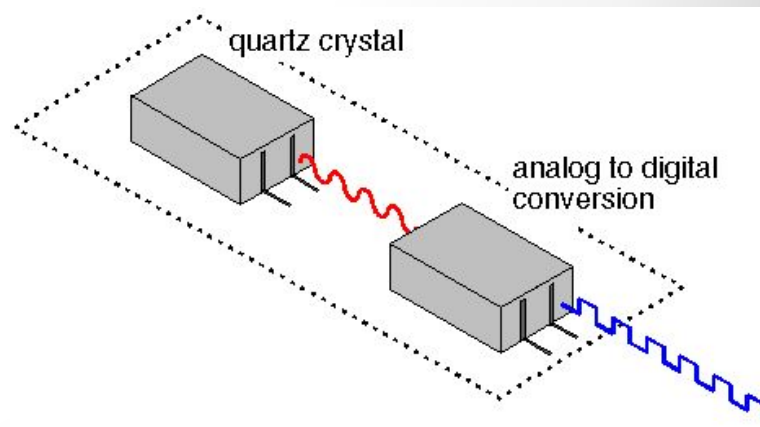

### Hertz: the clock's tick speed

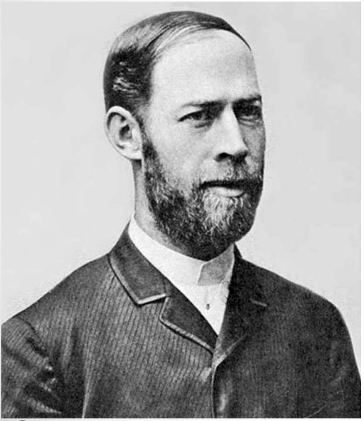

- Clock pulses are measured in **Hertz (Hz)**, named after the German physicist **Heinrich Hertz**.
- **1 Hertz = 1 cycle per second.**

 

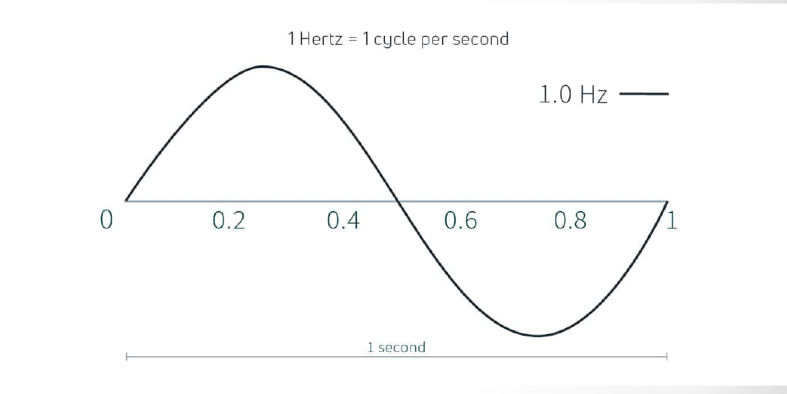

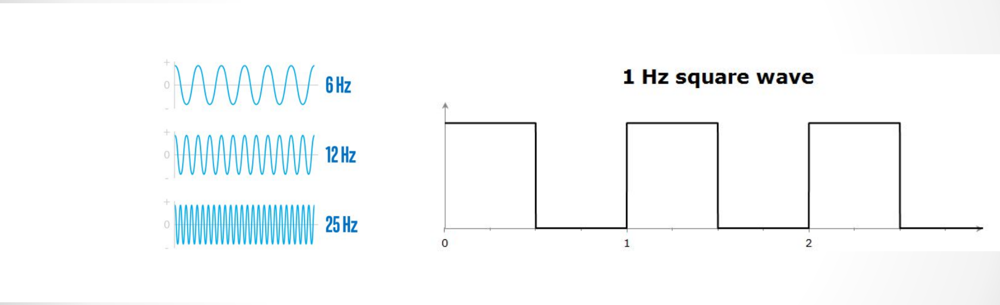

| Unit | Cycles per second |
|---|---|
| **Hertz (Hz)** | 1 |
| **Megahertz (MHz)** | 1 million |
| **Gigahertz (GHz)** | 1 billion |

- A **1 GHz** computer completes **a billion clock cycles per second**.
- Why so many? Each cycle doesn't do much on its own.

### Clock cycles: things happen

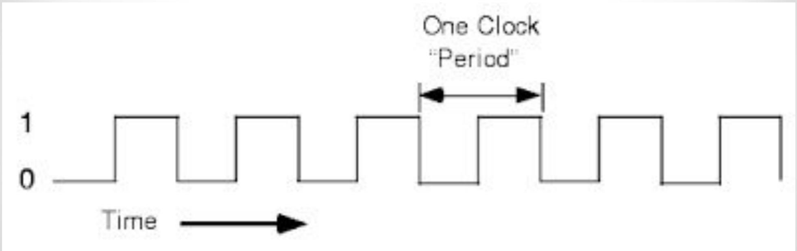

The clock signal switches between 1 and 0 over and over. One full up-and-down is one **clock period**. For a CPU, **the clock flips the switches**, and things happen on each tick.

## Transistors: The Switches

The clock's pulses flip switches called **transistors** on and off.

| Bipolar junction transistor (BJT) | MOSFET |
|---|---|
| 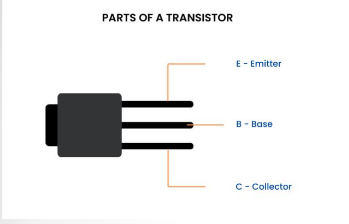 | 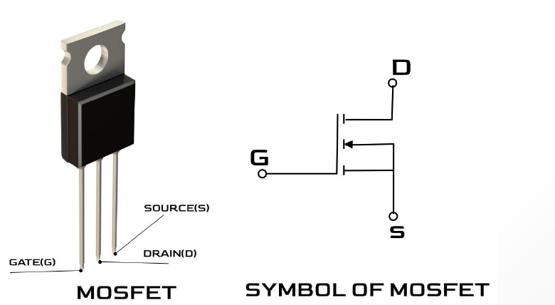 |
| The **base** controls the flow. | The **gate** controls the flow. |
| Current flows between the **collector** and the **emitter**. | Current flows between the **source** and the **drain**. |

- **MOSFET** stands for **Metal-Oxide-Semiconductor Field-Effect Transistor**. Modern CPUs are built from billions of them.
- For more on how a transistor works, see [How Does a Transistor Work?](Week-1-‐-Introduction-&-Computer-Architecture#4-how-does-a-transistor-work) in Week 1.

> **Correction:** The slide says "Emitter and source are the flow" for the BJT. In a BJT the current flows between the **emitter and the collector**. "Source" (and "drain") are MOSFET terms.

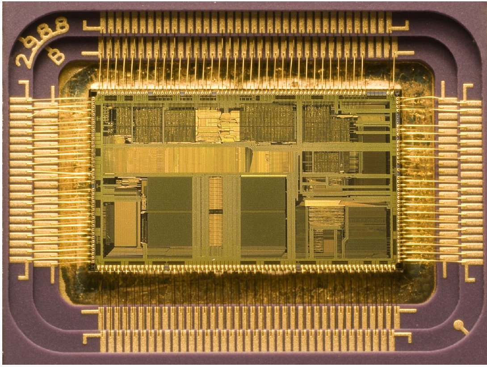 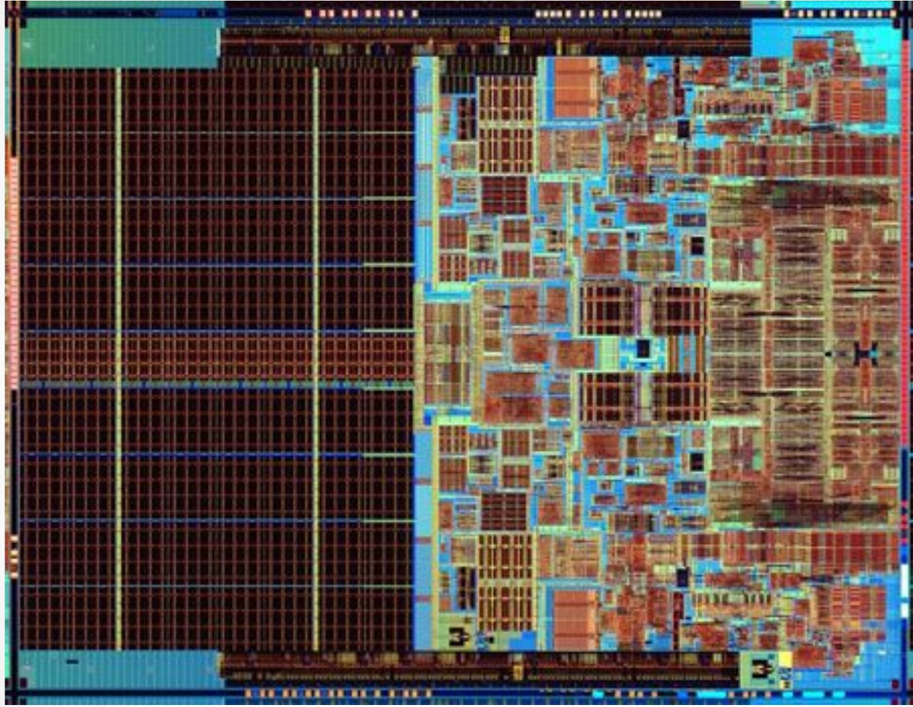

*Inside a CPU there are **many** transistors.*

## Connecting Transistors Creates Logic

Wiring transistors together creates **logic gates** (AND, OR, NOT). Now imagine billions of these in a network.

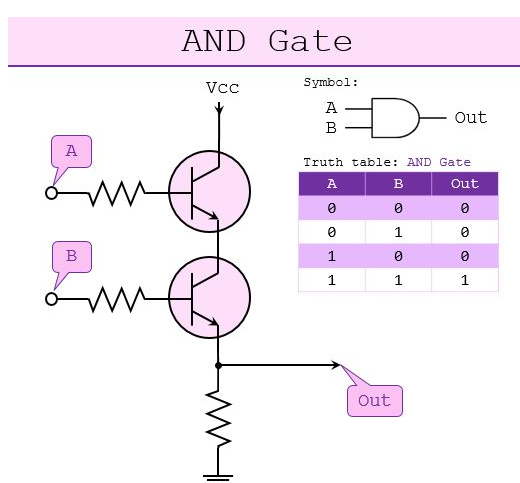 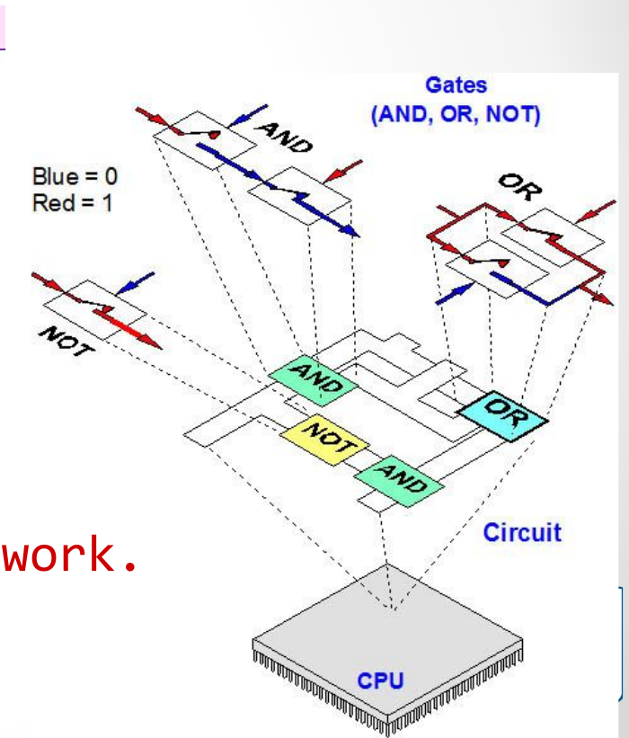

### The light switch analogy

Imagine two switch panels, one upstairs and one downstairs, both controlling the same light.

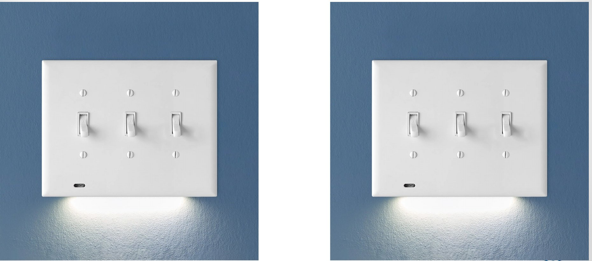

Different ways of wiring the switches give different kinds of logic. **This is how computers make decisions.**

| Wiring rule | Logic gate |
|---|---|
| Light is on if **either** switch is on | **OR** |
| Light is on only if **both** switches are on (off if either is off) | **AND** |
| Flipping **either** switch changes the light to the opposite of its current state | **XOR** (how real two-way stair switches work) |

## Why Not Make the Clock Faster?

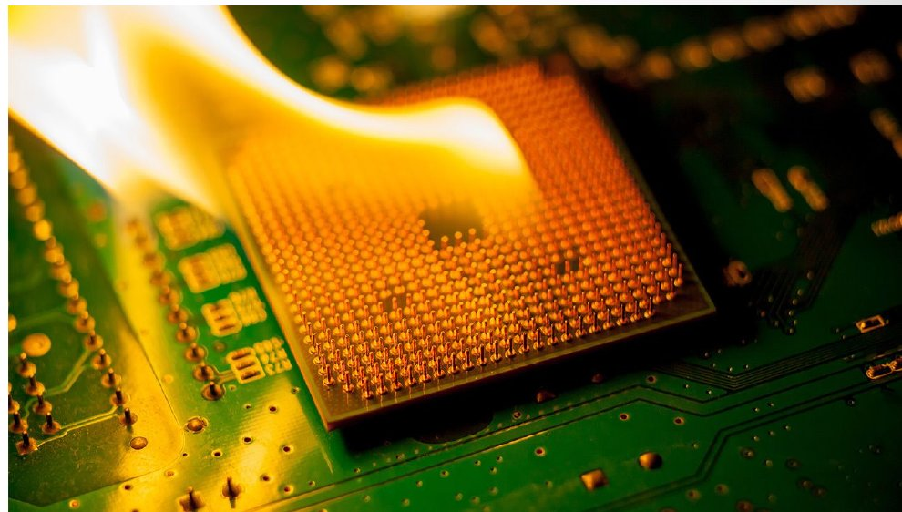

- It's now easy to make clock pulses far faster than current CPUs run. A **petahertz** (a million billion cycles per second) oscillator exists.
- **The limitation is heat, not the clock.** Every switch flip produces heat.
- **CPU cooling helps** (see [CPU Cooling](Week-2-‐-Data-Representation-&-Computer-Hardware#4-cpu-cooling) in Week 2).

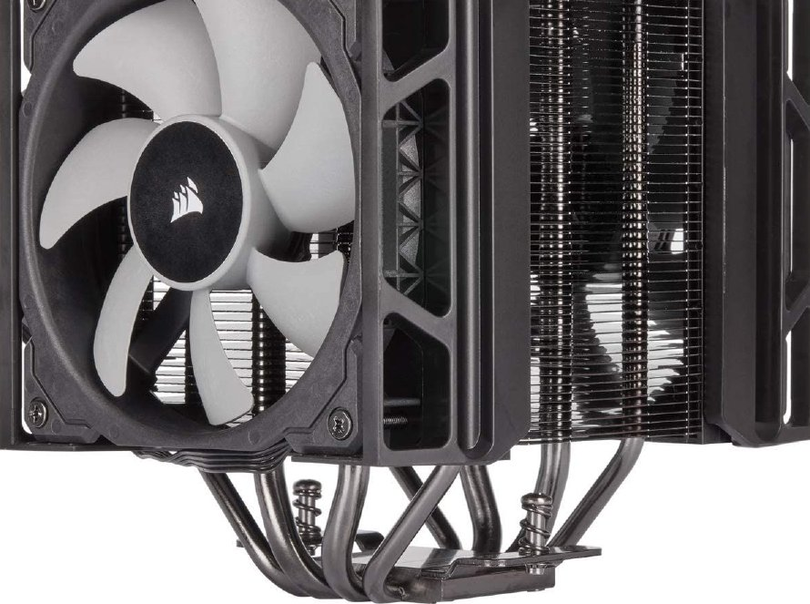

## Inside the CPU: Logical Design

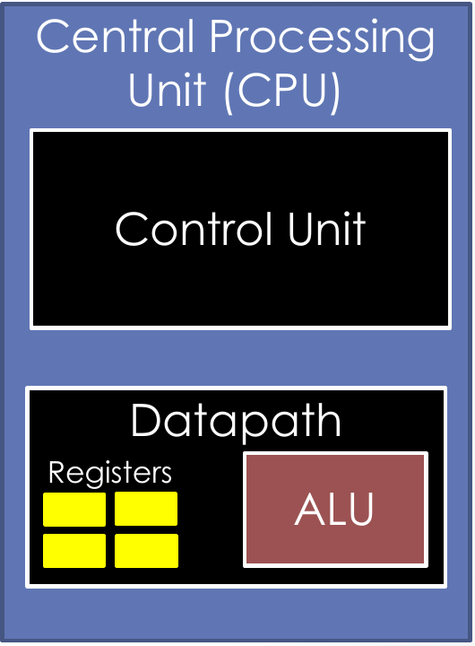

The **CPU** is the hardware component that runs programs. It includes:

- **Control unit**
  - Retrieves and decodes program instructions
  - Coordinates computer operations
- **Datapath**
  - **Arithmetic Logic Unit (ALU):** carries out commands
    - Arithmetic operations: `+`, `-`, etc.
    - Logical operations: `<`, `=`, etc.
  - **Registers:** the scratchpad. Memory slots in the processor that store data for fast lookup.

 

### Clock cycles step through the CPU task cycle

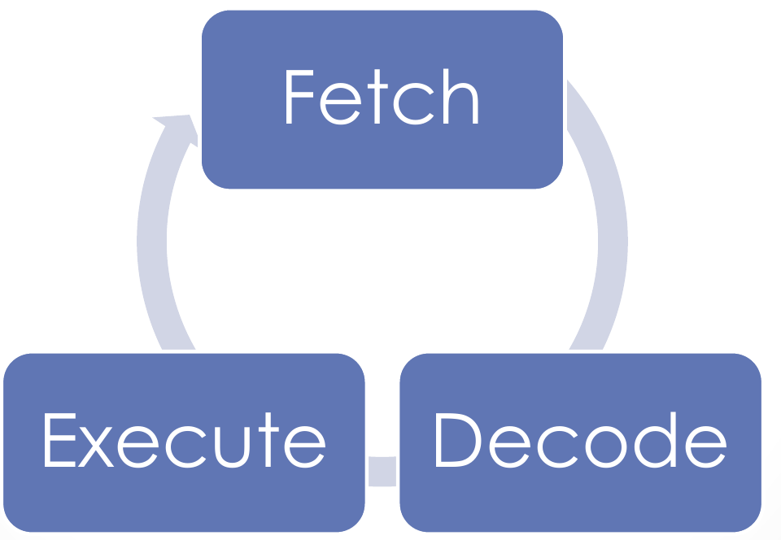

**Fetch → Decode → Execute**, then repeat. Each step takes clock cycles.

---

# 2. Fast Storage: Memory

**Memory is switches set in positions.**

- Memory keeps transistors in their state (on or off) to store data.
- There are different types of memory for different purposes.
- Different types of memory have different physical properties, which change how they behave.

| Kind of memory | Where it is | What it does |
|---|---|---|
| **Registers** | Inside the CPU | High-speed storage that temporarily holds data while instructions are decoded and executed. General-purpose vs. special registers (e.g., the **Program Counter**, instructions). |
| **Cache: L1** | Part of the processor | Stores frequently accessed data |
| **Cache: L2** | Near (but not on) the processor | Larger and slower than L1 |
| **Cache: L3** | Farther away than L2, on the motherboard or in the CPU housing | Larger and slower than L2 |
| **Main memory (RAM)** | On the motherboard | Holds both program instructions and data. **Volatile:** erased when the program ends or the computer turns off. Called **Random Access Memory** because the CPU can access any memory location. |
| **Disk storage** | Inside the hard drive | Nonvolatile, much slower |

The diagrams for these (the memory hierarchy, the x86 register layout, and the Pentium II cache) are in [Week 1: Memory Hierarchy](Week-1-‐-Introduction-&-Computer-Architecture#memory-hierarchy).

---

# 3. Units of Measurement: Megabytes and Mebibytes

## Bits, Bytes, and Words

- **1 byte = 8 bits** (see [Bits, Nibbles, and Bytes](Week-2-‐-Data-Representation-&-Computer-Hardware#bits-nibbles-and-bytes) in Week 2).
- A CPU is designed to operate on a set number of bits at a time. A **word** is the chunk of bits the processor is designed to work on.
  - Early personal computers were **8-bit**. The **Intel 8080** (1974) worked on 8 bits at a time.
  - Modern processors are typically **32-bit or 64-bit**.
  - So a word is usually **32 or 64 bits**, but it depends on the specific machine's architecture.

> **Clarification:** The reading mentions the 8088 but links to the **8080**. The 8080 (1974) was a true 8-bit CPU. The **8088** (1979, used in the original IBM PC) worked on 16 bits internally but used an 8-bit external bus.

## Kilobytes to Petabytes

Computers work in **base 2**, so on most hardware each step up is **1,024**, not 1,000:

| Unit | Approximately | Usually means | Bytes |
|---|---|---|---|
| **Kilobyte (KB)** | 1,000 bytes | 1,024 bytes | 1,024 |
| **Megabyte (MB)** | 1,000 KB | 1,024 KB | 1,048,576 (1,024 × 1,024) |
| **Gigabyte (GB)** | 1,000 MB | 1,024 MB | 1,073,741,824 |
| **Terabyte (TB)** | 1,000 GB | 1,024 GB | 1,099,511,627,776 |
| **Petabyte (PB)** | 1,000 TB | 1,024 TB | 1,125,899,906,842,624 |

## Kibibytes and Mebibytes

Why "approximately"? Outside computer science, **kilo** always means **1,000**, not 1,024. To fix the confusion, standards bodies created new, precise names that **always** mean the base-2 value:

| Decimal name (base 10) | Binary name (base 2) | Binary size |
|---|---|---|
| kilobyte (kB) = 1,000 bytes | **kibibyte (KiB)** | 1,024 bytes |
| megabyte (MB) = 1,000,000 bytes | **mebibyte (MiB)** | 1,024 KiB |
| gigabyte (GB) = 1,000,000,000 bytes | **gibibyte (GiB)** | 1,024 MiB |
| terabyte (TB) = 1,000,000,000,000 bytes | **tebibyte (TiB)** | 1,024 GiB |
| petabyte (PB) | **pebibyte (PiB)** | 1,024 TiB |

- A kibibyte is **guaranteed** to be 1,024 bytes.
- Unfortunately, these terms are rarely used in practice.

> **Clarification:** The reading says the IEEE proposed these names in 2000. They were introduced by the **IEC** (International Electrotechnical Commission) in 1998, and the IEEE adopted them in 2002. Also, the kibibyte is written **KiB** with a capital K.

## Why Your Drive Looks Smaller Than Advertised

- Many manufacturers sell storage using **1 GB = 1,000,000,000 bytes**, because it's more intuitive for buyers.
- Windows measures in base 2 (1 GB = 1,073,741,824 bytes) but still labels it "GB."
- So the same drive shows a smaller number in the operating system than on the box.

**Example: a "1 TB" drive**
- Sold as 1,000,000,000,000 bytes
- 1,000,000,000,000 ÷ 1,099,511,627,776 ≈ **0.91 TiB**, or about **931 GiB**
- Windows shows it as about **931 GB**. Nothing is missing; it's just a different unit.

---

# 4. Lab: How CPUs Work

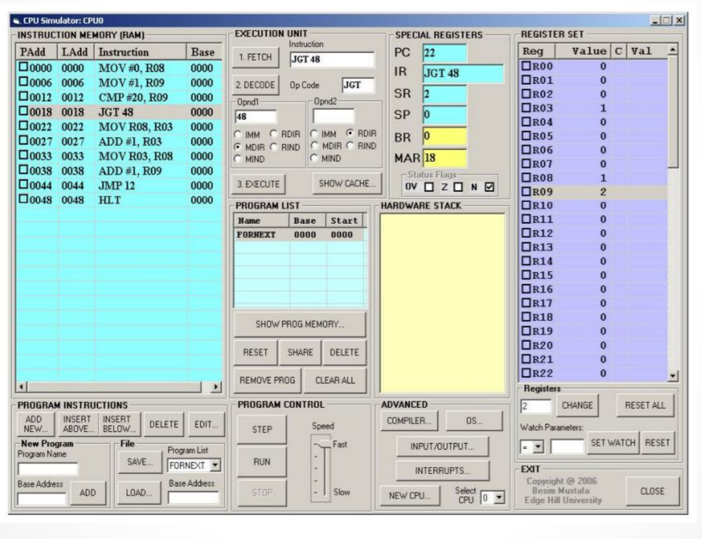

The lab uses a **CPU simulator** to step through machine code instructions one at a time and watch the registers change. Potentially **billions** of machine code instructions run just while Windows boots.

---

# 5. Further Reading & Credits

- [Crucial: Different Types of Memory Explained](https://www.crucial.com/articles/about-memory/different-types-of-memory-explained)
- Slides: *The Central Processing Unit (CPU) and Fast Storage*, SYS-140.
- Images are from the course slides.
