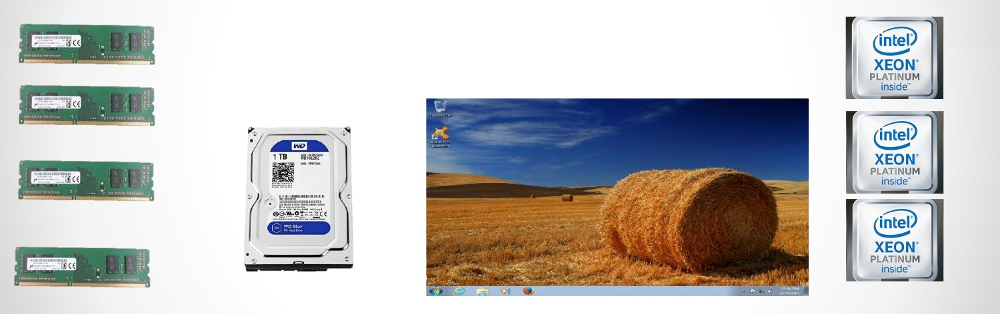
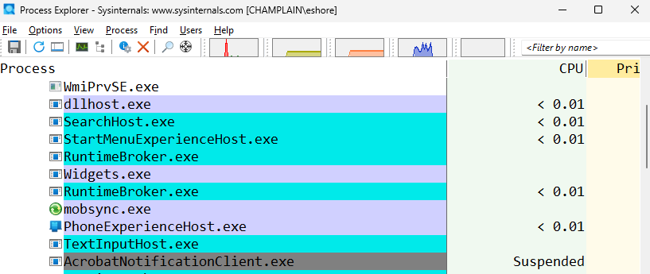

Week 4 covers processes: what a process is, how the operating system manages them, how the CPU carries them out, and how the OS decides which process runs next.

*Source: the SYS-140 "Processes" slides.*

## Contents

1. [What Is a Process?](#1-what-is-a-process)
2. [Process Management](#2-process-management)
   - [What the OS Must Do](#what-the-os-must-do)
   - [Process States](#process-states)
   - [The Process Control Block (PCB)](#the-process-control-block-pcb)
3. [Process Implementation](#3-process-implementation)
4. [Process Scheduling](#4-process-scheduling)
5. [Seeing Processes on Your Computer](#5-seeing-processes-on-your-computer)

---

# 1. What Is a Process?

- A **process** is a **program instance** handled by the CPU. When you open a program (a browser, a game, PowerPoint), the OS creates a process for it.
- **Processors handle processes.**
- For a process to run, it **needs**:
  - **Time** from the processor
  - **Memory** space
- It **might need**:
  - **I/O devices**
  - **Files**

> **Program vs. process:** A *program* is the file sitting on disk. A *process* is that program loaded into memory and running. Opening the same program twice creates two processes.

---

# 2. Process Management

Many processes share the same RAM, storage, screen, and CPUs. **How are these resources handed out?**

## What the OS Must Do

To properly manage processes, the OS must handle:

- Process **creation and termination**
- Providing the necessary **resources**
- Controlling process **progress**
- Process **scheduling**
- Process **switching**
- **Interrupt and exception** handling
- **Inter-process communication** (processes talking to each other)
- And more!

## Process States

To do this, the OS places each process into one of **5 states**:

| State | Meaning |
|---|---|
| **Executing** | Has control of a CPU and is running |
| **Waiting** | Ready to run, but needs to wait for a CPU (waiting on the CPU to finish something) |
| **Blocked** | Waiting on **I/O** (e.g., a disk read or keyboard input) |
| **Suspended** | Could run, but the OS chooses not to run it (usually waiting for another process) |
| **Ready** | Can run, but hasn't been given CPU time yet (waiting for the OS) |

> **Textbook comparison:** Many textbooks (including *Operating System Concepts*, the Week 1 reference) use a slightly different 5-state model: **New → Ready → Running → Waiting → Terminated**. In that model, "Waiting" means waiting for I/O, which is what these slides call **Blocked**. Same ideas, different names.

To keep track of all this, the OS maintains a **process table**, which holds a **Process Control Block (PCB)** for each process.

## The Process Control Block (PCB)

The **PCB** holds the details for each process:

- **Process state**
- **Process ID** (PID)
- **Program counter:** the address of the next instruction to run
- **CPU register values:** saved so the process can pick up where it left off
- **Memory management information**
- **I/O status information**
- **List of open files**
- **Processor scheduling information:** such as its priority

### Example PCB entry

| Field | Value |
|---|---|
| Process ID | `43` |
| Process State | Waiting |
| Program Counter | `0xc124e96b` |
| CPU Register Values | `eax = 0x3` `ebx = 0100 1101` |
| Memory Management Info | Page table at `0x89ab36f1` |
| I/O Status Info | 1 keyboard request |
| List of Open Files | `File1.html` |
| Processor Scheduling Information | Low-priority queue |

Notice the hex (`0x...`) and binary values from [Week 2](Week-2-‐-Data-Representation-&-Computer-Hardware#hexadecimal-base-16): memory addresses are written in hex.

---

# 3. Process Implementation

**Process implementation** is how the CPU hardware physically executes and manages a program's instructions, through the **instruction cycle**.

| Phase | What happens |
|---|---|
| **1. Fetch** | The CPU gets the next instruction from **memory (RAM)**, using the address stored in the **program counter** register. |
| **2. Decode** | The **control unit** breaks down the instruction to figure out what operation to perform. |
| **3. Execute** | The **ALU** (or another internal component) does the math, logic comparison, or data movement. |
| **4. Writeback** | The CPU saves the result back into a **register** or **memory** location. |

This is the same fetch-decode-execute cycle from [Week 1](Week-1-‐-Introduction-&-Computer-Architecture#the-von-neumann-fetch-decode-execute-cycle) and [Week 3](Week-3-‐-The-CPU-&-Fast-Storage#inside-the-cpu-logical-design), with the writeback step added. The [pipeline](Week-2-‐-Data-Representation-&-Computer-Hardware#2-the-pipeline) from Week 2 overlaps these phases so several instructions are in progress at once.

---

# 4. Process Scheduling

**Scheduling** is the OS's set of policies and mechanisms that decide **the order in which tasks are performed**.

**Goals of scheduling:**
- **Increased CPU usage:** less wasted time
- **Higher throughput:** more work done over time

By **sharing the processor**, we can get more done in less time.

### Objectives of process scheduling

- **Maximize throughput**
- **Minimize overhead**
- **Balance resource use**, while striking a balance between utilization and **response time**
- **Enforce priorities**
- **Avoid indefinite postponement** (no process should wait forever, also called *starvation*)
- **Give preference to processes holding key resources**
- **Degrade gracefully** under stress
- **Be predictable**

---

# 5. Seeing Processes on Your Computer

This is **Process Explorer** from Microsoft Sysinternals. It lists every running process, how much CPU each is using, and its state. Notice `AcrobatNotificationClient.exe` at the bottom is **Suspended**.

You can see the same kind of information in Windows **Task Manager** (Ctrl + Shift + Esc → *Details* tab), which shows each process's PID and status.

---

*Slides: Processes, System Fundamentals (SYS-140), with thanks to Eric Shore, Fall 2026.*
