Week 5 covers secondary storage: why we need it, how hard drives and SSDs work, how disks are organized into partitions and volumes, how a disk boots from the Master Boot Record, how RAID combines drives, and where storage fits when you build a PC.

*Sources: the "Files & Secondary Storage" slides, the "Secondary Storage: Disks, Volumes and Partitions" slides, the "Hard Drive and Disk Organization" reading, and Intel's "How to Build a Gaming PC" guide.*

## Contents

1. [Why Secondary Storage?](#1-why-secondary-storage)
2. [Types and Interfaces](#2-types-and-interfaces)
3. [How a Hard Drive Works](#3-how-a-hard-drive-works)
   - [Disk Terminology](#disk-terminology)
   - [Reading and Writing](#reading-and-writing)
   - [Disk Performance](#disk-performance)
   - [Sectors, Blocks, and Clusters](#sectors-blocks-and-clusters)
4. [Solid-State Drives (SSDs)](#4-solid-state-drives-ssds)
5. [Disks, Partitions, and Volumes](#5-disks-partitions-and-volumes)
6. [The Master Boot Record and Partition Table](#6-the-master-boot-record-and-partition-table)
7. [RAID](#7-raid)
8. [Building a PC: Where Storage Fits](#8-building-a-pc-where-storage-fits)
9. [Sources & Credits](#9-sources--credits)

---

# 1. Why Secondary Storage?

**Lots of data is stored locally**: the operating system, applications like Adobe's creative suite, and games.

| Windows keeps getting bigger | So do games |
|---|---|
| 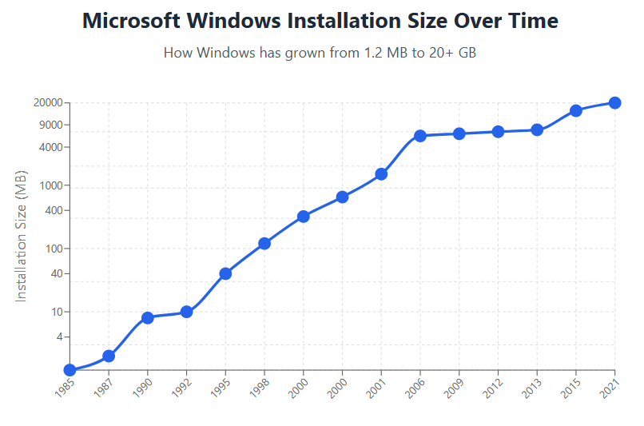 | 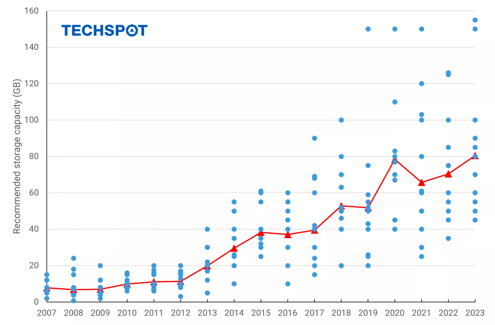 |

One example from the slides: the flight simulator **DCS World** can take up about **500 GB**.

Why not just stream everything from the internet? Local storage is usually much faster and has much lower latency:

| Speed comparison | Latency comparison |
|---|---|
| 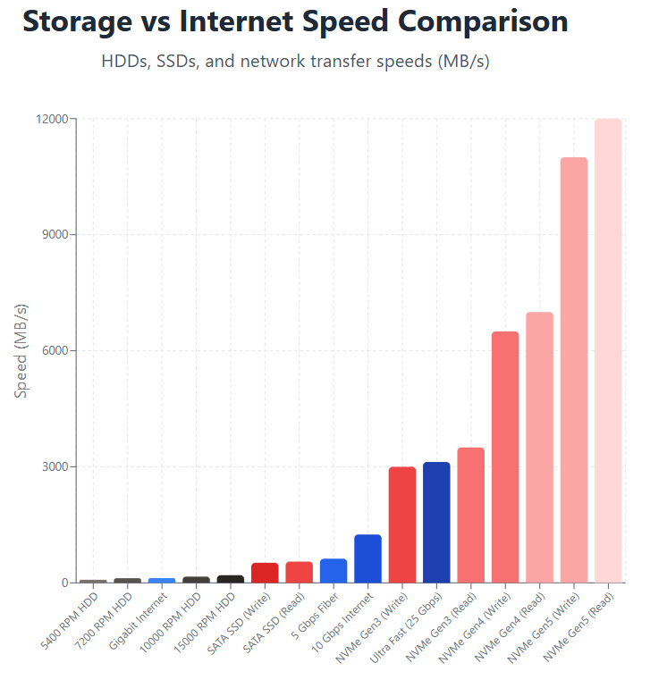 | 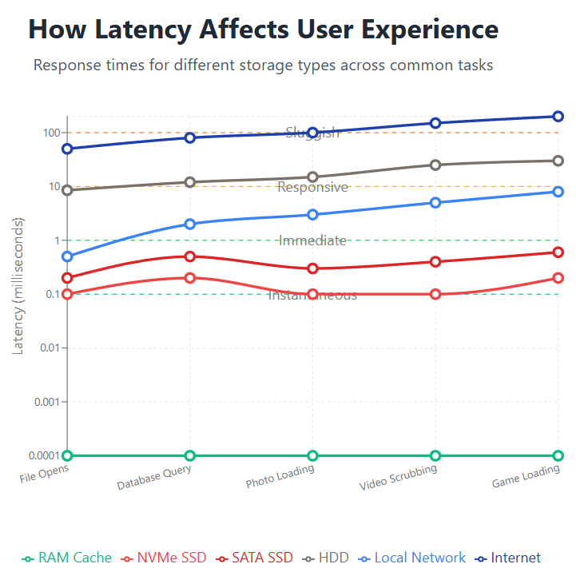 |

---

# 2. Types and Interfaces

**Secondary storage** is:
- **Long-term** storage
- **Nonvolatile:** it keeps data when the power is off (unlike RAM)

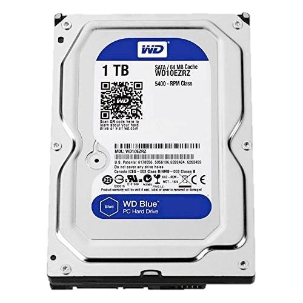 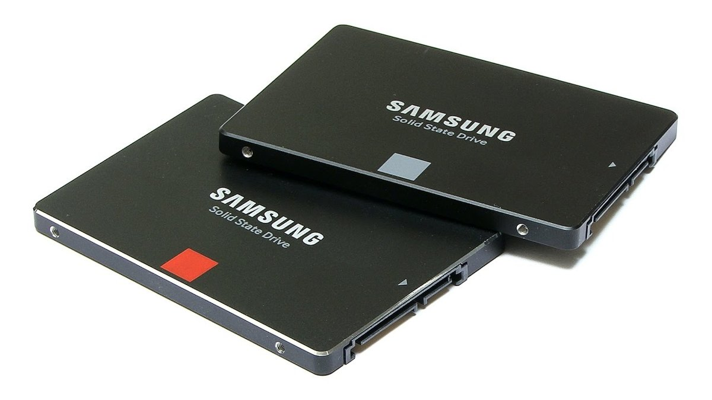 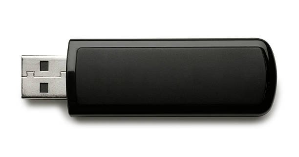 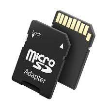

*Hard drive · SSD · USB flash drive · microSD card*

### Hard drive interfaces

| Interface | Status | Notes |
|---|---|---|
| **IDE (PATA)** | Basically gone | Wide ribbon cable |
| **SATA** | Popular | Thin cable, used by most 2.5" and 3.5" drives |
| **M.2** | New | A small card that plugs directly into the motherboard, no cables. Fast **NVMe** M.2 drives use the PCIe bus. |
| **SCSI (and SAS)** | Servers | Used in enterprise and server storage |

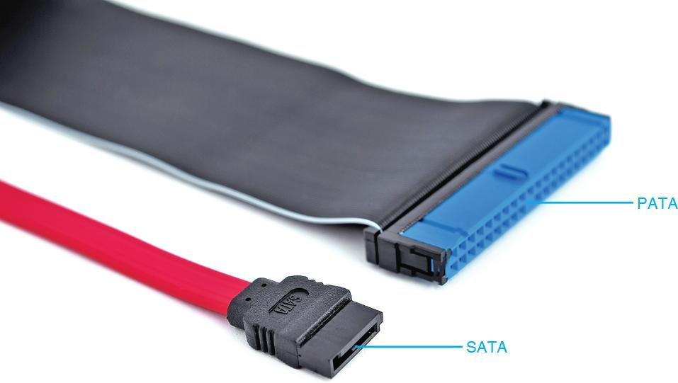 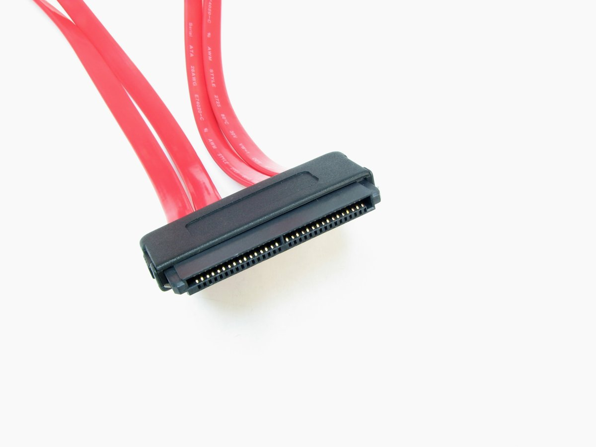 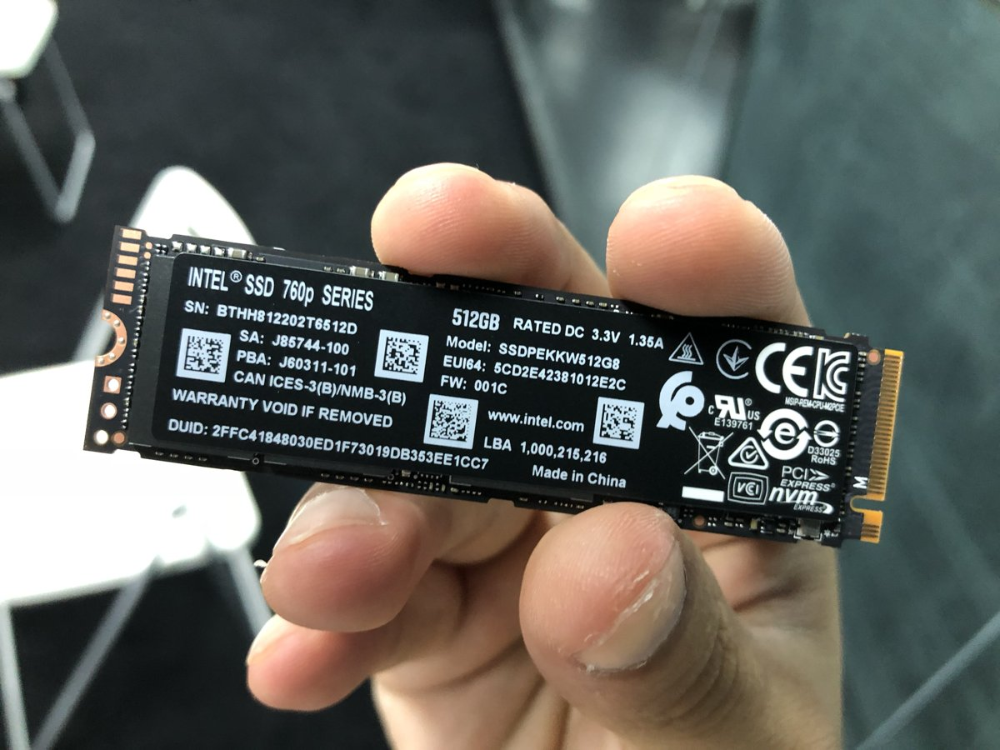

---

# 3. How a Hard Drive Works

A hard disk is a **sealed unit** containing a stack of spinning **platters**, with lots of moving parts. Electromagnetic **read/write heads** sit above and below each platter on arms, moving in toward the center and out toward the edge to reach the whole surface.

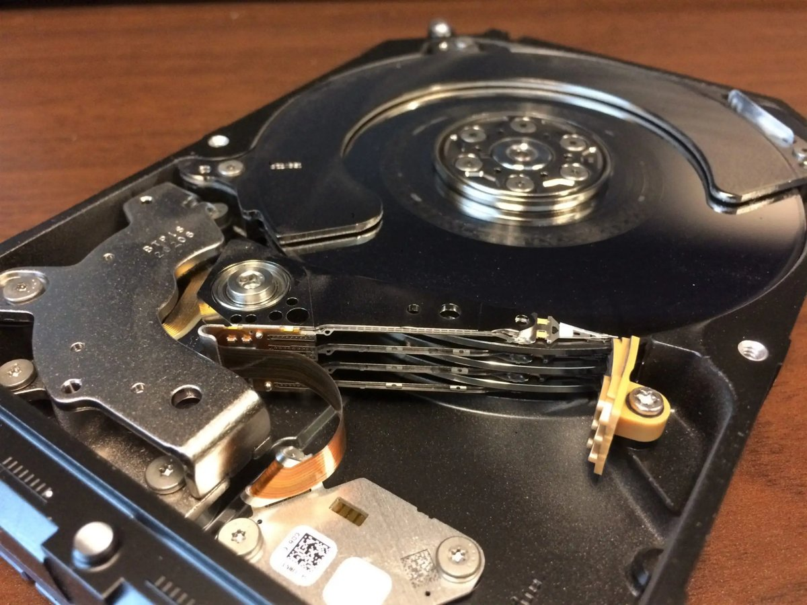

## Disk Terminology

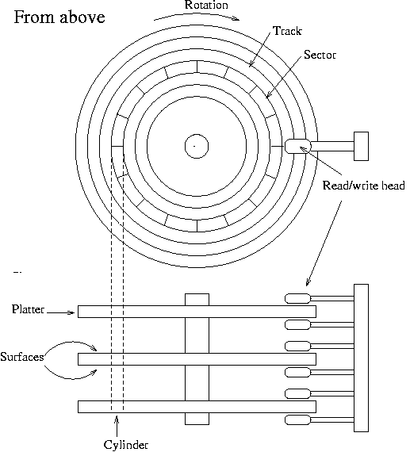

| Term | Meaning | Physical or logical? |
|---|---|---|
| **Platter** | A single disk in the drive | Physical |
| **Surface** | The top or bottom side of a platter | Physical |
| **Track** | A concentric ring on a platter. Track 0 is the **outermost** track. | Logical |
| **Sector** | A small segment of a track. The **smallest unit** of storage on the disk, traditionally **512 bytes**. | Logical |
| **Cylinder** | The set of tracks at the same position on every platter | Logical |

Tracks and sectors are **logical** structures: they're laid out when the disk is low-level formatted.

<br clear="right">

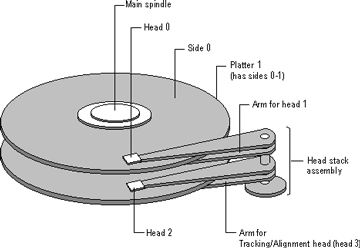

**Finding data on a disk requires its physical location**, for example: *"I need the data at sector 21 on surface 6 on track 46 on drive 3."*

### More details from the reading

- Most disks spin at a **constant angular velocity** (same RPM everywhere). The outer edge moves past the head faster than the center, so outer tracks are packed **less densely**. The result: the same amount of data can be read in the same time from anywhere on the disk.
- Each track has the same number of sectors, so sectors are packed closer together near the center.
- Older disks reserved one platter side for factory-written **track-positioning information**, so a 2-platter drive had only 3 usable sides.
- The **cylinder/head/sector (CHS)** scheme is being phased out. Modern disks translate their real layout into something else, and today drives are addressed by simple sector numbers (**LBA**, logical block addressing).

> **Modern note:** The reading is from the Windows NT era. Many modern drives use **4,096-byte (4K) physical sectors** ("Advanced Format"), often presenting themselves as 512-byte sectors for compatibility, and they store positioning data within each track instead of on a dedicated side.

## Reading and Writing

- The **read/write head** transfers data to and from the disk.
  - It uses **electrical currents**, and it **never touches the surface**.
- **Read:** the head picks up an electrical signal, which is converted to a digital signal.
- **Write:** a signal travels from the head and records a **1 or 0** in the right location.

## Disk Performance

It all takes time. Disk performance has two main parts:

| Component | Part | Meaning |
|---|---|---|
| **Access time** | **Seek time** | Time to move the read/write head into position |
| | **Latency (rotational) time** | Time waiting for the platter to spin the data under the head |
| **Disk bandwidth** (bytes transferred over time) | **Transfer time** | Time to move the data from secondary storage to primary storage (RAM) |

(The same three times appear in [Week 1: DASDs](Week-1-‐-Introduction-&-Computer-Architecture#dasds).)

## Sectors, Blocks, and Clusters

- **Blocks** (called **clusters** in Windows file systems) are an abstraction created by **software**.
  - Space on the disk is organized into blocks, each a group of one or more sectors.
  - Each block holds a set amount of data.
- **Example:** with 512-byte clusters, an **800-byte** file takes **2 clusters**. If it grows to 1,600 bytes, it gets 2 more.
- A file is **fragmented** when its blocks aren't next to each other (non-contiguous). Fragmented files are slower to read because the head has to visit several places.

### The box metaphor: a block is a box

| If blocks are **large**... | If blocks are **small**... |
|---|---|
| Small bits of data waste space (a big box for a small item) | Large files need many blocks, which get scattered (more fragmentation) |

A larger cluster size reduces fragmentation and the space needed to track used and free areas, but increases wasted space in partly filled clusters.

---

# 4. Solid-State Drives (SSDs)

**Hard drives are fragile.** The #1 cause of hard drive failure is **moving parts**. So let's get rid of the moving parts.

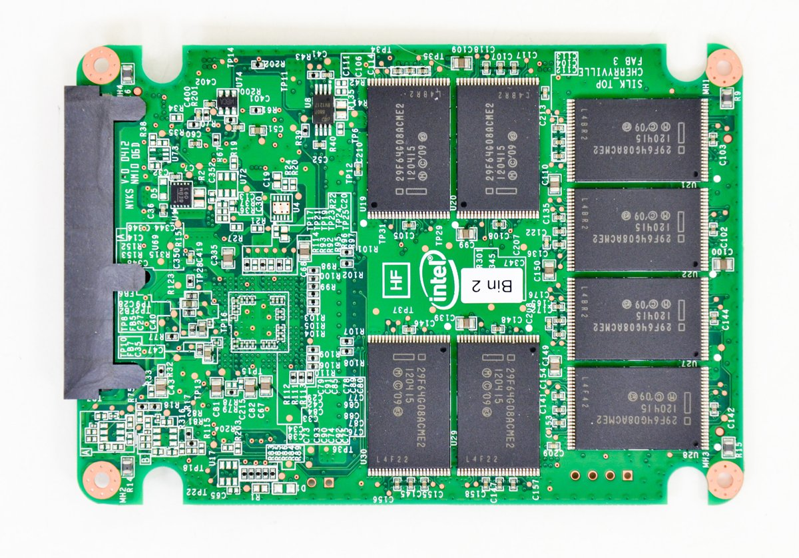

- **Solid-state drives (SSDs)** use **NAND flash memory** to store and fetch data.
  - Built from **floating-gate transistors**, which hold their state without power
  - The chips don't move
- Textbook: *"...they produce little heat and are reliable, quiet, secure, long-lasting, and fast."*

### SSD concerns

- **Writing is easy, but overwriting is not.**
  - Overwriting requires an **erase** operation first.
  - Data has to be moved to another block to be rewritten.
- Each SSD memory block has a **finite number of writes**. Nothing lasts forever.
- **Utilities made for mechanical drives won't work** the same way. For example, defragmenting an SSD doesn't help and only uses up writes. SSDs rely on features like **TRIM** instead.

### SSD vs. HDD

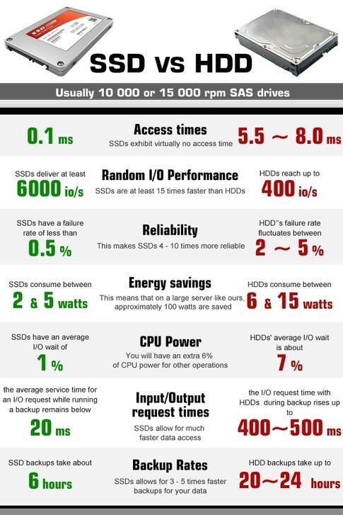 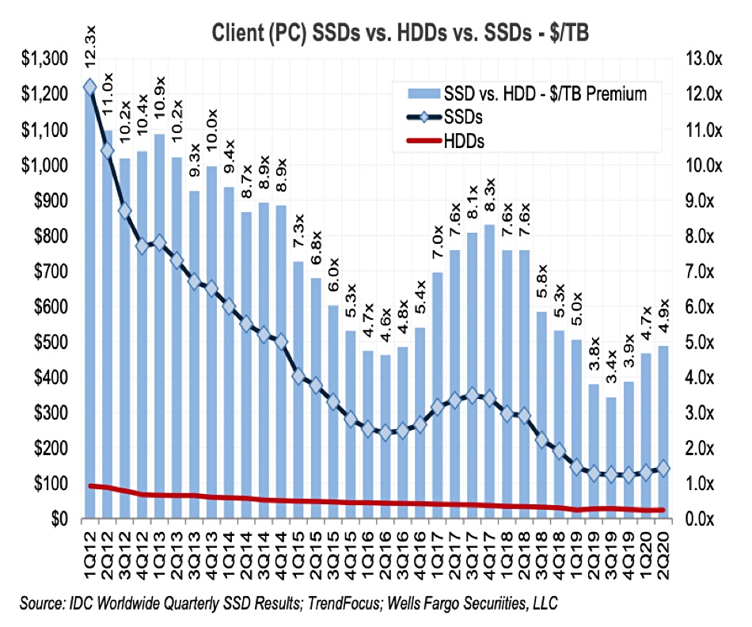

| | SSD | HDD |
|---|---|---|
| Access time | ~0.1 ms | ~5.5–8 ms |
| Random I/O | ~6,000 IO/s | ~400 IO/s |
| Failure rate | ~0.5% | ~2–5% |
| Power | ~2–5 watts | ~6–15 watts |
| Cost per TB | Higher | Lower |

### Limitations of all secondary storage

- **Speed** is limited.
- **Space** is limited.
- **If the drive fails, all its data may be lost.** The solution is RAID (section 7).

---

# 5. Disks, Partitions, and Volumes

Individual disk drives, and RAID sets of disks, **must be prepared** before they can be used.

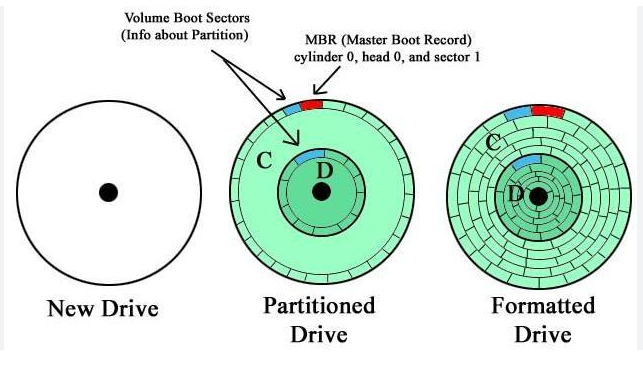

1. **New drive:** blank
2. **Partitioned:** divided into regions. The **MBR (Master Boot Record)** is written at cylinder 0, head 0, sector 1, and each partition gets a **volume boot sector**.
3. **Formatted:** a file system (like NTFS) is created in each partition.

### Key terms

| Term | Meaning |
|---|---|
| **Disk** | (1) The flat, circular, rotating object in a hard disk, floppy disk, or optical disc. (2) Any physical storage device, even one with no disk (like an SSD). Technically a misnomer, but it stuck, and it's official in Linux. *"Disc" is just another spelling.* |
| **Drive** | (1) The mechanical part that drives (spins) the disk. (2) Any physical storage device. (3) In Windows, another name for a volume or partition, like the **C: drive**. |
| **Partition** | A **logical region of a physical storage device** |
| **Volume** | A **logical storage area with a single file system** that the OS can access. It's a software concept, not a physical thing. |
| **Image** | A file containing the contents and structure of a storage device. An **ISO** is an optical disc image. The OS can open an image as a volume. |

### Partitions vs. volumes

- **Partitions and volumes are not the same.**
- Usually a partition is accessed as a volume, but not always. If the OS doesn't recognize a partition's file system, the partition exists but isn't a volume.
- Some devices can't be partitioned (like a floppy disk) but can still be accessed as a volume.
- Things that can be accessed as a volume:
  - A hard disk drive (HDD) or solid-state drive (SSD)
  - A floppy disk or optical disc (CD, DVD, Blu-ray)
  - A USB flash drive
  - A partition on a physical storage device
  - A disk image

### What are Windows drive letters?

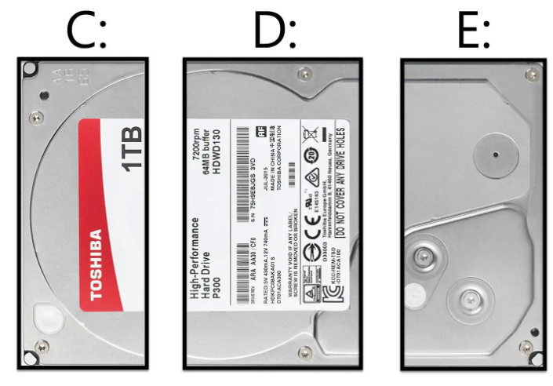

Windows gives each **volume** a letter (C:, D:, E:...). One physical drive can hold several lettered volumes, and one volume can span several drives.

### Basic disks vs. dynamic disks (Windows Disk Management)

**Basic disk:** divided into partitions (primary, extended, and logical drives).

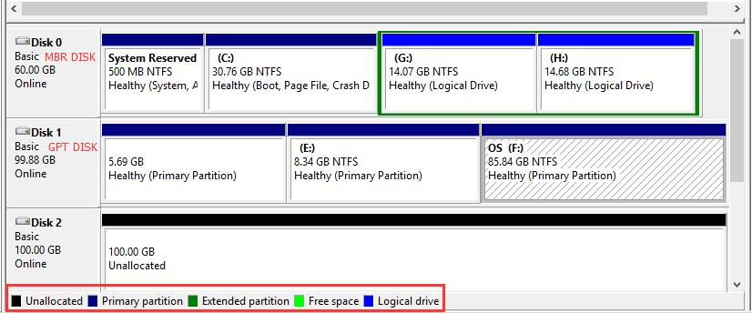

**Dynamic disk:** can create volumes that **span multiple disks**.

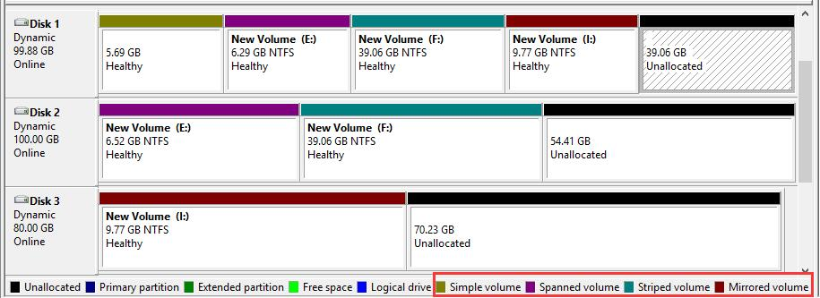

### Volume types for RAID (dynamic disks)

| Volume type | What it is |
|---|---|
| **Simple** | One physical disk working as an independent unit |
| **Mirrored** | Two copies of the data on separate physical disks (RAID 1) |
| **Striped** | Free space on two or more disks combined into one volume, with data spread across them (RAID 0) |
| **Spanned** | Unallocated space from multiple disks combined into one volume, filled one disk after another |
| **RAID-5** | Data and parity striped across **three or more** disks |

---

# 6. The Master Boot Record and Partition Table

This section is from the "Hard Drive and Disk Organization" reading. It ties into the [boot process from Week 1](Week-1-‐-Introduction-&-Computer-Architecture#the-boot-process).

### The big picture: three layers

| Layer | What it does |
|---|---|
| **Physical storage** | Platters, tracks, 512-byte sectors, and cylinders. File systems group sectors into clusters. |
| **Boot process** | The **MBR** in the first sector holds boot code and the partition table. At startup it finds the system partition, loads its boot sector, and hands over control. |
| **Partition organization** | The **partition table** defines up to **4 partitions** per disk. More are possible through an **extended partition**. |

## Master Boot Record (MBR)

- Created when you make the first partition on a disk. Probably **the most important data structure on the disk**.
- Always the **first sector**: cylinder 0, head 0, sector 1.
- Contains a small amount of **executable code** and the **partition table**.
- At startup on x86 computers, the MBR code:
  1. Examines the partition table and finds the **system partition**
  2. Loads that partition's **Partition Boot Sector** into memory
  3. Transfers execution to it, and the OS continues booting

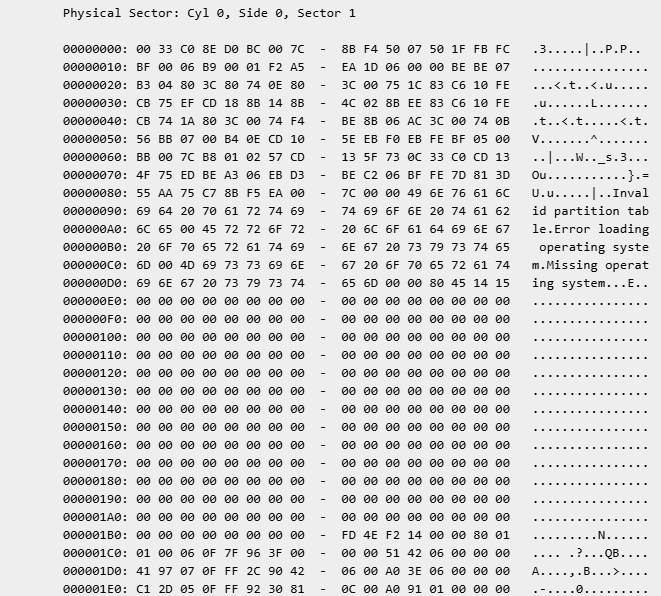

The **hex dump** above shows the MBR sector (hex from [Week 2](Week-2-‐-Data-Representation-&-Computer-Hardware#hexadecimal-base-16)). The first **446 bytes** are boot code, ending with the disk signature `FD 4E F2 14`. You can even spot its error messages, like "Invalid partition table" and "Missing operating system."

> **Security:** **Viruses can infect the MBR.** Because MBR code runs **before** any operating system starts, no OS can detect or recover from MBR corruption. Utilities exist to back up and restore the MBR.

## The partition table

- A **64-byte** structure in the same sector as the MBR
- **4 entries** of **16 bytes** each, so **at most 4 primary partitions**
- Entry offsets: Partition 1 at `0x01BE` (446), Partition 2 at `0x01CE` (462), Partition 3 at `0x01DE` (478), Partition 4 at `0x01EE` (494)
- The sector always ends with the signature `0x55AA`. Unused entries are all zeros.

**Partition table entry fields** (sample values are for partition 1):

| Offset | Size | Sample | Field |
|---|---|---|---|
| `0x00` | Byte | `0x80` | **Boot indicator:** `0x80` = system (active) partition, `0x00` = not bootable |
| `0x01` | Byte | `0x01` | Starting head |
| `0x02` | 6 bits | `0x01` | Starting sector (bits 6–7 are the top 2 bits of the starting cylinder) |
| `0x03` | 10 bits | `0x00` | Starting cylinder (max 1023) |
| `0x04` | Byte | `0x06` | **System ID:** the file system type |
| `0x05` | Byte | `0x0F` | Ending head |
| `0x06` | 6 bits | `0x3F` | Ending sector |
| `0x07` | 10 bits | `0x196` | Ending cylinder (max 1023) |
| `0x08` | 4 bytes | `3F 00 00 00` | **Relative sectors:** where the partition starts, counted in sectors from the start of the disk |
| `0x0C` | 4 bytes | `51 42 06 00` | **Total sectors** in the partition |

### Key fields

- **Boot indicator:** marks the **active** partition the computer starts from. Only one primary partition should have it set. Setting it lets you choose between operating systems on different partitions.
- **System ID:** tells the OS which file system the partition uses, and which drivers to load.

| System ID | Meaning |
|---|---|
| `0x01` | 12-bit FAT partition (fewer than 32,680 sectors) |
| `0x04` | 16-bit FAT partition (32,680–65,535 sectors) |
| `0x05` | **Extended partition** |
| `0x06` | BIGDOS FAT partition |
| `0x07` | **NTFS** partition |
| `0x0B` / `0x0C` | FAT32 (primary / extended, using INT 13 extensions) |
| `0x0E` / `0x0F` | FAT16 (extended / primary, using INT 13 extensions) |

- **Starting/ending head, sector, cylinder (CHS):** used by the MBR code to find the boot sector. Their bit sizes limit how big a disk they can describe:

**Max capacity = sector size × sectors per track × cylinders × heads**<br>
= 512 × 63 × 1,024 × 256 = **8,455,716,864 bytes ≈ 7.8 GB**

> **Modern note:** That 7.8 GB is the limit of the old **CHS** fields only. Windows NT and later use the **relative sectors** and **total sectors** fields instead, which allow MBR disks up to **2 TiB**. Disks bigger than that use **GPT (GUID Partition Table)**, the modern replacement for MBR that works with **UEFI** ([Week 1](Week-1-‐-Introduction-&-Computer-Architecture#uefi)) and allows 128 partitions by default.

Other legacy limits from the reading: FAT volumes max out at **4 GB** under Windows NT (64 KB clusters), and **2 GB** for MS-DOS/Windows 95.

### Extended partitions and logical drives

- Need more than 4 partitions? Make one partition an **extended partition** (System ID `0x05`). Only **one** extended partition per disk.
- Inside it, you can create any number of **logical drives**. Available drive letters are the practical limit.
- Each logical drive starts with its own small partition table, which forms a **linked chain**:
  - Entry 1: the current logical drive
  - Entry 2: where the **next** logical drive's table is
  - Entries 3 and 4: all zeros
- The last logical drive lists only itself.

---

# 7. RAID

**RAID (Redundant Array of Independent Disks)** combines multiple drives to get:
- **More storage**
- **Better performance**
- **Fault tolerance** (surviving a drive failure)

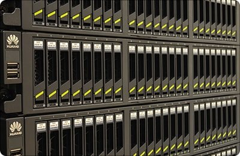

RAID comes in standard configurations called **RAID levels**. The numbers are just labels.

In the diagrams below, **A, B, C, D** are blocks of one file and each column is a disk.

### RAID 0: striping

Blocks are placed on **alternating drives**.

| Disk 1 | Disk 2 | Disk 3 | Disk 4 |
|:-:|:-:|:-:|:-:|
| A | B | C | D |

- **Best** read/write performance (all disks work at once)
- **No fault tolerance:** if any drive fails, the data is lost

### RAID 1: mirroring

Every block is **copied** to a second drive.

| Disk 1 | Disk 2 |
|:-:|:-:|
| A | A |
| B | B |

- If one drive fails, the other still has everything.
- You only get half the total space.

### RAID 10 (1+0): mirrored, then striped

A **mirrored set of disks is striped**: pairs of mirrored disks, with data striped across the pairs.

| Pair 1: Disk 1 | Pair 1: Disk 2 | Pair 2: Disk 3 | Pair 2: Disk 4 |
|:-:|:-:|:-:|:-:|
| A | A | B | B |
| C | C | D | D |

- The speed of striping plus the safety of mirroring
- Needs at least 4 drives, and half the space goes to copies

### RAID 5: striping with parity

Blocks are placed on alternating drives, **and a parity block is stored** as well. The parity rotates between drives.

| Disk 1 | Disk 2 | Disk 3 |
|:-:|:-:|:-:|
| A | B | **P(A,B)** |
| C | **P(C,D)** | D |
| **P(E,F)** | E | F |

#### What is parity? XOR

Parity blocks are calculated with **XOR** ("exclusive or"):
- `x OR y` is true if x or y **or both** are true.
- `x XOR y` is true when x or y is true, **but not both**.

| x | y | x XOR y |
|:-:|:-:|:-:|
| 0 | 0 | 0 |
| 0 | 1 | 1 |
| 1 | 0 | 1 |
| 1 | 1 | 0 |

**Example:** Block A = `0110`, Block B = `1100`

```
    0110   (A)
XOR 1100   (B)
    ----
    1010   (Parity)
```

**Why is this useful?** If any one drive dies, XOR the surviving blocks to rebuild the missing one. If Block A is lost:

```
    1100   (B)
XOR 1010   (Parity)
    ----
    0110   (A is back!)
```

#### Why not just use RAID 5 for everything?

- Must have **at least 3 drives**
- **Rebuilding is slow** after a failure
- Not quite as reliable as mirroring

### RAID levels compared

| Level | Method | Min. drives | Usable space | Survives a drive failure? |
|---|---|:-:|---|:-:|
| **RAID 0** | Striping | 2 | 100% | ❌ |
| **RAID 1** | Mirroring | 2 | 50% | ✅ |
| **RAID 5** | Striping + parity | 3 | (n − 1) ÷ n | ✅ (one drive) |
| **RAID 10** | Mirrored, then striped | 4 | 50% | ✅ (one per mirrored pair) |

**Other RAID levels:** 3, 6, 50, and more, which mix and vary 0, 1, and 5.

### Hot-swapping

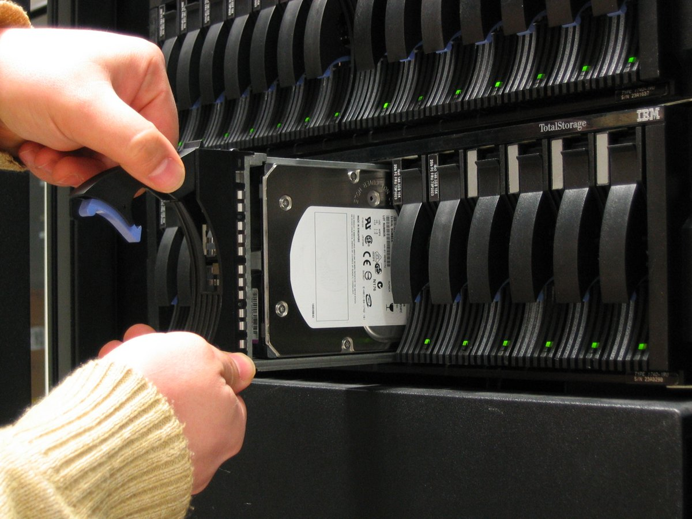

RAID can be **hot-swappable**: disks can be pulled out of and put into the array while it keeps running. This is **very valuable for servers**.

---

# 8. Building a PC: Where Storage Fits

Highlights from Intel's guide, [How to Build a Gaming PC](https://www.intel.com/content/www/us/en/gaming/resources/how-to-build-a-gaming-pc.html), focused on how this week's material shows up in a real build.

### Parts list

1. Case
2. CPU
3. GPU
4. Motherboard
5. Memory (RAM)
6. **Storage (SSD and/or HDD)**
7. Power supply (PSU)
8. Cooling (CPU cooler and case airflow)
9. Peripherals (monitor, keyboard, mouse)
10. Operating system

### Choosing storage

| Choice | What to know |
|---|---|
| **SSD vs. HDD** | SSDs are recommended for speed and reliability, and some games require one. HDDs are cheaper per TB, so they're good for bulk storage. Many builds use both. |
| **SATA SSD** | The older interface, with higher latency and lower peak speed |
| **NVMe SSD** | Uses the **PCIe** interface for much higher performance |
| **2.5" SSD** | Connects with SATA data and power cables |
| **M.2 SSD** | Plugs straight into a motherboard slot, no cables |
| **3.5" HDD** | Common in desktops, usually 7,200 RPM or faster |
| **2.5" HDD** | Common in laptops, often 5,400 RPM |

**Typical setup:** an SSD as the **boot drive** for the OS and games, plus HDDs for extra capacity.

### Build steps

1. **Install the CPU** in the motherboard socket. Line up the arrows and never force it.
2. **Install M.2 SSDs** (optional). Use a small Phillips #0 screwdriver. An M.2 drive can disable some SATA ports, so check the motherboard manual.
3. **Install CPU cooling.** Use a rice-grain-sized dot of [thermal paste](Week-2-‐-Data-Representation-&-Computer-Hardware#thermal-paste) if the cooler doesn't have it pre-applied.
4. **Install RAM.** Line up the notch and press until the tabs lock.
5. **Test outside the case** (optional). Check for [POST](Week-1-‐-Introduction-&-Computer-Architecture#power-on-self-test-post) beeps, LEDs, or codes.
6. **Mount the power supply.**
7. **Install the motherboard** in the case (I/O shield first, then the standoffs and screws).
8. **Install the GPU** in the longest PCIe x16 slot.
9. **Install storage drives** in the drive bays, and connect SATA data and power cables.
10. **Install the operating system:**
    - Enter the **BIOS/UEFI** and confirm all drives are detected, including M.2.
    - Set the **boot order**: USB installer first, target drive second.
    - If the USB won't boot, make sure the **UEFI or Legacy** mode matches the installer. Most modern systems use UEFI.

### Tools

- Phillips #2 screwdriver (and #0 for M.2 screws)
- An **8 GB or larger USB flash drive** for the OS installer
- A large table on a non-carpeted floor, to reduce static electricity risk. An anti-static wrist strap is optional.

---

# 9. Sources & Credits

- [Intel: How to Build a Gaming PC](https://www.intel.com/content/www/us/en/gaming/resources/how-to-build-a-gaming-pc.html)
- Hard Drive and Disk Organization reading, from the [KillDisk manual](https://www.killdisk.com/manual/index.html#KB/hdd-partition.html)
- Slides: *Files & Secondary Storage* and *Secondary Storage: Disks, Volumes and Partitions*, System Fundamentals, Champlain College

<details>
<summary><b>Image credits (from the course slides)</b></summary>

- Hard drive: [Best Buy](https://pisces.bbystatic.com/image2/BestBuy_US/images/products/5638/5638723_sa.jpg)
- Hard drive diagram: [The Linux Documentation Project](https://www.tldp.org/LDP/sag/html/hd-schematic.png)
- SATA & PATA: [O'Reilly](https://learning.oreilly.com/library/view/complete-a-guide/9780135291542/graphics/07fig15.jpg)
- SCSI cable: [Wikimedia Commons](https://upload.wikimedia.org/wikipedia/commons/2/22/SFF-8484-internal-connector-0a.jpg)
- Other charts and photos: from the course slides and reading

</details>
