Week 6 is about **system integration**: choosing parts that work together to build a complete computer. It covers the CPU, motherboard form factors, RAM, GPU, storage, the case, the power supply, and fans, plus the parts-selection lab. It ends with a quick review of last week's storage material.

*Sources: the "System Integration: Building a Computer" slides, the "Motherboard Specifications" reading, and the "Files & Storage Review" slides.*

## Contents

1. [What Is System Integration?](#1-what-is-system-integration)
2. [CPU](#2-cpu)
3. [Motherboard](#3-motherboard)
4. [RAM](#4-ram)
5. [GPU](#5-gpu)
6. [Secondary Storage and the Case](#6-secondary-storage-and-the-case)
7. [Power Supply (PSU)](#7-power-supply-psu)
8. [Fans](#8-fans)
9. [Lab: Selecting Parts](#9-lab-selecting-parts)
10. [Week 5 Storage Review](#10-week-5-storage-review)

---

# 1. What Is System Integration?

**Integrate:** to combine things so that they become a whole.

**Building a computer** is also called **system integration**. Every part has to fit physically, connect correctly, and work with the others.

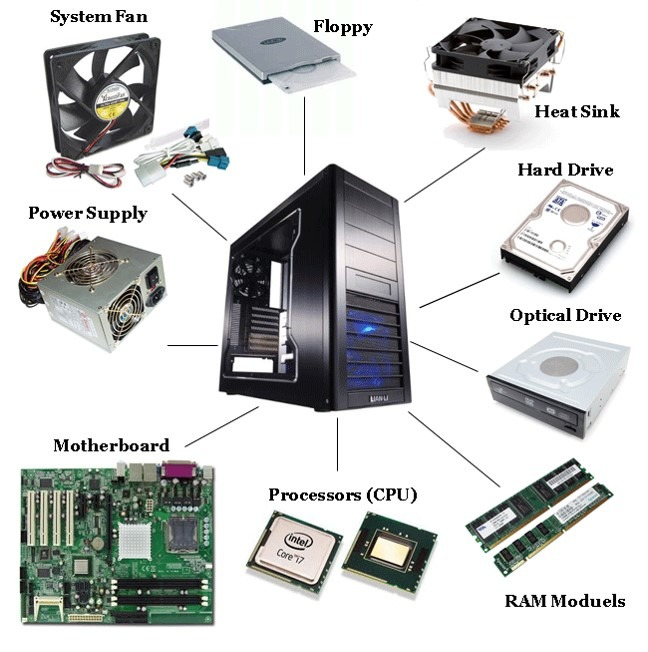

Every compatibility question this week comes back to one of these:

| Part | Must be compatible with... |
|---|---|
| **CPU** | The motherboard socket and chipset, and the cooler |
| **Motherboard** | The CPU, RAM, case, and GPU |
| **RAM** | The motherboard (type, speed, slots) and CPU |
| **GPU** | The motherboard slot, case size, and power supply |
| **Storage** | The motherboard ports (SATA, M.2) and case bays |
| **Power supply** | Every part's peak power draw, and the case |

---

# 2. CPU

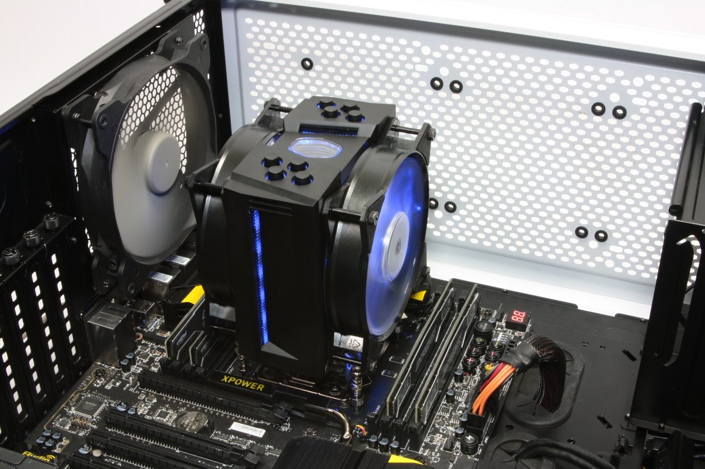

- The CPU must physically fit **along with a potentially large cooling fan**.
- It must match the motherboard's **socket** (e.g., **LGA 1700** for 12th–14th Gen Intel Core, **LGA 1851** for Intel Core Ultra).
- (See [CPU Cooling](Week-2-‐-Data-Representation-&-Computer-Hardware#4-cpu-cooling) in Week 2.)

### Reading an Intel processor name

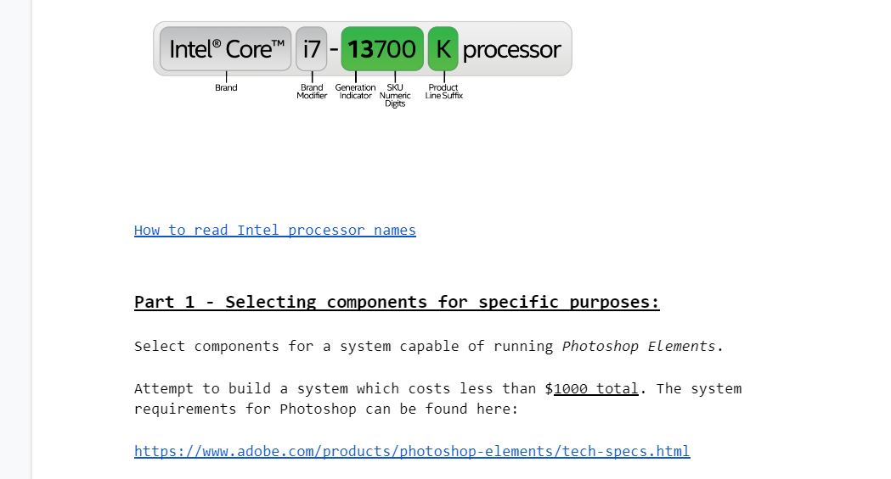

| Part | Example | Meaning |
|---|---|---|
| Brand | Intel **Core** | Product line |
| Brand modifier | **i7** | Performance tier (i3 < i5 < i7 < i9) |
| Generation | **13** | 13th generation |
| SKU | **700** | Model number within the generation |
| Suffix | **K** | Unlocked for overclocking |

---

# 3. Motherboard

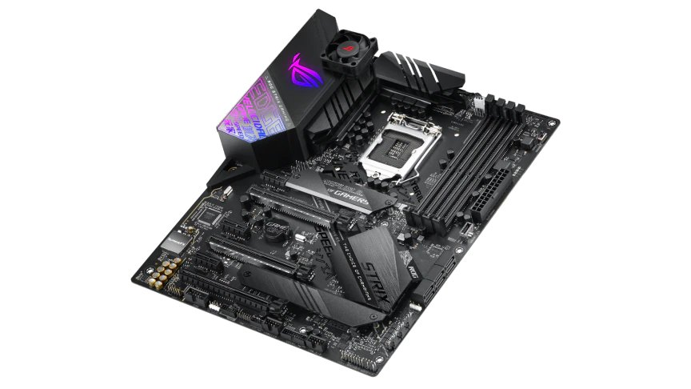

The motherboard has to be **compatible with the CPU, RAM, case, and GPU**:

- The **chipset** must support the CPU and the required RAM (see [Chipsets](Week-2-‐-Data-Representation-&-Computer-Hardware#5-chipsets) in Week 2).
- **Form factors:** ATX, micro-ATX, ITX, server types, and proprietary designs
- There are **many** options for slots, ports, and other features.

## Form factors

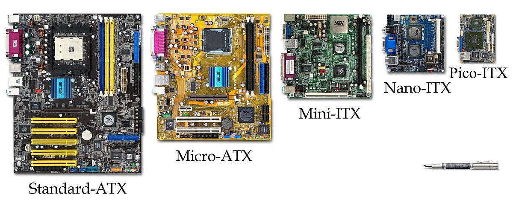

| Form factor | Size | Expansion slots | RAM | Typical use |
|---|---|---|---|---|
| **ATX** | 305 × 244 mm (12.0" × 9.6") | Up to 7 | Usually 4 DIMM slots, dual-channel DDR4/DDR5 | Standard desktops and gaming PCs |
| **Micro-ATX (mATX)** | Up to 244 × 244 mm (9.6" × 9.6") | Up to 4 | 2–4 DIMM slots, up to 192 GB | Smaller desktops. Fits ATX cases too. |
| **Mini-ITX** | 170 × 170 mm (6.7" × 6.7") | 1 PCIe x16 | Usually 2 DIMM slots, up to 64–96 GB | Small form factor (SFF) PCs |
| **Nano-ITX** | 120 × 120 mm (4.7" × 4.7") | Mini-PCIe and M.2 | 1 SO-DIMM or onboard RAM | Low-power embedded systems |
| **Pico-ITX** | 100 × 72 mm (3.9" × 2.8") | — | Onboard or SO-DIMM | Industrial and embedded, fanless |

### ATX

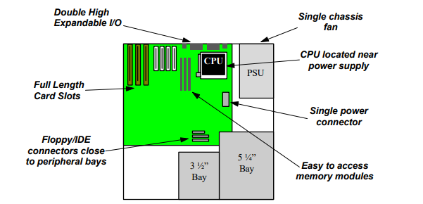

- **Size:** 12.0" × 9.6" (305 × 244 mm)
- **Expansion slots:** up to 7 PCIe/PCI slots
- **Memory:** typically 4 DIMM slots, dual-channel DDR4 or DDR5
- **Back panel I/O:** a standard rear I/O shield opening, 6.25" × 1.75"
- **Power:** a **24-pin** main ATX connector plus an **8-pin/4-pin CPU** connector
- **Example Intel chipsets:**
  - **Z890 / B860** (LGA 1851): Intel Core Ultra (Series 2), PCIe 5.0, DDR5
  - **Z790 / B760** (LGA 1700): 12th, 13th, and 14th Gen Intel Core

 

### Micro-ATX

- Maximum **9.6" × 9.6"** (244 × 244 mm). Some are narrower, at 244 × 205 mm.
- Uses a subset of the ATX mounting holes, so it **fits in full-size ATX cases**.
- Up to **4** expansion slots (often fewer)
- Sockets: LGA 1700 or LGA 1851
- 2–4 DIMM slots, dual-channel DDR4/DDR5, up to 192 GB
- 24-pin ATX power plus a 4- or 8-pin CPU connector
- Multiple SATA 6 Gb/s ports and 1–3 M.2 NVMe (PCIe Gen 4/5) slots

### Mini-ITX

- **170 × 170 mm.** Fits small form factor (SFF) cases but still takes standard desktop CPUs.
- Sockets: LGA 1700 or LGA 1851
- **Chipset tiers:**
  - **H-series** (e.g., H610): budget and office
  - **B-series** (e.g., B660/B760): mid-range
  - **Z-series** (e.g., Z690/Z790): enthusiast, **overclocking enabled**
- 2 DIMM slots, dual-channel DDR4/DDR5
- **1 PCIe x16 slot** (PCIe 4.0 or 5.0) for a graphics card
- 1–2 M.2 NVMe slots and 2–4 SATA III ports
- Gigabit or 2.5G Ethernet, plus optional Wi-Fi 6/6E and Bluetooth
- HDMI, DisplayPort, and sometimes VGA. These only work if the CPU has **integrated graphics**.
- **Example:** ASUS Prime H610I-PLUS D4, about $110–$130: LGA 1700, DDR4, PCIe 4.0 x16

### Nano-ITX

- **120 × 120 mm**, ultra-low power
- **Soldered (BGA) processors:** Intel Atom, Celeron, Pentium, N-series, and some Core
- 1 SO-DIMM slot (DDR3L/DDR4/DDR5) or fixed onboard RAM
- 2 or 3 independent displays (HDMI, DisplayPort, VGA, LVDS/eDP)
- Storage through SATA III, mSATA, or M.2
- Dual Gigabit or 2.5 GbE LAN
- Mini-PCIe and M.2 Key-E (for Wi-Fi/Bluetooth)
- **Single 12 V DC power input**
- Mostly **passive cooling** (no fans) thanks to low-TDP chips

### Pico-ITX

- **100 × 72 mm.** Ultra-compact single-board computers (SBCs), also called the "2.5-inch" embedded form factor.
- Built for **passive cooling**, industrial automation, embedded edge systems, and portable devices
- +12 V DC input
- Operating temperature from 0–60 °C (commercial) up to −40 to 70 °C (industrial)

**Typical Pico-ITX configurations:**

| Tier | Example board | Processor | Memory | Storage & expansion | Display & I/O |
|---|---|---|---|---|---|
| **Ultra-low power** | Axiomtek PICO319 | Intel Atom x5-E3940 | Up to 8 GB DDR3L SO-DIMM | M.2 Key B, mSATA | DisplayPort, LVDS, dual GbE |
| **Modern embedded SoC** | Supermicro A4SAP-H | Intel N97 (4-core, 12 W TDP) | Up to 16/32 GB DDR5 SO-DIMM | M.2 B-Key, SATA 3.0 | Dual 2.5 GbE, HD audio |
| **Core-series** | AAEON PICO-KBU4 | 7th Gen Intel Core U / Celeron | Up to 16/32 GB DDR4 SO-DIMM | M.2 B-Key and E-Key | HDMI 1.4, LVDS, dual GbE |

---

# 4. RAM

### RAM specifications

| Spec | Meaning |
|---|---|
| **Type** | DDR5, DDR4, ... Must match the motherboard. |
| **Speed** | The clock rate it can handle |
| **Size** | In gigabytes. More RAM lets more run at once. |
| **CAS latency** | The delay, **in clock cycles**, between when the CPU requests data and when the RAM delivers it. Lower is faster. |
| **Memory bandwidth** | How much data can move per second, in GB/s (or TB/s) |
| **Memory channels** | Physical data paths between the CPU's memory controller and the RAM. Dual-channel uses two at once. |
| **ECC vs. non-ECC** | **ECC (Error-Correcting Code)** RAM automatically detects and fixes single-bit errors to prevent crashes. It's used in servers. **Non-ECC** has no error correction but is cheaper and faster, and it's standard in consumer PCs. |

### Comparing RAM generations

| | DRAM | DDR | DDR2 | DDR3 | DDR4 | DDR5 |
|---|---|---|---|---|---|---|
| **Prefetch** | 1-bit | 2-bit | 4-bit | 8-bit | Bit per bank | 16-bit |
| **Data rate (MT/s)** | 100–166 | 266–400 | 533–800 | 1066–1600 | 2133–5100 | 3200–6400 |
| **Transfer rate (GB/s)** | 0.8–1.3 | 2.1–3.2 | 4.2–6.4 | 8.5–14.9 | 17–25.6 | 38.4–51.2 |
| **Voltage (V)** | 3.3 | 2.5–2.6 | 1.8 | 1.35–1.5 | 1.2 | 1.1 |

- **Data rate (MT/s):** **mega-transfers** (millions of transfers) per second
- **Transfer rate (GB/s):** **gigabytes** per second
- **Module density:** a module's total capacity, usually 4, 8, 16, 32, or 64 GB (sometimes 24 or 48 GB). Sold as single modules or in kits.
- **Prefetch:** loading data before it's needed, which reduces waiting later
- **Voltage:** lower voltage uses less power and makes less heat

Only data rate, transfer rate, and density are choices you make. Prefetch and voltage are fixed by the generation.

> **Correction:** The source table defines GB/s as "Gigabits per second... equal to 1,000,000,000 bytes per second." GB/s means **gigabytes** per second (1,000,000,000 bytes). Gigabits would be written Gb/s.

### The notch lines it up

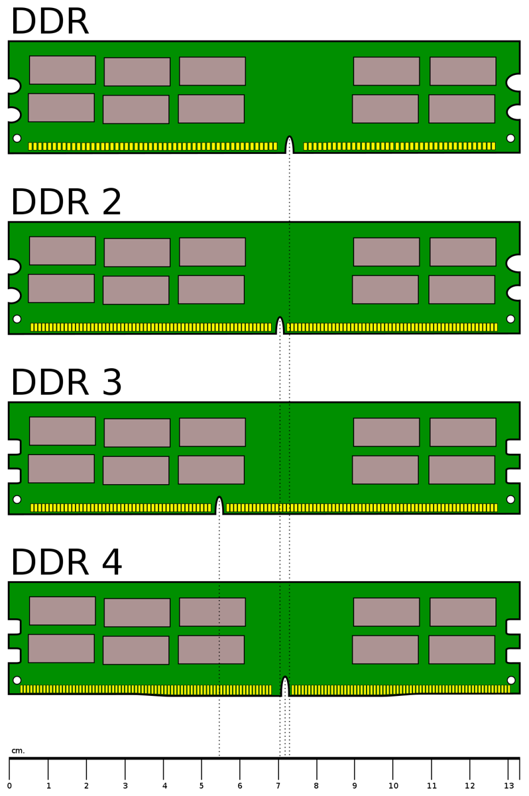 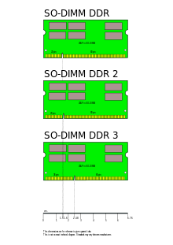

Each RAM generation puts the **notch (module key)** in a different place, so you **can't install the wrong type**. That applies to both standard desktop **DIMMs** and smaller laptop **SO-DIMMs** (small outline).

### Anatomy of a RAM stick: DDR5 vs. DDR4

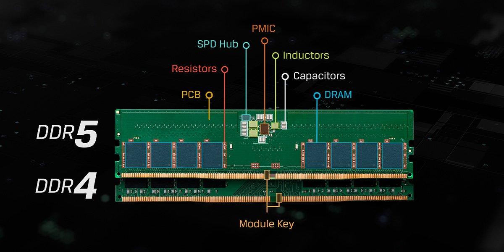

| Part | What it does |
|---|---|
| **DRAM chips** | The memory chips that hold the data |
| **SPD hub** | *(DDR5)* Stores the module's data (speed, timings), monitors temperature, and manages communication with the system |
| **PMIC** | *(DDR5)* A power management chip that regulates and distributes power on the stick itself, instead of relying on the motherboard |
| **PCB** | The green or black printed circuit board that holds the chips and connects to the motherboard |
| **Module key** | The notch along the gold pins that makes sure the RAM goes in the right way and blocks incompatible types |
| **Resistors** | Small surface-mount parts for signal termination and impedance matching, which keep data signals clean and stable |
| **Inductors** | Part of the voltage regulation system, delivering clean, stable power |
| **Capacitors** | Smooth out and filter power to the memory chips |

> **Clarification:** The slide says the capacitors "store an electrical charge to represent a binary bit." Each DRAM memory cell *inside the chips* does store a bit as a charge on a tiny capacitor. The larger capacitors you can see on the module's board, though, are for **power filtering**, not data storage.

---

# 5. GPU

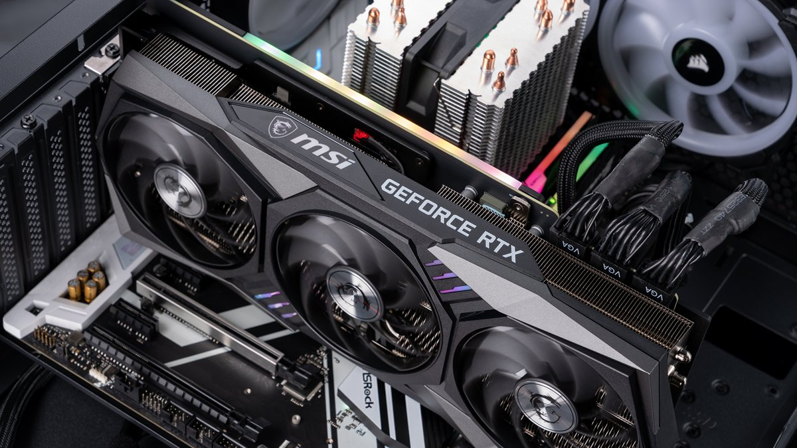

- It must have the needed **interface** (a PCIe x16 slot).
- It's typically a **physically large card with fans**, so check its size against the case.
- **POWER HUNGRY!** The GPU is often the biggest factor in choosing the power supply.
- **Generates heat**
- (See [Graphics Processing Unit](Week-2-‐-Data-Representation-&-Computer-Hardware#3-graphics-processing-unit-gpu) in Week 2.)

---

# 6. Secondary Storage and the Case

### Storage must fit

- **Size:** 2.5", 3.5", or M.2
- **Connection:** the correct port (SATA? M.2?)
- **Number of bays:**
  - **Internal bays:** SSDs, HDDs
  - **External bays:** DVD drives (and floppy drives, lol)

(More in [Week 5](Week-5-‐-Secondary-Storage-&-RAID#2-types-and-interfaces).)

### Case choice

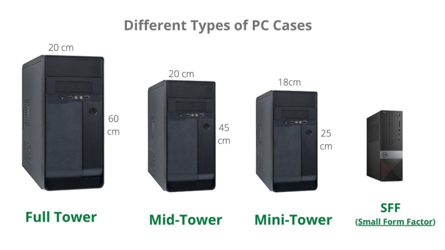

| Case | Approx. height | Fits |
|---|---|---|
| **Full tower** | ~60 cm | E-ATX/ATX, lots of storage and cooling |
| **Mid-tower** | ~45 cm | ATX, the most common choice |
| **Mini-tower** | ~25 cm | Micro-ATX / Mini-ITX |
| **SFF (small form factor)** | Smallest | Mini-ITX, with limited upgrade room |

### Drive bays

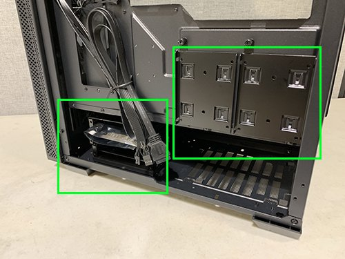 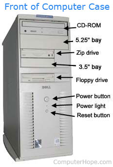

- **Internal bays** hold 2.5" and 3.5" drives inside the case.
- **External bays** are the "ancient standard sizes": **5.25"** (CD/DVD drives) and **3.5"** (floppy and Zip drives), open to the front of the case.

---

# 7. Power Supply (PSU)

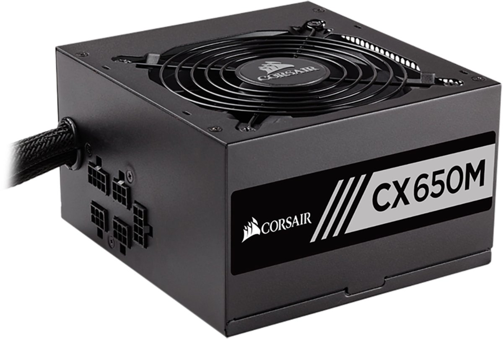

The PSU **must support every part at its peak power consumption**:

**CPU + GPU + secondary storage + RAM/motherboard** (+ fans and everything else)

### PSU form factors and cables

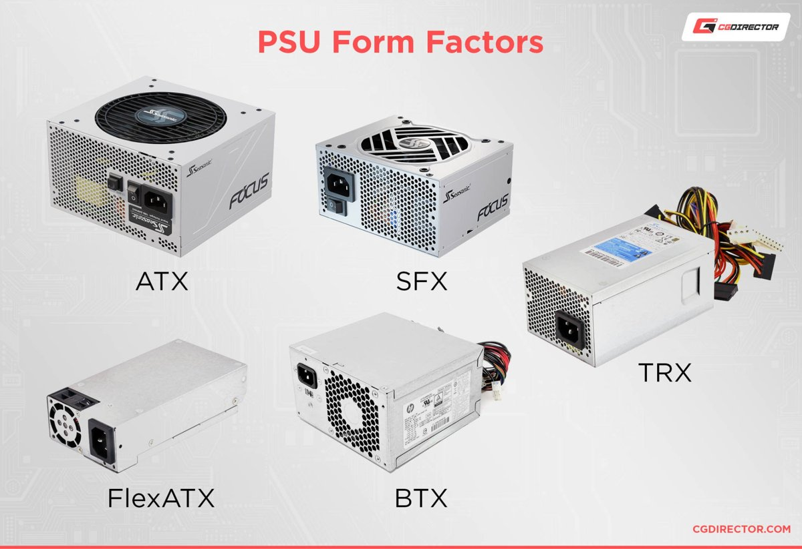 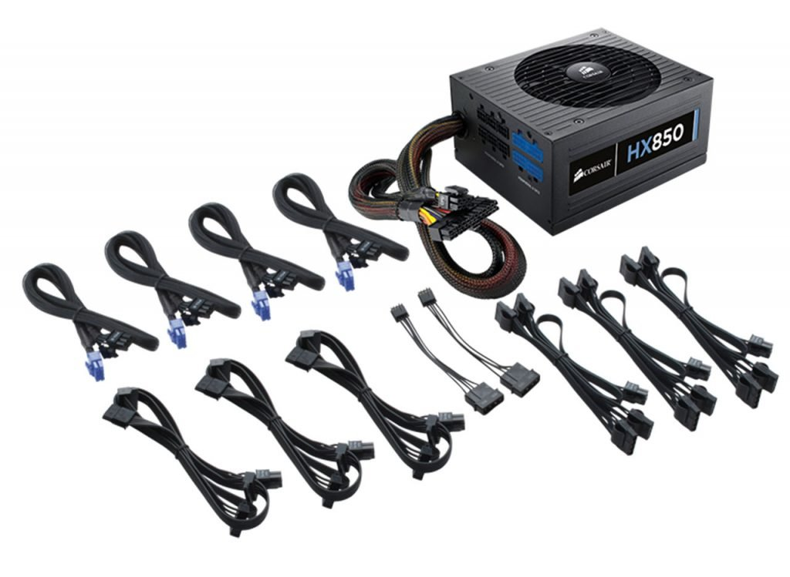

- **Form factors:** ATX (standard), SFX (small form factor), TFX, FlexATX, BTX
- **Modular** PSUs let you attach only the cables you need, which makes for less clutter and better airflow.

### As components are added, required power increases

Estimates from an online wattage calculator ([PCPartPicker](https://pcpartpicker.com/)):

| Parts selected | Suggested wattage |
|---|---|
| Intel Core Ultra 5 CPU | 215 W |
| + Motherboard | 285 W |
| + NVIDIA GeForce RTX GPU | **800–899 W** |

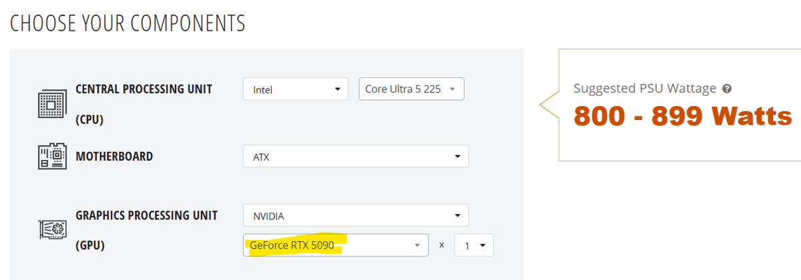

The GPU alone more than doubled the power needed.

---

# 8. Fans

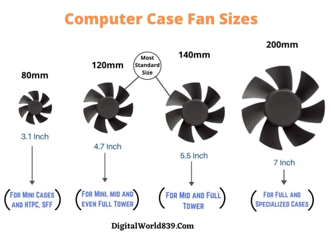

- Fans come in different sizes: **80 mm, 120 mm** (the most common), **140 mm, 200 mm**.
- The choice of fans depends on **how much heat the parts generate**.
- Bigger fans move the same air at lower speeds, so they're **quieter**.

---

# 9. Lab: Selecting Parts

**System Integration Lab #1.** Objective: get experience **selecting the parts** needed to build a complete computer system.

- You usually build a computer for a reason, general or specific. This lab is about picking components **for a specific purpose**.
- Finding compatible parts by reading every spec sheet is very time-consuming, and new CPUs and motherboards come out all the time. Many online vendors offer part-matching tools.
- This lab uses **[PCPartPicker](https://pcpartpicker.com/)**, which checks compatibility and has good text export.

| Part | Task |
|---|---|
| **1. Meeting specific requirements** | Build a system that can run **Adobe Photoshop Elements** for **under $1,000 total**. Requirements: [Adobe tech specs](https://www.adobe.com/products/photoshop-elements/tech-specs.html). Tip: [how to read Intel processor names](#reading-an-intel-processor-name). |
| **2. Matching as closely as possible** | Match a prebuilt system's specs (a Dell Precision 3660 Tower Workstation) as closely as possible. |
| **3. Specs to run a game** | Build a system to run a specific game (e.g., **FIFA 23**), using its minimum and recommended requirements. Tool: PCGameBenchmark's "Can I run it?" checker. |
| **4. Cost of RAID systems** | Start with a base system, then configure 4 systems with the **same 16 TB of total storage**: a single drive, **RAID 0** (4 × 4 TB, striped), **RAID 1** (2 × 16 TB, mirrored), and **RAID 10** (4 × 8 TB, striped and mirrored). Compare the specs and costs. |
| **5. Low-power system** | Build a complete system (CPU, motherboard, storage, RAM, case, PSU) that uses **less than 200 W**. |

> **Why those RAID drive counts?** See [RAID levels compared](Week-5-‐-Secondary-Storage-&-RAID#raid-levels-compared) in Week 5. RAID 0 uses all its space (4 × 4 TB = 16 TB), while RAID 1 and RAID 10 lose half to mirroring (2 × 16 TB → 16 TB, 4 × 8 TB → 16 TB).

---

# 10. Week 5 Storage Review

The review slides recap [Week 5: Secondary Storage & RAID](Week-5-‐-Secondary-Storage-&-RAID). They add fuller definitions of the drive interfaces:

| Interface | Stands for | Definition |
|---|---|---|
| **IDE** | Integrated Drive Electronics | The older parallel interface, basically gone |
| **SATA** | Serial Advanced Technology Attachment (Serial AT Attachment) | The standard interface for connecting HDDs, SSDs, and optical drives to the motherboard |
| **M.2** | Pronounced "M-dot-2" | A compact form factor and interface for internal expansion cards, especially high-speed SSDs |
| **SCSI** | Small Computer System Interface | A set of standards for connecting computers to peripherals like hard drives, tape drives, and scanners |

**Quick recap:**
- **Secondary storage** is long-term and **nonvolatile**.
- **Disk terms:** platter, track, sector, cylinder, surface. The read/write head never touches the surface.
- **Disk performance:** access time (seek + latency) plus transfer time
- **SSDs:** NAND flash with floating-gate transistors and no moving parts. Overwriting needs an erase, and each block has limited writes.
- **All storage** is limited in speed and space, and can fail. **RAID** adds storage, performance, and fault tolerance.
- **Volumes:** logical storage areas with one file system each. RAID volume types are simple, mirrored (RAID 1), striped, spanned, and RAID-5.
- **RAID** can be **hot-swappable**, which is very valuable for servers.
