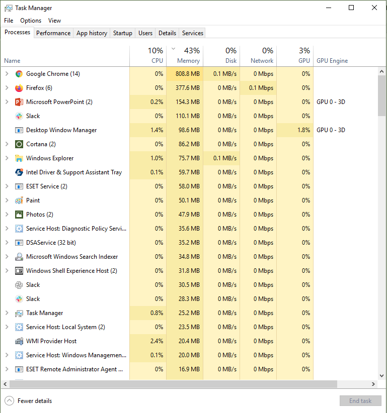
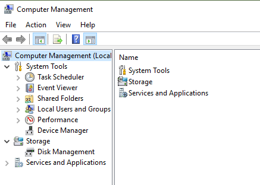
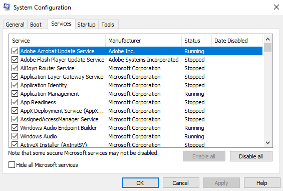
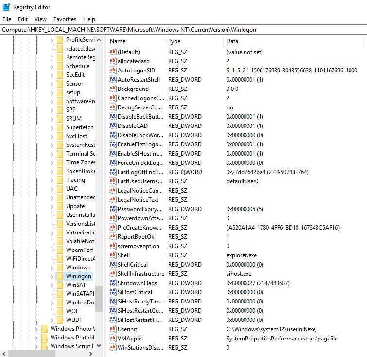
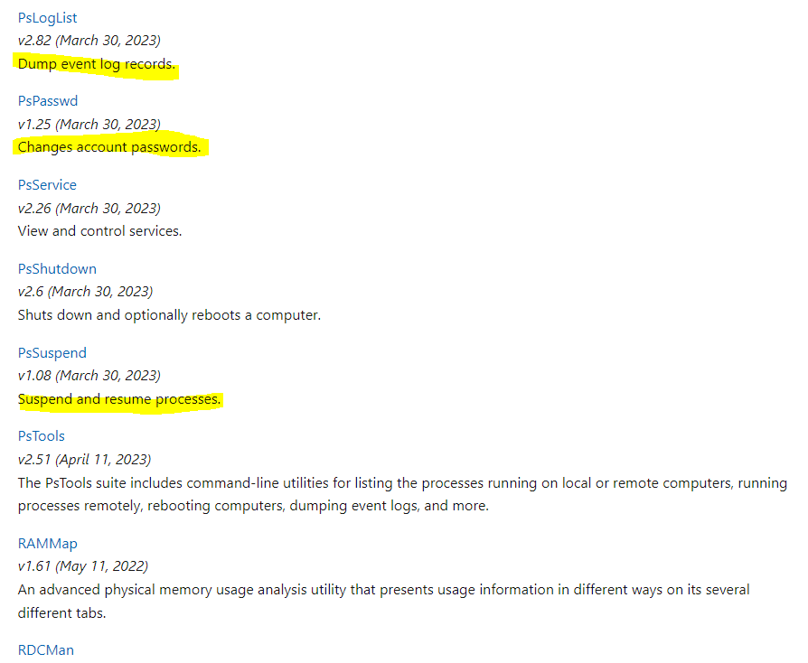

Week 7 covers **system utilities**, the tools we use to see what a computer is doing and keep it healthy, along with a reference list of Windows' built-in tools. It also covers **I/O (input/output)**: how data moves between the computer and its devices, and the three ways the CPU can handle it (programmed I/O, interrupts, and DMA).

*Sources: the "System Utilities" slides, the "Built-in Windows System Tools" handout, [TechTarget: I/O (input/output)](https://www.techtarget.com/news/input-output-I-O/871641/), and [GeeksforGeeks: I/O Interface (Interrupt and DMA Mode)](https://www.geeksforgeeks.org/computer-organization-architecture/io-interface-interrupt-dma-mode/).*

## Contents

1. [System Utilities](#1-system-utilities)
   - [Why Do We Need Them?](#why-do-we-need-them)
   - [Viewing System Details](#viewing-system-details)
   - [Scheduling and Viewing Events](#scheduling-and-viewing-events)
   - [General Settings and Startup](#general-settings-and-startup)
   - [Deeper Settings: The Registry](#deeper-settings-the-registry)
   - [Small, Specialized Command-Line Tools](#small-specialized-command-line-tools)
   - [The Tool of Last Resort: Backups](#the-tool-of-last-resort-backups)
2. [Built-in Windows System Tools (Reference)](#2-built-in-windows-system-tools-reference)
3. [Input/Output (I/O)](#3-inputoutput-io)
   - [What Is I/O?](#what-is-io)
   - [Input, Output, and Both](#input-output-and-both)
   - [The I/O Interface](#the-io-interface)
4. [Modes of I/O Transfer](#4-modes-of-io-transfer)
   - [Programmed I/O](#programmed-io)
   - [Interrupt-Initiated I/O](#interrupt-initiated-io)
   - [Direct Memory Access (DMA)](#direct-memory-access-dma)
   - [Comparing the Three Modes](#comparing-the-three-modes)
   - [Other I/O Terms](#other-io-terms)

---

# 1. System Utilities

**Utility, tool, command, and program** are somewhat interchangeable terms. They all mean software that helps us work with the system.

## Why Do We Need Them?

- To **maintain** the computer.
- Computers perform many tasks at the same time, and **we can't tell what's going on** just by looking.
- We need the computer to **tell us what it's doing**. ("I did some things" isn't good enough.)
- We can't do everything ourselves. **We need tools**, and **combining tools with automation is powerful**.

**Our tools should let us:**
- **Investigate and report** on systems
- **Perform maintenance**
- **Schedule tasks**

These are all things computers are excellent at.

## Viewing System Details

What might we want to see?
- **Processes:** what runs at startup and what's running now (see [Week 4: Processes](Week-4-‐-Processes))
- **Disk use**
- Any other system detail

**Built-in OS programs for this:**

| OS | Tool |
|---|---|
| Windows | **Task Manager** |
| macOS | **Activity Monitor** |
| Linux | **System Monitor** (graphical) or **`top`** (command line) |

## Scheduling and Viewing Events

The **Microsoft Management Console (MMC)**, shown here as **Computer Management**, brings many tools together:

- **Task Scheduler:** schedule routine tasks
- **Event Viewer:** view system events
- **Shared Folders:** monitor shared folders
- **Local Users and Groups:** manage user accounts
- **Disk Management:** manage disks (see [Week 5](Week-5-‐-Secondary-Storage-&-RAID#5-disks-partitions-and-volumes))

**Event Viewer** is useful for looking into things like:
- **Logon failures**
- **Hard disk errors**

## General Settings and Startup

General-purpose system tools let you:
- **Change basic settings:** what runs at startup, accessibility options
- **Manage related settings:** network settings, UI settings

The **System Configuration** tool (`msconfig`) shown above controls startup options and services.

But what if you need to change **deeper settings** that don't have their own utility?

## Deeper Settings: The Registry

**Registry Editor** (`regedit`):
- Lets you **view and edit individual registry values**
- Can change settings that have **no UI option**
- **.reg files** can save these settings or share them with other computers

> ⚠️ Editing the registry incorrectly can break Windows. Back it up (or create a restore point) before making changes.

## Small, Specialized Command-Line Tools

- **Command-line** tools
- **Single-purpose** tools
- Can be used in **scripts**
- Can be **combined** with other tools

**Example: Microsoft Sysinternals PsTools**

| Tool | What it does |
|---|---|
| **PsLogList** | Dumps event log records |
| **PsPasswd** | Changes account passwords |
| **PsService** | Views and controls services |
| **PsShutdown** | Shuts down and optionally reboots a computer |
| **PsSuspend** | Suspends and resumes processes |
| **PsTools** | The whole suite: list processes on local or remote computers, run processes remotely, reboot, dump event logs, and more |
| **RAMMap** | Advanced physical memory usage analysis |

(Process Explorer, shown in [Week 4](Week-4-‐-Processes#5-seeing-processes-on-your-computer), is also a Sysinternals tool.)

## The Tool of Last Resort: Backups

**Backup programs** let you load a previous, and hopefully working, configuration of your OS or data.

| OS | Built-in tool |
|---|---|
| Windows | **System Restore** |
| macOS | **Time Machine** |

---

# 2. Built-in Windows System Tools (Reference)

From the "Built-in Windows System Tools" handout. **Win + R** opens the Run box, where you can type the commands shown.

### Performance & diagnostics

| Tool | What it does | How to open |
|---|---|---|
| **Task Manager** | Real-time CPU, memory, disk, and network usage, plus processes | Ctrl + Shift + Esc |
| **Resource Monitor** | More detailed real-time resource usage | Win + R → `perfmon.exe /res` (or `resmon`) |
| **Performance Monitor** | Tracks detailed system metrics and creates diagnostic logs over time | Win + R → `perfmon` |
| **Event Viewer** | Inspects system, security, and application event logs to troubleshoot errors | Win + R → `eventvwr` |

### Storage & cleanup

| Tool | What it does | How to open |
|---|---|---|
| **Storage Sense** | Automatically clears temporary files and old update files, and empties the Recycle Bin on a schedule | Settings → System → Storage |
| **Disk Management** | Creates, resizes, and manages partitions and volumes | Win + R → `diskmgmt.msc` |

### Security & maintenance

| Tool | What it does | How to open |
|---|---|---|
| **Malicious Software Removal Tool (MRT)** | Scans for and removes specific common malware | Win + R → `MRT` |
| **Windows Sandbox** | Runs an isolated, temporary desktop to safely test untrusted apps or scripts | Start menu (must be enabled first) |
| **Netplwiz** | Manages user accounts and reviews administrator privileges | Win + R → `netplwiz` |

### Productivity & utilities

| Tool | What it does | How to open |
|---|---|---|
| **Snipping Tool** | Screenshots, screen recordings, text extraction, and annotations | Win + Shift + S |
| **PowerShell & Command Prompt** | Run admin scripts, manage network details, and do deep system repairs with **DISM** or **SFC** | Start menu (Run as administrator for repairs) |
| **Windows Subsystem for Linux (WSL)** | Runs a real Linux distribution inside Windows | `wsl` in a terminal |

---

# 3. Input/Output (I/O)

## What Is I/O?

**I/O** (pronounced "eye-oh") is any **operation, program, or device that moves data to or from a computer**. Printers, hard disks, keyboards, and mice are all I/O devices.

- Every kind of data moving through a system depends on I/O: audio, video, text, and software instructions.
- Input can come from **hardware, software, or people**.
- I/O devices connect through **parallel or serial ports**, or **wirelessly**.
- The OS manages devices through an **I/O subsystem** that uses **device drivers**.

| Term | Meaning |
|---|---|
| **Hard I/O** | Direct transfer between a computer and a physical device (like a keyboard or mouse) |
| **Soft I/O** | Data exchanged between computers over a network (like streaming or file sharing) |
| **IOPS** | **I/O operations per second**, a common measure of storage performance (see the SSD vs. HDD table in [Week 5](Week-5-‐-Secondary-Storage-&-RAID#ssd-vs-hdd)) |

## Input, Output, and Both

| Input devices (data flows **into** the computer) | Output devices (data flows **out** to the user) | Both input and output |
|---|---|---|
| Keyboard, mouse, trackball | Monitor (LCD, CRT) | Hard drives and SSDs (read **and** write) |
| Microphone, webcam, digital camera | Speakers, headphones | Network interface cards (NICs) |
| Scanner, barcode reader | Printers, plotters | Modems |
| Touchscreen, stylus, light pen | Projectors | USB flash drives and removable storage |
| Joystick, game controller | Braille displays | Writable CDs/DVDs |
| Sensors, biometric readers | | Voice assistants (hear you, talk back) |

> Some experts argue whether storage drives count as I/O devices or just "storage." Since they both read and write data, they're usually counted as **both input and output**.

(Compare with [Input & Output Devices](Week-1-‐-Introduction-&-Computer-Architecture#input--output-devices) in Week 1.)

## The I/O Interface

- An **I/O interface** is how information moves between **internal storage (memory)** and **external devices**.
- CPUs and peripherals work very differently (speed, data format, timing), so **special interface units** sit between them to **supervise and synchronize** transfers. One example is the **I/O controller** from [Week 1](Week-1-‐-Introduction-&-Computer-Architecture#io-controllers).
- Many systems use an **I/O processor** between the system bus and the devices to take this work off the CPU.
- In every transfer mode, the data's source or destination is **memory**.

---

# 4. Modes of I/O Transfer

There are three ways to move data between I/O devices and memory:

1. **Programmed I/O**
2. **Interrupt-initiated I/O**
3. **Direct Memory Access (DMA)**

## Programmed I/O

The **CPU handles every transfer itself**, one instruction per data item.

**How it works:**
1. The CPU **repeatedly checks** whether the device is ready. This is called **polling**.
2. When it's ready, an **input instruction** moves the data from the device into a CPU register.
3. A **store instruction** moves it from the register into memory.
4. Repeat for every piece of data.

| ✅ Pro | ❌ Con |
|---|---|
| Simplest to program | The CPU is stuck in a **waiting loop** until the device is ready, which wastes CPU time. It's the slowest mode. |

## Interrupt-Initiated I/O

Instead of the CPU constantly asking "are you ready yet?", **the device tells the CPU when it's ready** by sending an **interrupt**.

**How it works:**
1. The CPU keeps running other programs.
2. The interface monitors the device.
3. When the device is ready, the interface sends an **interrupt request** to the CPU.
4. The CPU **pauses** its current task, runs an **interrupt service routine** to do the transfer, then **resumes** where it left off.

| ✅ Pro | ❌ Con |
|---|---|
| No wasted polling. The CPU does useful work while waiting. | Each transfer still goes **through the CPU** and takes several instructions, so speed is limited by how fast the CPU can service the device. |

The **Advanced Programmable Interrupt Controller (APIC)** is the hardware that delivers these interrupt signals to the processor.

> This connects to [Week 4](Week-4-‐-Processes#2-process-management): a process waiting on I/O is **Blocked**, and the interrupt is what lets the OS know it can run again.

### Types of interrupts

| Category | One kind | The other kind |
|---|---|---|
| **Source** | **Hardware:** from external devices | **Software:** from program instructions |
| **Handler address** | **Vectored:** a fixed address for the handler | **Non-vectored:** the address is found at runtime |
| **Control** | **Maskable:** can be disabled or ignored | **Non-maskable:** can't be ignored (used for critical errors) |
| **Origin** | **External:** from I/O devices | **Internal:** from the processor itself (e.g., an illegal instruction) |
| **Timing** | **Synchronous:** predictable, tied to instructions | **Asynchronous:** can happen at any time |

## Direct Memory Access (DMA)

For **fast, high-volume** devices like disks, even interrupts are too slow, because every byte still passes through the CPU. **DMA** lets the device move data **directly to and from memory without the CPU**.

**How it works:**
1. A **DMA controller** asks the CPU for control of the **buses**.
2. The CPU **grants** it and steps aside (it's idle on the bus during the transfer).
3. The DMA controller moves a **whole block** of data directly between the device and memory.
4. It **returns control** of the buses to the CPU, usually signaling with an interrupt when it's done.

**Transfer time = bus request time + (block size ÷ transfer rate) + bus release time**

| ✅ Pro | ❌ Con |
|---|---|
| Fastest for large transfers. Frees the CPU from moving data. | Needs extra hardware (a DMA controller), and the CPU can't use the bus while DMA has it. |

> You saw DMA in the [single-processor system diagram](Week-1-‐-Introduction-&-Computer-Architecture#single-processor-systems) in Week 1, where a device writes straight into memory.

## Comparing the Three Modes

| | Programmed I/O | Interrupt-initiated I/O | DMA |
|---|---|---|---|
| **Who moves the data** | CPU, using instructions | CPU, in an interrupt service routine | **DMA controller** |
| **How the CPU knows the device is ready** | Keeps checking (polling) | The device sends an interrupt | The DMA controller requests the bus |
| **CPU involvement** | Constant, always busy | Only when interrupted | Minimal |
| **Data path** | Device → CPU register → memory | Device → CPU register → memory | Device → **memory directly** |
| **Best for** | Simple, slow devices | Devices with unpredictable timing (keyboard, mouse) | Fast, high-volume devices (disks, network cards) |

**Analogy:** waiting for a pizza delivery.
- **Programmed I/O:** you stand at the door checking every few seconds.
- **Interrupts:** you do other things until the **doorbell** rings.
- **DMA:** the driver lets themselves in and puts the pizza in the fridge, and you never stop what you're doing.

## Other I/O Terms

| Term | Meaning |
|---|---|
| **I/O processor** | A processor between the system bus and peripherals that handles transfer work |
| **APIC** | Advanced Programmable Interrupt Controller. It delivers interrupt signals to the CPU. |
| **IOMMU** | **Input-Output Memory Management Unit.** It maps device memory addresses to physical memory. It's important for **virtual machines**, so a VM can safely use real hardware. |

> **Correction:** The TechTarget article spells IOMMU out as "input-output memory machine unit." The standard name is **input-output memory *management* unit**.

---

*Sources: [TechTarget: I/O (input/output)](https://www.techtarget.com/news/input-output-I-O/871641/) · [GeeksforGeeks: I/O Interface (Interrupt and DMA Mode)](https://www.geeksforgeeks.org/computer-organization-architecture/io-interface-interrupt-dma-mode/) · SYS-140 "System Utilities" slides · "Built-in Windows System Tools" handout*
