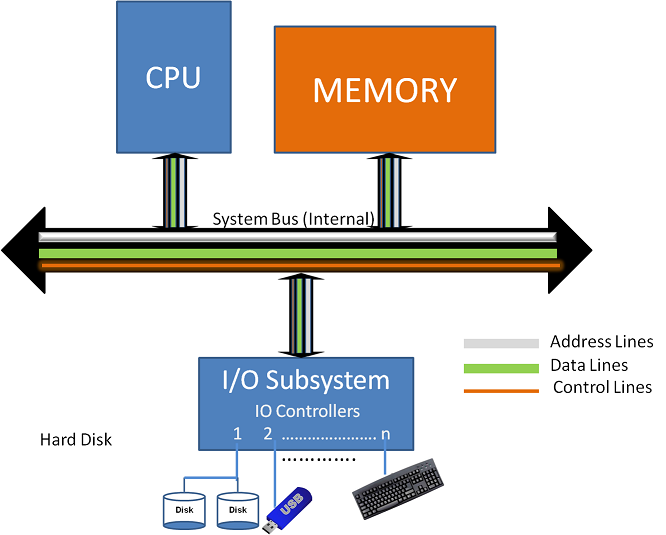
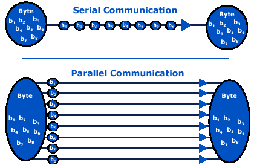
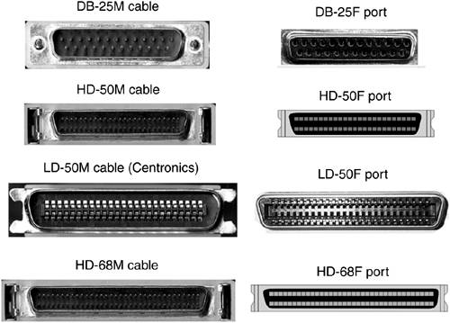
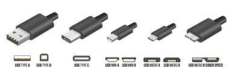
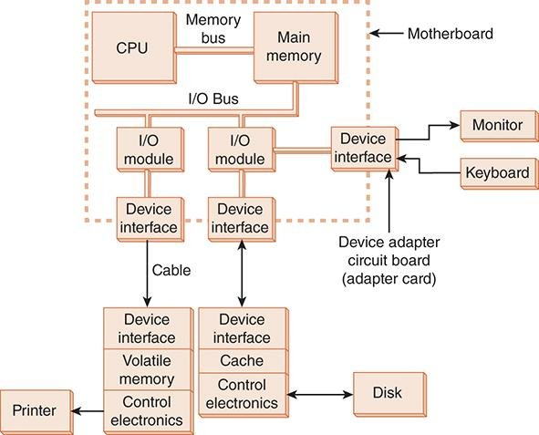
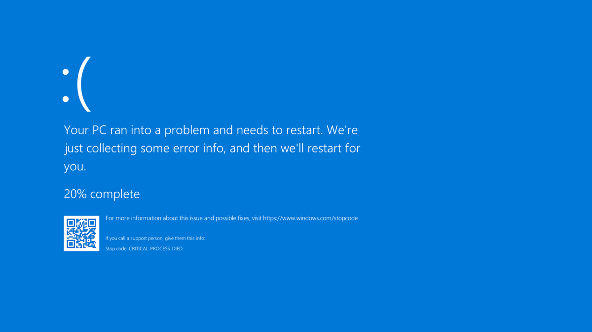

Week 8 continues **input and output**: how data travels (serial vs. parallel), and the four ways devices get the system's attention (polling, interrupts, memory-mapped I/O, and DMA). It also introduces the **OSI model**, the 7-layer framework for how data moves across a network.

*Sources: the "Input & Output" slides and the "OSI Model" slides. This builds on [Week 7: System Utilities & I/O](Week-7-‐-System-Utilities-&-IO#4-modes-of-io-transfer).*

## Contents

1. [Input & Output: The Big Picture](#1-input--output-the-big-picture)
2. [How Data Moves: Serial vs. Parallel](#2-how-data-moves-serial-vs-parallel)
3. [How Devices Get the System's Attention](#3-how-devices-get-the-systems-attention)
   - [Polling](#polling)
   - [Interrupts](#interrupts)
   - [Memory-Mapped I/O](#memory-mapped-io)
   - [Direct Memory Access (DMA)](#direct-memory-access-dma)
   - [Summary](#summary)
4. [The OSI Model](#4-the-osi-model)
   - [Goals](#goals)
   - [The 7 Layers](#the-7-layers)
   - [Remembering the Layers](#remembering-the-layers)

---

# 1. Input & Output: The Big Picture

**Input and output devices let us interact with our computers.**
- **Input devices** let us give the computer instructions and data.
- **Output devices** let the computer show or tell us the results of its processes.

The **CPU** and **memory** talk over the **system bus**, which has address, data, and control lines. Devices don't connect straight to the CPU. They go through the **I/O subsystem** and its **I/O controllers**. (See [Buses](Week-1-‐-Introduction-&-Computer-Architecture#buses) and [I/O controllers](Week-1-‐-Introduction-&-Computer-Architecture#io-controllers) in Week 1.)

---

# 2. How Data Moves: Serial vs. Parallel

There are two ways data is transferred:

| | **Parallel** | **Serial** |
|---|---|---|
| **How** | All the bits of a byte are sent **at the same time**, over several wires | Bits are sent **one at a time**, over a single channel |
| **Bits at once** | More (e.g., 8 at a time) | One |
| **Distance** | **Effective only over short distances.** The bits can arrive out of sync ("skew"). | **Better over longer distances** |
| **Errors** | More interference between wires | **Fewer transmission errors** |
| **Examples** | Old printer (Centronics) cables, IDE/PATA, SCSI | USB, SATA, Ethernet, PCIe |

 

*Left: older **parallel** connectors. Right: modern **serial** cables (USB).*

> **Why did serial win?** Parallel seems faster because it sends more bits at once, but at high speeds the bits on different wires stop arriving at exactly the same time. Serial links can run at much higher clock speeds, so modern interfaces like **SATA** replaced **PATA**, and **PCIe** replaced PCI. (See [Week 5: Types and Interfaces](Week-5-‐-Secondary-Storage-&-RAID#2-types-and-interfaces).)

---

# 3. How Devices Get the System's Attention

**Input and output need attention.**
- Devices need the system's attention.
- The CPU needs access to the I/O process.
- How can we do I/O **without slowing things down**?
- How can we do I/O **without creating problems**?

**There are 4 ways devices get the system's attention:**

| Method | Idea |
|---|---|
| **1. Polling** | Checking with each device |
| **2. Interrupts** | Letting every device interrupt the system |
| **3. Memory-mapped I/O** | Giving devices access to memory addresses |
| **4. DMA** | Giving a special controller the ability to control communication |

## Polling

- The system **continuously monitors** the I/O device for input.
  - This is done using **control registers**.
- When data arrives, the I/O device **sets a bit** in the register.
- The system sees the bit, grabs and processes the data, then **goes back to polling**.

> *"Signal generated?" "No." "...How about now?" "No." "...How about now?" "**No!**"*

Polling is the **programmed I/O** from [Week 7](Week-7-‐-System-Utilities-&-IO#programmed-io). It's simple, but it wastes CPU time asking over and over.

## Interrupts

**Interrupt-driven I/O:**
- The I/O device **alerts the system** whenever it has input.
- The system may not respond **immediately**.
- **Interrupts can collide**, when several devices want attention at once. They're handled **in order of priority**.

> *"Okay, which one of you is most important?"* (the CPU, to the keyboard, mouse, and monitor)

More details, including types of interrupts, are in [Week 7: Interrupt-Initiated I/O](Week-7-‐-System-Utilities-&-IO#interrupt-initiated-io).

## Memory-Mapped I/O

- The device **shares the same address space as main memory**.
- To the CPU, talking to the device **looks just like a standard memory access**: it reads and writes certain addresses, and those addresses belong to the device instead of RAM.

**Example:** the slides show a grid of memory addresses where the keyboard's registers (🟨 K1–K6) and the mouse's registers (🟥 M1–M6) are scattered among normal memory. The CPU reaches them with the same instructions it uses for RAM.

| Address | 0x00 | 0x01 | 0x02 | 0x03 | 0x04 | 0x05 |
|---|:-:|:-:|:-:|:-:|:-:|:-:|
| **0x00** | RAM | 🟨 K1 | RAM | RAM | 🟥 M3 | RAM |
| **0x10** | RAM | RAM | 🟥 M1 | RAM | RAM | 🟥 M5 |
| **0x20** | 🟨 K2 | RAM | 🟥 M2 | RAM | 🟨 K6 | RAM |
| **0x30** | RAM | 🟨 K4 | 🟥 M4 | 🟨 K3 | RAM | 🟥 M6 |
| **0x40** | 🟨 K5 | RAM | RAM | RAM | RAM | RAM |

**Downside: it can get messy and unstable.** If a device (or its driver) writes to the wrong address, it can overwrite memory that something else is using. So what happens when memory-mapped devices do the wrong thing?

**A crash.** That's a classic cause of the Windows "blue screen."

> **Clarification:** Memory-mapped I/O itself is very common and safe when used correctly. Modern graphics cards and other PCIe devices use it. The instability comes from **buggy devices or drivers**, which is why the OS keeps device memory protected and why faulty drivers are a common cause of blue screens.

## Direct Memory Access (DMA)

- The system **offloads I/O work to a DMA controller**.
- It gives the controller three pieces of information:
  1. **Location** of the bytes to transfer
  2. **How many** bytes to transfer
  3. **Where** to transfer them
- **A lot like a package delivery system!** The CPU hands off the package and goes back to work.
- Used by **secondary storage controllers**
- **Offloads duties from the CPU**

> **CPU:** *"Move the ten bytes at `0xfeedface` to the printer."* 
> **DMA:** *"Got it."*

(`0xfeedface` is a hex memory address, from [Week 2](Week-2-‐-Data-Representation-&-Computer-Hardware#hexadecimal-base-16). More on DMA is in [Week 7](Week-7-‐-System-Utilities-&-IO#direct-memory-access-dma).)

## Summary

| Method | Who starts the conversation? | CPU effort | Main drawback |
|---|---|---|---|
| **Polling** | The CPU keeps asking | High (constant checking) | Wastes CPU time |
| **Interrupts** | The device | Medium (only when interrupted) | Interrupts can collide, so they need priorities |
| **Memory-mapped I/O** | The CPU, using normal memory reads and writes | Low (no special instructions) | A bad device or driver can corrupt memory |
| **DMA** | The CPU hands off the job | Lowest | Needs a DMA controller |

---

# 4. The OSI Model

The **OSI (Open Systems Interconnection) model** describes how data moves between devices on a **network**. It's the network version of this week's I/O question: how does data get from here to there, correctly?

## Goals

The OSI model provides a structure for the rules that handle:

1. How the different **transmission media** are arranged and connected
2. How network devices that use **different languages** communicate with one another
3. How a network device **contacts** another network device
4. **How and when** data gets transmitted across the network
5. How data is sent to the **correct device**
6. How it is known whether the network data was **received properly**

All these tasks must be handled by a set of rules, and **the OSI model provides a structure those rules fit into**.

## The 7 Layers

| # | Layer | What it does | Data unit | Devices / examples |
|:-:|---|---|---|---|
| **7** | **Application** | Provides network services (file, print, messaging) to any software application on the network | Data | HTTP, email, file sharing |
| **6** | **Presentation** | **Translates** data from one character set to another (and handles formatting, encryption, and compression) | Data | ASCII/Unicode ([Week 2](Week-2-‐-Data-Representation-&-Computer-Hardware#characters-ascii-unicode-and-utf-8)), JPEG, TLS encryption |
| **5** | **Session** | Manages **communication and synchronization** between network devices | Data | Opening and closing sessions |
| **4** | **Transport** | How data is sent: **reliability and error correction** | Segment | TCP, UDP |
| **3** | **Network** | **Path selection** between networks. **Routers** live here and send data toward the destination network. **Multilayer switches** can also work here. | **Packet** | Routers, IP addresses |
| **2** | **Data Link** | **Encapsulates bits into frames.** Can provide error control. **MAC addresses** are at this layer. | **Frame** | **Layer 2 switches**, MAC addresses |
| **1** | **Physical** | Defines **how bits are transferred and received**: the network media, connectors, and voltage levels | **Bits** | **Hubs, cables, NICs** |

**Encapsulation:** as data goes **down** the layers on the sender, each layer wraps it with its own information (bits → frames → packets). The receiver **unwraps** it going back **up**.

## Remembering the Layers

| Direction | Mnemonic |
|---|---|
| **Top to bottom** (7 → 1) | **A**ctive **P**eople **S**eldom **T**ake **N**aps **D**uring **P**arties *(from the slides)* |
| **Bottom to top** (1 → 7) | **P**lease **D**o **N**ot **T**hrow **S**ausage **P**izza **A**way |

Application · Presentation · Session · Transport · Network · Data Link · Physical
