Week 9 covers how computers communicate over networks: network types and topologies, the OSI and TCP/IP models (explained by mailing a letter to Grandma), how data travels in packets, TCP vs. UDP, network hardware, Ethernet cable categories, and how DNS and DHCP give names and addresses to everything.

*Sources: the "Network Communications" slides (Pt. 1), the "Data & Networks" slides (Pt. 2), the "Network Hardware" and "Data Packets" readings, and [Cablify: Speeds of Cat5e, Cat6, Cat6a, Cat7 and Cat8 Cables Compared](https://www.cablify.ca/speeds-of-cat5e-cat6-cat6a-cat7-and-cat8-cables-compared/).*

## Contents

1. [Types of Networks](#1-types-of-networks)
2. [Network Topology](#2-network-topology)
3. [The OSI Model, Layer by Layer](#3-the-osi-model-layer-by-layer)
4. [The TCP/IP Model](#4-the-tcpip-model)
5. [Data Packets](#5-data-packets)
6. [TCP vs. UDP](#6-tcp-vs-udp)
7. [Network Hardware](#7-network-hardware)
8. [Ethernet Cables: Cat5e to Cat8](#8-ethernet-cables-cat5e-to-cat8)
9. [IP Addresses and DNS](#9-ip-addresses-and-dns)
10. [Getting Your Own IP: Static vs. DHCP](#10-getting-your-own-ip-static-vs-dhcp)

---

# 1. Types of Networks

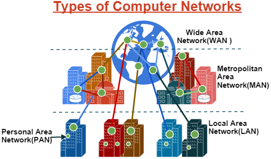

| Acronym | Name | Covers |
|---|---|---|
| **PAN** | Personal Area Network | Devices around one person (phone, earbuds, smartwatch) |
| **LAN** | Local Area Network | A home, office, or building |
| **MAN** | Metropolitan Area Network | A city or campus |
| **WAN** | Wide Area Network | Large regions or the world. The internet is the biggest WAN. |

---

# 2. Network Topology

Data on each device on a network (each **node**) must have a **path to every other node**. How are these paths formed?

**Topology:** in computer networks, *the way in which the parts are arranged and connected*.

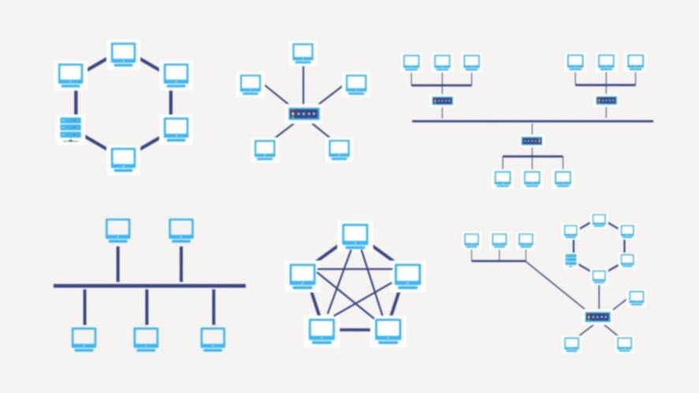

### Bus topology

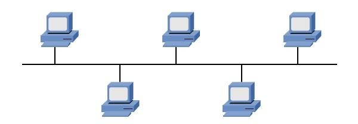

- Common in original networks that used **coaxial cable**
- A **single cable** strings one device to the next
- ✅ **Pros:** simple, uses less cable than other topologies
- ❌ **Cons:** machines can't transmit at the same time, and **one cable break brings the whole network down!**
- Example: **10BASE2 (Thinnet)**, which used BNC connectors and reached up to 185 meters

### Ring topology

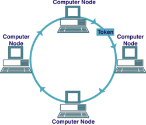

- **Token-passing:** a "token" travels around the ring, and only the device holding it can transmit. **Every device gets a turn.**
- ❌ Inefficient, and **more devices = SLOW**
- ❌ **A single break = network down.** **Token loss = network down.**
- ❌ Difficult to make changes
- Example: **Token Ring (IEEE 802.5)**, now **largely obsolete**

### Mesh topology

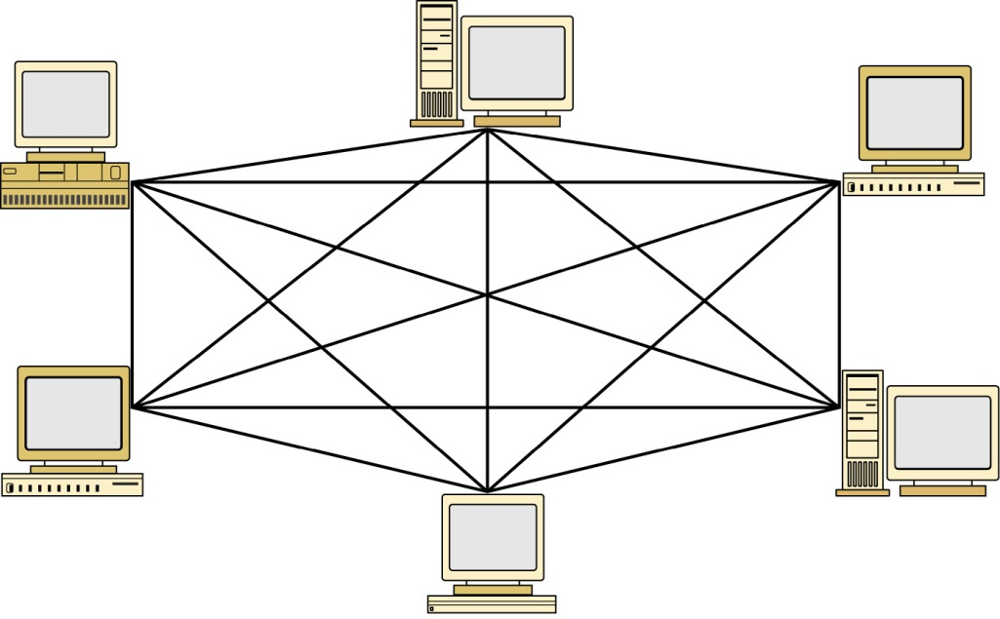

- **Heavily interconnected** and **highly redundant**
- ❌ **Lots of cable**

**Where mesh is used, wherever reliability is critical:**
- **WANs:** the internet backbone uses a **partial mesh** for redundancy
- **Wireless mesh networks:** Wi-Fi mesh systems (Google Wifi, Eero)
- **Data centers:** high-availability server clusters

> **Why not full mesh everywhere?** With **500 devices**, a full mesh needs 500 × 499 ÷ 2 = **124,750 cables**, and every device needs **499 network interfaces**. Completely impractical!

### Star topology

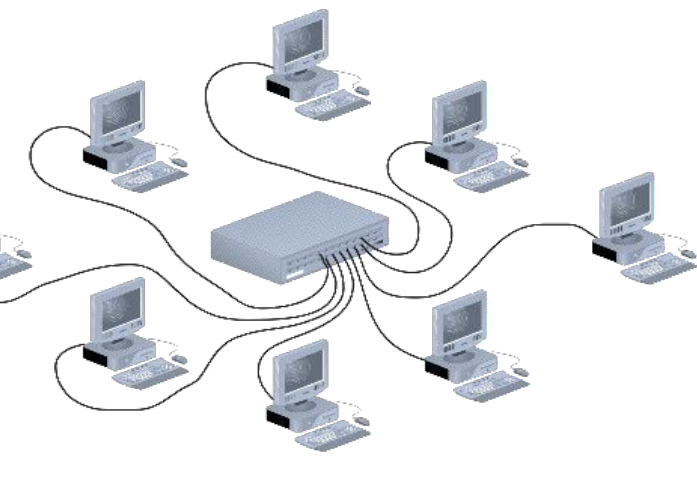

- **Very common in modern LANs.** Every device connects to a central switch.
- ✅ A **cable break only affects one node**
- ❌ Uses lots of cabling, and the central device is still a **single point of failure**

### Realistically: star-mesh hybrid

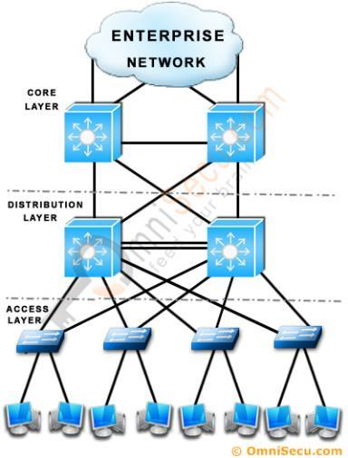

- **Common in modern networks**
- **Balances efficiency and redundancy**
- **Star** connects user devices, and the **backbone devices are meshed**

| Topology | Strength | Weakness | Today |
|---|---|---|---|
| **Bus** | Simple, little cable | One break takes down everything | Obsolete |
| **Ring** | Every device gets a turn | Slow, fragile | Largely obsolete |
| **Mesh** | Very redundant | Huge amount of cabling | Backbones, data centers, Wi-Fi mesh |
| **Star** | One break affects one node | Central point of failure | Most LANs |
| **Star-mesh hybrid** | Balances efficiency and redundancy | More complex | Modern enterprise networks |

---

# 3. The OSI Model, Layer by Layer

Topology is the **physical layout**. Thinking about the **data itself** is different: the actual bits moving through the wires need to be organized.

Networks have distinct needs (software, network hardware, computers). Dividing them into **layers** helps us think about each clearly. The **OSI (Open Systems Interconnection)** model is a **theoretical framework, not a specific technology**. Its 7 layers define the stages data goes through to travel from one device to another. ([Week 8](Week-8-‐-Input-Output-&-the-OSI-Model#4-the-osi-model) has a one-table summary and memory tricks.)

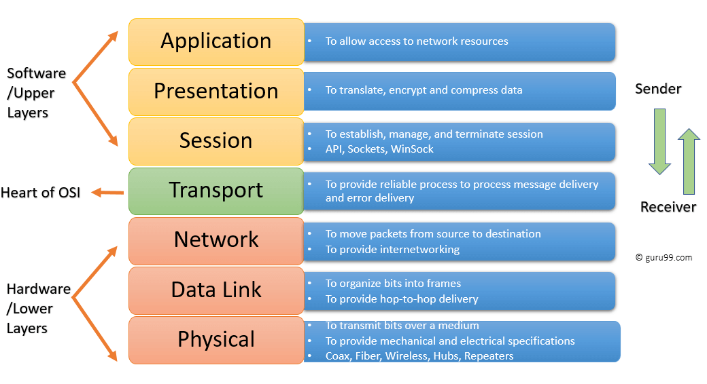

### What is a protocol?

A **protocol** is a **set of rules that devices follow to communicate** over a network. Think of it as a language with grammar rules: both sides must follow the same ones.

Mailing a letter has a protocol too: write the recipient's address on the front, put the return address in the corner, put the stamp in the top right, seal the envelope, and drop it in the mailbox.

### Metaphor: sending a letter to Grandma

Sending a message over a network is a lot like sending a package. There's a **carrier**, the service has **requirements and phases**, and **numbers, systems, and methods** make sure it all works.

## 7. Application Layer

- Contains **protocols** (HTTP, FTP, SMTP, DNS), **not the applications themselves**. It provides network **services**.
- Example: your web browser (Chrome) is the **application**, and **HTTP** is the Application Layer **protocol** it uses.

✉️ **Letter:** the body of the letter, *"Happy Birthday Grandma!"*

## 6. Presentation Layer

The **"translator."** It converts data between the application's format and the network's format, so the receiver's application can understand the sender's.
- **Data format translation** (e.g., ASCII to EBCDIC, see [Week 2](Week-2-‐-Data-Representation-&-Computer-Hardware#characters-ascii-unicode-and-utf-8))
- **Data compression:** reduces data size for transmission
- **Encryption and decryption:** secures data
- **Syntax conversion:** handles different data representations

✉️ **Letter:** the language the letter is written in.

## 5. Session Layer

**Establishes, manages, and ends** communication sessions between applications.
- **Session establishment and termination:** creating and closing connections
- **Session maintenance:** keeping the connection active and synchronized
- **Dialog control:** managing turn-taking (half-duplex or full-duplex)
- **Synchronization:** adding checkpoints to data streams for recovery
- **Session token management:** may handle session credentials after login

✉️ **Letter:** the ongoing conversation between you and Grandma. It's her 82nd birthday, and you've been writing letters for 9 years.

## 4. Transport Layer

Manages **end-to-end delivery** between applications.
- **Segmentation:** divides messages into smaller **segments**
- **Port addressing:** makes sure data reaches the right application (e.g., **port 80 for HTTP**)
- **Flow control:** regulates the transmission rate
- **Error detection:** checks for transmission errors

✉️ **Letter:** you choose **Certified Mail with tracking and a signature (TCP)** instead of **regular mail (UDP)**, so you know Grandma got it. If it's lost, the postal service resends it.

## 3. Network Layer

**Logical addressing and routing** between different networks.
- **Logical addressing:** uses **IP addresses** to identify sender and receiver
- **Routing:** finds the best path across networks
- **Packet forwarding:** moves **packets** router to router toward the destination
- **Fragmentation and reassembly:** breaks packets into smaller pieces if a network needs it
- **Error handling:** uses **ICMP** for diagnostics (e.g., `ping`)
- **Protocols:** IP (IPv4/IPv6), ICMP, routing protocols (OSPF, BGP, RIP)

✉️ **Letter:** the street address and ZIP code of the sender and receiver.

## 2. Data Link Layer

**Node-to-node** delivery on the local network, plus error detection.
- **Framing:** wraps network-layer packets into **frames**
- **Physical addressing:** uses **MAC addresses** to identify devices on the local network
- **Media Access Control (MAC):** decides when it's safe to transmit and prevents collisions (CSMA/CD for wired, CSMA/CA for wireless)
- **Error detection:** using a **CRC** (Cyclic Redundancy Check)
- **Flow control** between directly connected nodes
- **Examples:** Ethernet, Wi-Fi (802.11), PPP. **Switches** operate here.

✉️ **Letter:** the mail carrier's **local route**. They know the physical location of every mailbox (the MAC addresses), pick up from yours, scan the barcode (error detection), and bring it to the local post office. Layer 2 is about the **local segment**: the "first and last mile."

## 1. Physical Layer

The **"real world."**
- **Signal conversion:** turns digital bits into **electrical signals, light pulses, or radio waves**
- **Transmission medium:** copper cables, fiber optics, wireless
- **Bit rate:** transmission speed
- **Physical topology:** how devices are physically connected ([section 2](#2-network-topology))
- **Examples:** Ethernet cables (Cat5e, Cat6, see [section 8](#8-ethernet-cables-cat5e-to-cat8)), fiber, radio frequencies
- **Hardware:** repeaters, hubs, connectors (RJ-45, fiber connectors)
- **Standards:** RS-232, USB, Bluetooth PHY, Wi-Fi PHY (802.11)

✉️ **Letter:** the mail truck, airplane, roads, and conveyor belts. The actual vehicles moving the package.

### The letter metaphor at a glance

| # | Layer | ✉️ Letter to Grandma |
|:-:|---|---|
| 7 | Application | The message: "Happy Birthday Grandma!" |
| 6 | Presentation | The language it's written in |
| 5 | Session | Your ongoing, 9-year letter conversation |
| 4 | Transport | Certified Mail (TCP) vs. regular mail (UDP) |
| 3 | Network | Street address and ZIP code |
| 2 | Data Link | The mail carrier's local route |
| 1 | Physical | Trucks, planes, roads, and conveyor belts |

---

# 4. The TCP/IP Model

**TCP/IP (Transmission Control Protocol/Internet Protocol)** is the other major networking framework, and the one the internet actually runs on. It has **4 layers**:

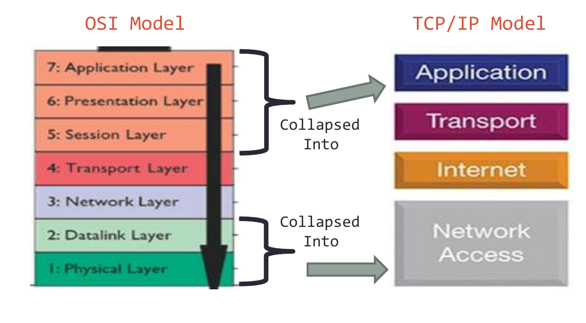

| TCP/IP layer | OSI layers it covers |
|---|---|
| **Application** | 7 Application + 6 Presentation + 5 Session |
| **Transport** | 4 Transport |
| **Internet** | 3 Network |
| **Network Access (Link)** | 2 Data Link + 1 Physical |

### Timeline

| When | What happened |
|---|---|
| **1970s** | TCP/IP developed by **DARPA** (Defense Advanced Research Projects Agency) for **ARPANET**, the precursor to the internet |
| **1983** | ARPANET switches to TCP/IP: the **"birth of the internet"** |
| **1984** | The OSI model is published by **ISO** as an international standard |
| **1990s–now** | **TCP/IP becomes dominant.** OSI is used as a general reference model. |

---

# 5. Data Packets

A **data packet** is a small, formatted unit of information broken off from a larger message so it can travel quickly and efficiently across a network. Files, emails, and videos are split into packets, sent across the internet, and **reassembled in order** at the destination.

### Structure of a packet

| Part | Contains |
|---|---|
| **Header** | Control and routing info: sender's IP, receiver's IP, **sequence number** (e.g., "3 of 10"), protocol type |
| **Payload** | The actual chunk of user data (text, part of an image, audio) |
| **Trailer (footer)** | **Error-checking codes** to confirm the data wasn't corrupted on the way |

### Packet switching

- **Independent travel:** packets don't always take the same path. Each can take a different route based on live traffic.
- **Reassembly:** sequence numbers let the receiver put them back in order, even if they arrive out of sequence.
- **Efficiency:** millions of users can **share network bandwidth** at the same time instead of tying up a dedicated line.

### Encapsulation: the journey down (sender)

As data leaves an application, **each layer wraps it with its own header** (and sometimes a trailer):

| Layer | What it does | Data is now called |
|---|---|---|
| **Application** | The app (browser, email client) creates the message, e.g., an HTTP request | Data |
| **Transport (TCP/UDP)** | Breaks data into chunks, adds **sequence numbers**, starts the **three-way handshake** (SYN, SYN-ACK, ACK), and manages flow control and error checking (checksums, retransmissions) | **Segment** |
| **Internet/Network (IP)** | Wraps the segment with an **IP header** (source and destination IP addresses) so routers can choose a path | **Packet** (IP datagram) |
| **Data Link** | Wraps the packet with **MAC addresses** and error-checking info (CRC trailer) | **Frame** |
| **Physical** | Converts the frame into **electrical, light, or radio signals** | **Bits** |

### In transit: routers

- **Routers** read the **IP header** (Network layer) to find the destination.
- For each **hop**, the router **strips and replaces the Data Link frame**, checks its **routing table**, and forwards the packet to the next node until it reaches the target network.

### Decapsulation: the journey up (receiver)

1. **Physical & Data Link:** remove frame headers and trailers, and verify checksums.
2. **Internet:** remove the IP header and pass the segment up.
3. **Transport (TCP):** check sequence numbers, **reassemble** out-of-order pieces, discard duplicates, **request missing pieces**, and send **ACKs** back.
4. **Application:** deliver the original data to the app.

---

# 6. TCP vs. UDP

The two main **Transport layer** protocols. They differ in how they balance **reliability vs. speed**.

### TCP (Transmission Control Protocol)

- **Connection-oriented:** guarantees **reliable, ordered, error-free** delivery
- Uses a **three-way handshake** (SYN → SYN-ACK → ACK) before sending data
- Tracks every packet with **sequence numbers** and requires **acknowledgments (ACKs)**
- **Automatically resends** lost or corrupted packets
- **Best for:** anything where missing data breaks the experience: web browsing (HTTP/HTTPS), email (SMTP), file downloads (FTP)

### UDP (User Datagram Protocol)

- **Connectionless:** prioritizes **speed and low latency** over guaranteed delivery
- **No handshake.** It sends datagrams immediately.
- Doesn't track packets, check for missing pieces, or resend lost data
- Much smaller header: **8 bytes** (vs. TCP's 20–60)
- **Best for:** real-time apps where a delay is worse than a tiny missing piece: live streaming, online gaming, VoIP and video calls (Zoom), DNS lookups

### Key differences

| Feature | TCP | UDP |
|---|---|---|
| **Type** | Connection-oriented | Connectionless |
| **Reliability** | Guarantees delivery | No guarantee ("fire-and-forget") |
| **Ordering** | Packets arrive in order | No ordering |
| **Speed** | Slower (checks and handshakes) | Faster (minimal overhead) |
| **Header size** | 20–60 bytes | Fixed 8 bytes |
| **Examples** | HTTP/HTTPS, FTP, SMTP, SSH | DNS, DHCP, VoIP, online gaming |

---

# 7. Network Hardware

### Hub (Layer 1)

The **simplest** device. Any packet that comes in one port is **sent out every other port**, and each computer decides whether the packet is for it. It's like a **mailing list**: everyone gets the mail.

- ❌ Lots of **wasted transmission**, so the network gets bogged down easily
- Used on **small networks** with little traffic
- **Active hub:** has its own power supply and cleans, boosts, and relays the signal. It works as a repeater and a wiring center, and can **extend the distance** between nodes.
- **Passive hub:** collects wiring and relays signals **without** cleaning or boosting them, so it **can't extend distance**.

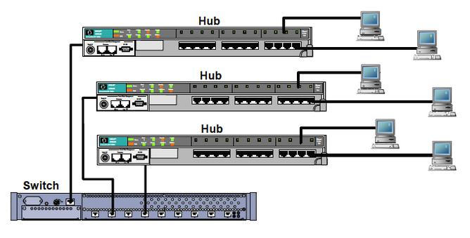

### Bridge (Layer 2)

One step up from a hub: it **checks the destination before sending**. If the destination isn't on the other side, it doesn't forward the data. A bridge has **one incoming and one outgoing port**.

- Email analogy: the bridge reads `bob@smith.com` and only passes the message on if Bob is on the other side.
- Used to **separate parts of a network** that rarely need to talk but still need to be connected.
- **Transparent bridges:** stations don't know the bridge exists, so adding or removing it needs no reconfiguration. It uses **bridge forwarding** and **bridge learning**.
- **Source routing bridges:** the **sending station** decides the route and puts it in the frame. The host finds routes by sending a **discovery frame** across all possible paths.

### Switch (Layer 2)

A step up from a bridge: **many ports**. The switch reads each frame's **MAC address** and sends it **only to the right computer**.

- Much more efficient, because packets don't go to computers that don't need them.
- **Most networks use switches, not hubs**, to connect computers in the same subnet.

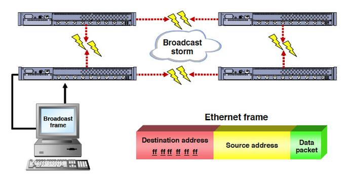

*A **broadcast storm**: a broadcast frame (destination MAC `ff:ff:ff:ff:ff:ff`, meaning "everyone") loops endlessly between switches that are connected in a circle, flooding the network.*

### Router (Layer 3)

Forwards packets by **IP address** instead of MAC address. Before forwarding, it checks the **destination IP**, which lets it connect **different networks**.

- **Common home use:** sharing a broadband internet connection. The router has a **public IP address** and shares it with the devices on the home network, forwarding incoming data to the right computer.
- Email analogy (a bit of a stretch): it's like receiving a message as an email and delivering it as a **fax**.

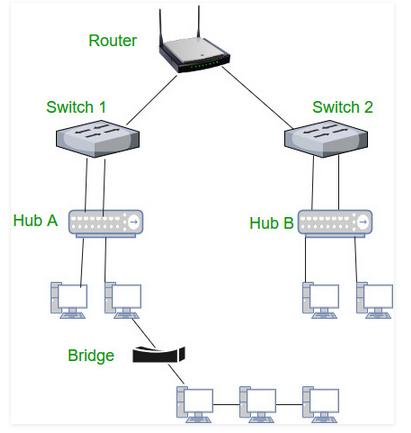

### Repeater (Layer 1)

**Regenerates the signal** before it becomes too weak or corrupted, which extends how far it can travel. It **doesn't amplify**: it copies the signal **bit by bit** and rebuilds it at full strength. It's a **2-port** device.

### Gateway (any layer)

Connects **two networks that may use different networking models**. It takes data from one system, **interprets** it, and transfers it to the other. Also called a **protocol converter**. More complex than a switch or router.

### Brouter (Layers 2 and 3)

A **bridging router** that combines a bridge and a router. It can **route packets across networks** like a router and **filter LAN traffic** like a bridge.

### Network hardware at a glance

| Device | OSI layer | Uses | What it does |
|---|:-:|---|---|
| **Repeater** | 1 | Signal | Regenerates a weak signal (2 ports) |
| **Hub** | 1 | Nothing (sends to all) | Copies every packet to every port |
| **Bridge** | 2 | MAC address | Filters traffic between two segments |
| **Switch** | 2 | MAC address | Sends each frame only to its destination port |
| **Router** | 3 | IP address | Connects different networks |
| **Brouter** | 2 & 3 | MAC & IP | Bridge + router |
| **Gateway** | Any | Any | Translates between different network types |

---

# 8. Ethernet Cables: Cat5e to Cat8

From [Cablify's cable comparison](https://www.cablify.ca/speeds-of-cat5e-cat6-cat6a-cat7-and-cat8-cables-compared/). These are **Physical layer** media.

| Category | Max speed | Bandwidth | Max distance at full speed | Shielding | Typical use |
|---|---|---|---|---|---|
| **Cat5e** | 1 Gbps | 100 MHz | 100 m | Usually unshielded | Repairs and extensions to older installs |
| **Cat6** | 10 Gbps | 250 MHz | **55 m** at 10 Gbps (100 m at 1 Gbps) | Usually unshielded | Small offices with short runs |
| **Cat6a** | 10 Gbps | 500 MHz | **100 m** | UTP or STP | **Recommended for new commercial cabling**, data centers, PoE++ |
| **Cat7** | 10 Gbps | 600 MHz | 100 m | S/FTP (each pair shielded + overall shield) | Specialist/industrial. **Not a TIA standard.** |
| **Cat8** | 25–40 Gbps | 2,000 MHz | **30 m** | S/FTP | Server-to-switch links in data centers |

**Key points:**
- **Bandwidth (MHz)** is the cable's signal frequency range. Higher MHz supports higher data rates.
- **Cat5e** is being phased out. It can't do 10 Gbps at practical lengths, and Cat6 costs barely more.
- **Cat6** drops to 55 m at 10 Gbps because of **alien crosstalk** (interference from neighboring cables).
- **Cat6a** holds 10 Gbps over the full **100 m** and supports **PoE++** (Power over Ethernet, up to 90 W). It costs about 10–20% more than Cat6 per drop.
- **Cat7** isn't recognized by the **TIA** (the North American standards body). Most Cat7 sold with RJ-45 connectors performs like Cat6a anyway.
- **Cat8** is only for short (≤30 m) data center links. It's too short and expensive for office runs.
- **Shielding:** **UTP** = unshielded twisted pair. **STP** = shielded twisted pair, for high-interference places (factories, hospitals with MRI machines).

**How to choose:**

| Situation | Choose |
|---|---|
| Small office, short runs (under ~45 m), no PoE++ | Cat6 |
| Commercial office, healthcare, warehouse, PoE++, 10+ year lifespan | **Cat6a** |
| Server rack connections under 30 m needing 25G/40G | Cat8 |
| New commercial work in North America | **Avoid Cat7** |

Not sure what's installed? The category is **printed on the cable jacket**.

---

# 9. IP Addresses and DNS

### IP address

An **IP address** identifies each computer that uses the **Internet Protocol** to communicate over a network.

**Example:** `208.115.107.132` is the IP address of **champlain.edu**.

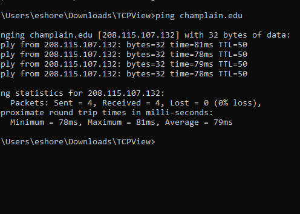

When you type a domain name, how does the browser know the IP address?

### What is DNS?

The **Domain Name System** is the **contacts list of the internet**.
- We don't remember everyone's phone number, and we don't want to memorize IP addresses like `192.168.1.1`.
- **DNS servers** match **names to IP addresses**.
- The DNS database is a **general-purpose, distributed, replicated database**: it's spread across many servers worldwide, with copies kept in many places.

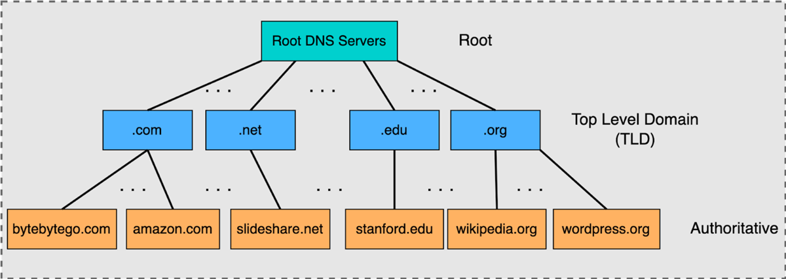

### Looking up a name, step by step

You type **eecs.berkeley.edu** into your browser:

| Step | Who | What happens |
|:-:|---|---|
| 1 | **Browser** | Checks its own **cache**. Not there? It asks the OS. |
| 2 | **Operating system** | Checks the **hosts file**. If the name is listed, it returns that IP. |
| 3 | **Local server / ISP** | Your provider often keeps a list of **common requests**. This improves performance and reduces their load (saving them money). |
| 4 | **Root name server** | *"Please tell me the IP of eecs.berkeley.edu."* "I don't know, but here's the server for the **.edu** zone." |
| 5 | **Top-level domain (.edu) server** | "I don't know either, but here's the server for the **berkeley.edu** zone: `adns1.berkeley.edu`." |
| 6 | **berkeley.edu name server** | "That's one of ours! The IP address of eecs.berkeley.edu is **`23.185.0.1`**." |

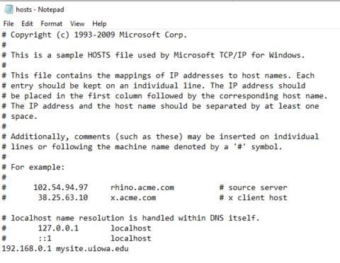 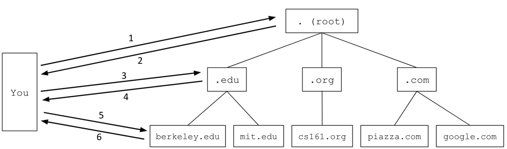

*Left: the Windows **hosts file** (`C:\Windows\System32\drivers\etc\hosts`). Right: the lookup path from root to .edu to berkeley.edu.*

### Root servers

There are **13 root name servers**, labeled **A through M** (`a.root-servers.net` to `m.root-servers.net`). These are 13 *logical* servers, but hundreds of physical copies run worldwide. The slides cite **2,048** root server instances as of October 2026.

| Letter | Operator | Letter | Operator |
|:-:|---|:-:|---|
| **A** | Verisign | **H** | US Army Research Lab |
| **B** | USC-ISI | **I** | Netnod (Sweden) |
| **C** | Cogent Communications | **J** | Verisign |
| **D** | University of Maryland | **K** | RIPE NCC (Netherlands) |
| **E** | NASA | **L** | ICANN |
| **F** | Internet Systems Consortium | **M** | WIDE Project (Japan) |
| **G** | US DoD | | |

---

# 10. Getting Your Own IP: Static vs. DHCP

DNS is how you find the IP address of **another** computer. But how do **you** get **your** IP address?

### Static IP address

- **Assigned by an admin** or **leased from a provider**
- Typically tied to hardware, like a **physical port** or **MAC address**
- **Servers and special hardware** usually get static IPs, so they're always at the same address.

### Dynamic IP address and DHCP

What if you move around? You're at home, then work, then school, on one network and then another. You need **a different IP address on each network**.

**DHCP (Dynamic Host Configuration Protocol)** **assigns IP addresses automatically** to devices that don't have a permanent one.

### DHCP leases

- A DHCP assignment is only valid for a set time, called the **lease time**.
- Clients must **renew** their IP address with the DHCP server to keep using it.
- This **prevents devices from tying up addresses** after they've left the network.

**How long should a lease last? It depends** on how often clients join and leave:

| Network type | Typical lease |
|---|---|
| **Highly static** (same devices every day, like an office) | **Days** |
| **Dynamic** (devices coming and going, like a coffee shop or guest Wi-Fi) | **Minutes** |

> **Try it:** On Windows, run `ipconfig /all` in Command Prompt to see your IP address, your DHCP server, and when your lease was obtained and expires.

---

*Sources: SYS-140 "Network Communications" and "Data & Networks" slides · "Network Hardware" reading ([nutt.net](http://www.nutt.net/2004/11/20/difference-in-hub-switch-bridge-router/), [GeeksforGeeks](https://www.geeksforgeeks.org/network-devices-hub-repeater-bridge-switch-router-gateways/), [TU Berlin](https://www.net.t-labs.tu-berlin.de/teaching/computer_networking/05.06.htm)) · "Data Packets" reading · [Cablify](https://www.cablify.ca/speeds-of-cat5e-cat6-cat6a-cat7-and-cat8-cables-compared/)*
